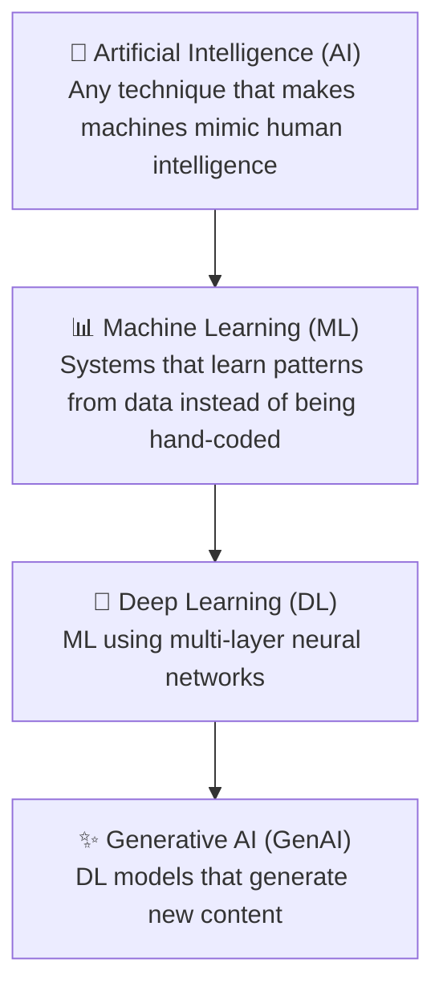
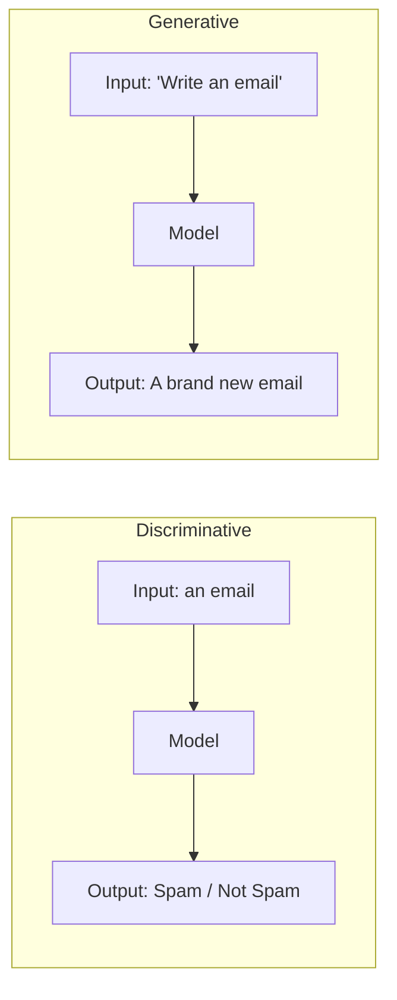
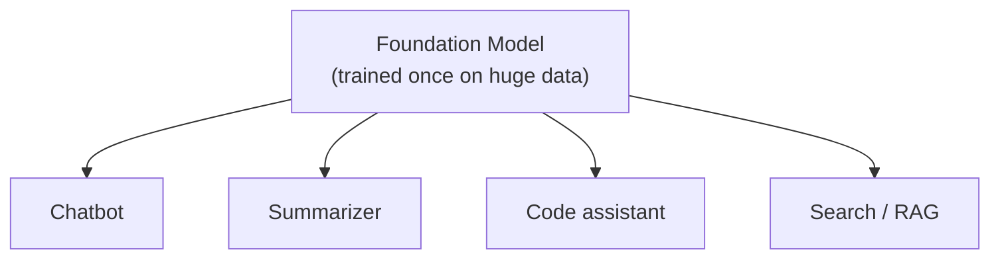
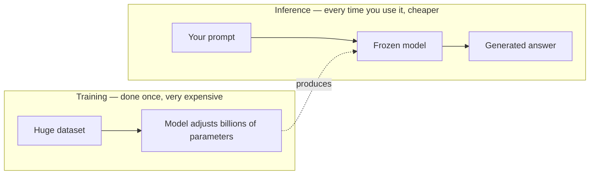
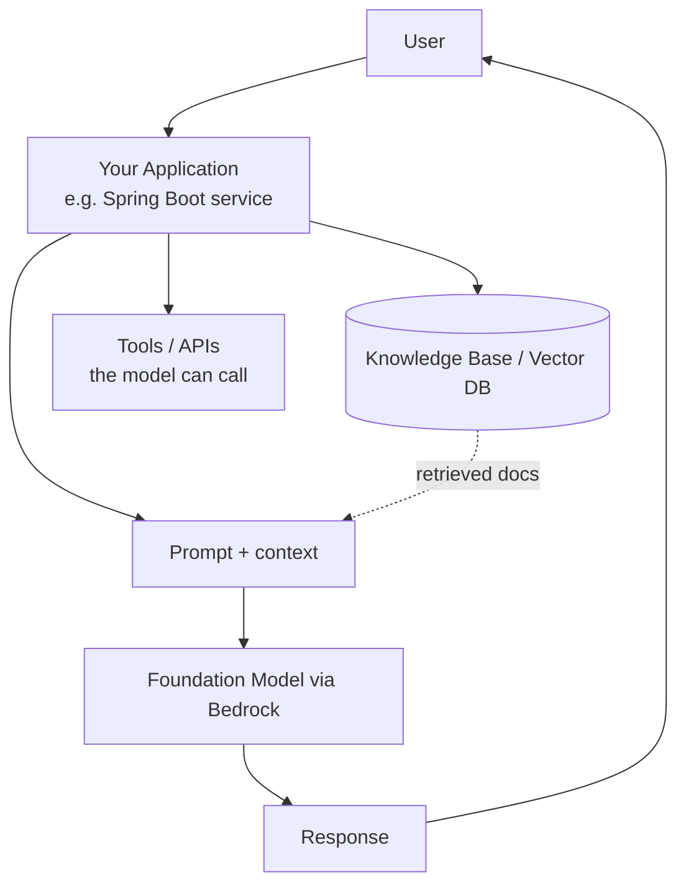

# 1. AI & GenAI Fundamentals

> **In one sentence:** Generative AI is a type of machine learning that *creates* new content (text, images, code) by learning patterns from massive amounts of data, instead of just classifying or predicting a label.

**Interview goal:** Be able to explain the GenAI landscape and architecture in 5–10 minutes.

---

## 1.1 The big picture: AI vs ML vs DL vs GenAI

These terms are often used interchangeably, but they are nested inside each other like Russian dolls.

| Term | What it means | Everyday example |
|------|---------------|------------------|
| **AI** | The broad goal: machines doing "smart" things | A chess program, a thermostat that learns |
| **ML** | Machines learn rules **from data** rather than being explicitly programmed | Spam filter, Netflix recommendations |
| **DL** | ML using **deep neural networks** (many layers) | Face recognition, speech-to-text |
| **GenAI** | DL that **produces** new text, images, audio, or code | ChatGPT, Midjourney, GitHub Copilot |

**Key mental model:**
- Traditional ML mostly answers *"Which category is this?"* or *"What number comes next?"* (discriminative).
- GenAI answers *"Create something new that fits this pattern."* (generative).

---

## 1.2 Discriminative vs Generative models

- **Discriminative** — learns the *boundary* between classes. Example: is this a cat or a dog?
- **Generative** — learns the *distribution* of the data so it can produce new samples. Example: draw a new cat that has never existed.

---

## 1.3 What is a Large Language Model (LLM)?

An **LLM** is a generative model trained on huge amounts of text to predict the next word (token) in a sequence. By doing this billions of times, it learns grammar, facts, reasoning patterns, and style.

- **"Large"** = billions of parameters (the internal numbers it learns) + huge training data.
- **"Language Model"** = its core job is to predict likely text.

> Everything an LLM does — answering questions, writing code, summarizing — is built on top of one simple skill: **predict the next token.**

Examples: GPT-4, Claude, Llama, Amazon Nova, Titan.

---

## 1.4 Foundation Models

A **foundation model** is a large model trained on broad data that can be *adapted* to many downstream tasks. It's the "base" you build on.

- Trained once (very expensive), reused many times (cheap).
- Can be **text**, **image**, **multimodal** (text + image + audio), etc.
- On AWS, foundation models are served through **Amazon Bedrock**.

**Why they matter:** Instead of training your own model from scratch (millions of dollars), you take a foundation model and adapt it with prompts, retrieval (RAG), or fine-tuning.

---

## 1.5 Training vs Inference

This is one of the most important distinctions to get right.

| | **Training** | **Inference** |
|---|---|---|
| **What** | Teaching the model by adjusting its parameters | Using the trained model to answer |
| **When** | Once (or occasionally, to fine-tune) | Every single request |
| **Cost** | Extremely high (GPUs, weeks/months) | Per-request (what you pay Bedrock/OpenAI) |
| **Analogy** | Studying for years to become a doctor | The doctor seeing a patient |

**Fine-tuning** is a lighter form of extra training on your own data to specialize a foundation model. It sits between "full training" and "just prompting."

**Ways to adapt a foundation model (cheapest → most expensive):**
1. **Prompt engineering** — just change the wording.
2. **RAG** — feed the model relevant documents at query time.
3. **Fine-tuning** — retrain on your data.
4. **Full pretraining** — build a model from scratch (almost never done by companies).

---

## 1.6 The modern GenAI application stack

This diagram is the "skeleton" behind almost every topic in these notes — RAG adds the knowledge base, agents add the tools, security wraps around it all.

---

## 1.7 Common terms cheat sheet

| Term | Meaning |
|------|---------|
| **Parameter** | An internal learned number; more parameters ≈ more capacity |
| **Token** | A chunk of text (~¾ of a word) the model reads/writes |
| **Prompt** | The input text you send to the model |
| **Hallucination** | When the model confidently makes up wrong information |
| **Context window** | How much text the model can "see" at once |
| **Multimodal** | Handles more than one data type (text + images + audio) |

---

## Practical / Interview Goal

✅ **Explain the GenAI architecture in 5–10 minutes.** Practice this out loud:
1. AI ⊃ ML ⊃ DL ⊃ GenAI.
2. LLMs predict the next token; scaled up, that becomes reasoning + writing.
3. Foundation models are trained once and adapted many ways.
4. Training (once, costly) vs inference (per request).
5. Real apps = model + prompt + retrieved knowledge + tools.

---

## Resources

- Course: *AI A-Z 2026* (Udemy) — foundations section.
- [What is Generative AI? — AWS](https://aws.amazon.com/what-is/generative-ai/) *(content rephrased from official AWS overview for compliance)*
- Next: [02 — LLM Fundamentals](02-llm-fundamentals.md)
