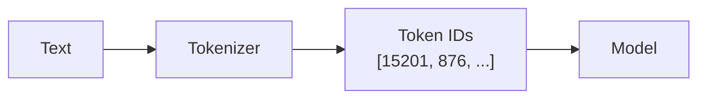
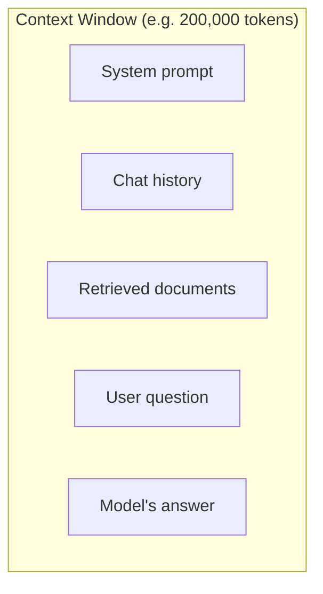
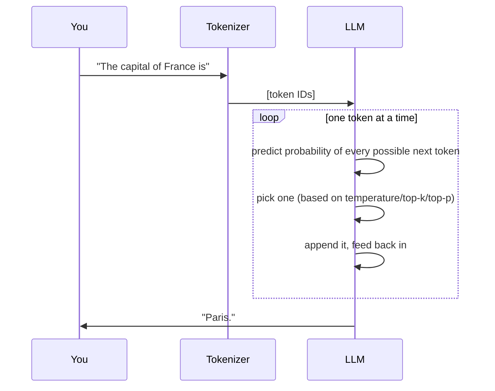
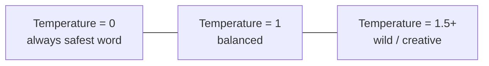
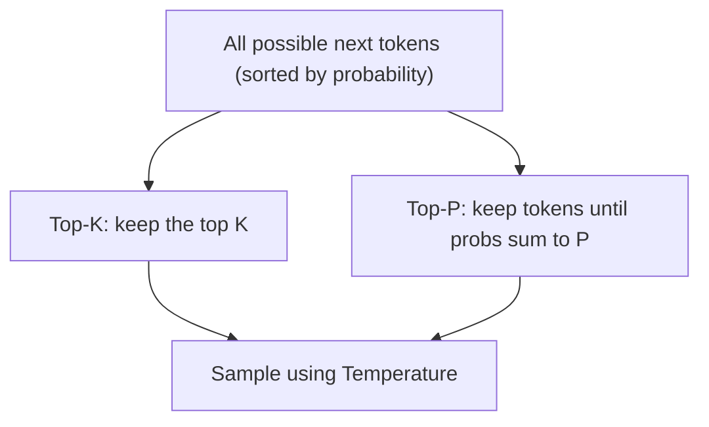

# 2. LLM Fundamentals

> **In one sentence:** An LLM turns your text into numbers (tokens), predicts the most likely next token over and over, and turns those tokens back into text — and several "knobs" control how it makes those choices.

**Interview goal:** Explain what happens, step by step, when a prompt reaches an LLM.

---

## 2.1 Tokens

Models don't read words or letters — they read **tokens**. A token is a common chunk of text. Roughly: **1 token ≈ 4 characters ≈ ¾ of a word** in English.

```
"Generative AI is powerful"
→ ["Gener", "ative", " AI", " is", " powerful"]
→ [15201, 876, 8213, 374, 8147]   (each token maps to a number)
```

Why it matters:
- **Cost** is charged per token (input + output).
- **Limits** (context window) are measured in tokens, not words.
- Weird spellings, code, and other languages can use more tokens.



---

## 2.2 Context window

The **context window** is the maximum number of tokens the model can consider at once — this includes **your prompt + retrieved documents + conversation history + the model's answer**.



- If you exceed it, older content gets **truncated** (forgotten).
- Bigger windows = more context, but **higher cost and latency**.
- This is *why* RAG exists: you can't fit a whole company's documents in the window, so you retrieve only the relevant chunks.

---

## 2.3 Parameters

**Parameters** are the internal numbers (weights) the model learned during training. Think of them as the "knowledge storage."

- More parameters ≈ more capacity to learn patterns (e.g., 8B, 70B, 400B).
- Bigger isn't always better — a well-trained smaller model can beat a poorly-trained larger one, and small models are cheaper/faster.
- **Do not confuse parameters (fixed after training) with inference settings (temperature, etc., which you change per request).**

---

## 2.4 Inference — what happens when a prompt arrives

Inference is the model **generating** a response. It happens one token at a time (autoregressive).



Step by step:
1. **Tokenize** your prompt into token IDs.
2. The model computes a **probability for every possible next token** (a huge list).
3. A **sampling strategy** picks one token (controlled by the knobs below).
4. That token is appended and fed back in.
5. Repeat until a stop signal or max length is reached.
6. **Detokenize** back into readable text.

---

## 2.5 The generation "knobs" (inference parameters)

These control *how the next token is chosen* from the probability list. They don't change the model's knowledge — only its behavior.

### Temperature 🌡️
Controls **randomness / creativity**.

- **Low (0–0.3):** picks the most likely tokens → focused, deterministic, repeatable. Good for facts, code, extraction.
- **High (0.8–1.5):** flattens the probabilities → more variety and creativity, but more risk of nonsense.



### Top-K
Only consider the **K most likely** tokens, ignore the rest, then sample.
- `Top-K = 1` → always the single best token (greedy).
- `Top-K = 50` → sample among the 50 best.

### Top-P (nucleus sampling)
Consider the smallest set of tokens whose probabilities **add up to P** (e.g., 0.9), then sample from them.
- Adapts automatically: if the model is very confident, few tokens qualify; if unsure, more do.



### Practical defaults
| Goal | Temperature | Top-P |
|------|-------------|-------|
| Factual answers, extraction, code | 0.0 – 0.2 | 0.9 |
| Balanced assistant | 0.5 – 0.7 | 0.9 |
| Brainstorming, creative writing | 0.9 – 1.2 | 0.95 |

> **Tip:** Usually tune **temperature OR top-p**, not both aggressively at once.

### Other common settings
- **max_tokens** — cap on how long the answer can be.
- **stop sequences** — strings that force the model to stop (e.g., `"\n\n"`).
- **frequency / presence penalty** — discourage repetition.

---

## 2.6 Determinism & hallucination

- Because generation involves sampling, the **same prompt can give different answers** — set temperature to 0 for (near) repeatable output.
- **Hallucination** = the model produces fluent but false information. It's predicting *plausible* text, not *true* text. Mitigations: RAG (ground it in real docs), lower temperature, ask it to cite sources, guardrails.

---

## Practical / Interview Goal

✅ **Explain what happens when a prompt reaches an LLM.** A clean 60-second answer:
> "The prompt is tokenized into IDs. The model runs a forward pass and outputs a probability distribution over the next token. A sampling strategy — shaped by temperature, top-k, and top-p — selects one token. That token is appended and fed back, and the loop repeats until a stop condition. All of this must fit inside the context window, which is why we retrieve only relevant context via RAG."

---

## Resources

- Course: *AI A-Z 2026* (Udemy).
- [Amazon Bedrock inference parameters](https://docs.aws.amazon.com/bedrock/latest/userguide/inference-parameters.html) *(rephrased for compliance)*
- Try it: [OpenAI Tokenizer](https://platform.openai.com/tokenizer) to see tokens live.
- Next: [03 — Transformers](03-transformers.md)
