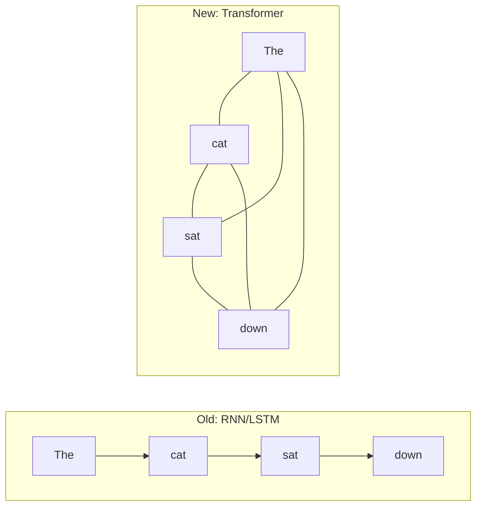
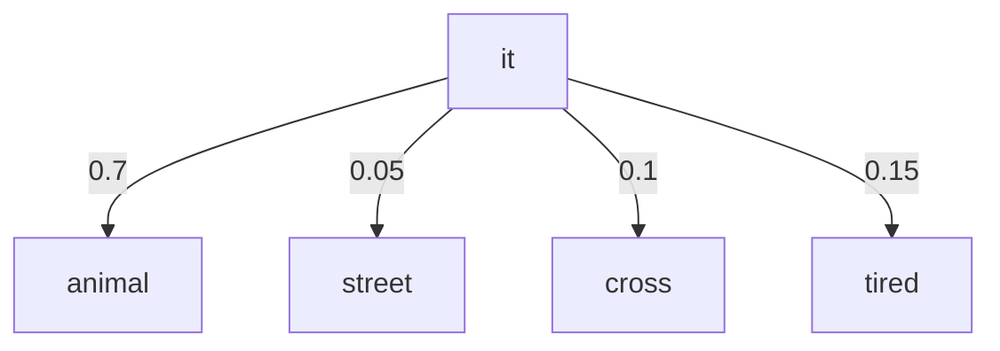
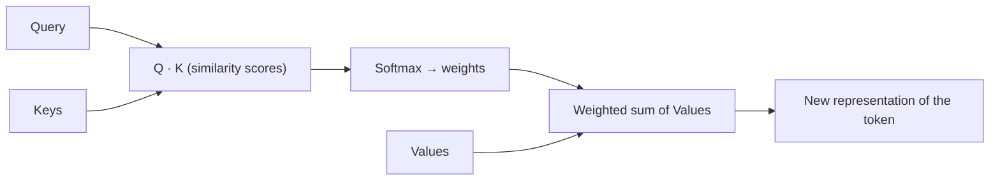
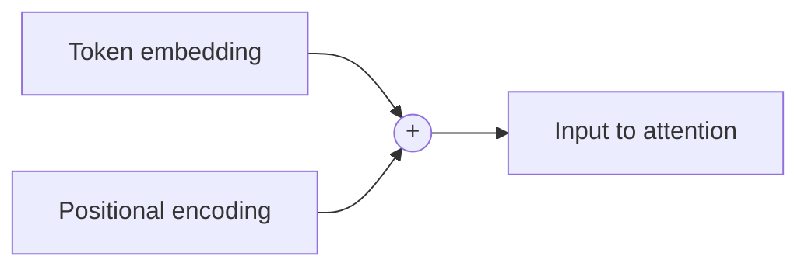
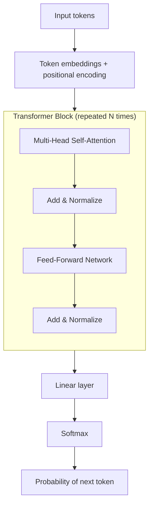

# 3. Transformers

> **In one sentence:** The Transformer is the neural network architecture behind every modern LLM; its superpower is **attention** — the ability to look at all words in a sentence at once and decide which ones matter to each other.

**Interview goal:** Draw the Transformer at a high level and explain why it works so well for LLMs.

---

## 3.1 Why Transformers replaced older models

Before Transformers (2017, the paper *"Attention Is All You Need"*), language models used **RNNs/LSTMs** that read text **one word at a time, left to right**.

Problems with that:
- **Slow** — can't process words in parallel.
- **Forgetful** — struggled to connect words far apart ("The *cat*, which we adopted last year, *was* hungry").

Transformers fixed both:
- Process **all tokens in parallel** (fast on GPUs).
- Use **attention** to directly connect any two tokens, no matter how far apart.

*The Transformer connects every token to every other token directly.*

---

## 3.2 Attention — the core idea

**Attention answers:** "For this word, how much should I focus on each other word to understand its meaning?"

Example: *"The animal didn't cross the street because **it** was too tired."*
What does "it" refer to? Attention lets the model weight "animal" heavily and "street" lightly.

The numbers are **attention weights** — how much each word contributes to understanding "it."

---

## 3.3 Self-attention & Q, K, V

**Self-attention** = attention applied *within the same sequence* (every word attends to every other word in the same input).

It works using three vectors created for each token:

| Vector | Role | Analogy (a library search) |
|--------|------|----------------------------|
| **Query (Q)** | What am I looking for? | Your search request |
| **Key (K)** | What do I contain? | The label on each book |
| **Value (V)** | The actual content | The book's contents |

The model compares each **Query** against all **Keys** to get scores, turns scores into weights (via softmax), then takes a weighted sum of the **Values**.

**Multi-head attention:** the model does this many times in parallel ("heads"), each learning a different kind of relationship (grammar, meaning, references). Results are combined.

---

## 3.4 Positional encoding

Because Transformers look at all tokens at once, they lose the natural sense of **order**. "Dog bites man" ≠ "Man bites dog."

**Positional encoding** adds information about each token's position, so the model knows the order.

---

## 3.5 Full Transformer architecture (high level)

The original Transformer has an **encoder** (understands input) and a **decoder** (generates output). Most modern LLMs (GPT, Claude, Llama) are **decoder-only**.

Components inside each block:
1. **Multi-head self-attention** — mix information between tokens.
2. **Add & Normalize (residual connection + layer norm)** — keeps training stable.
3. **Feed-forward network** — processes each token individually.
4. Stacked **N times** (e.g., 32, 80+ layers).

---

## 3.6 Encoder vs Decoder vs Encoder-Decoder

| Type | Reads | Used for | Examples |
|------|-------|----------|----------|
| **Encoder-only** | Whole input at once (bidirectional) | Understanding, embeddings, classification | BERT |
| **Decoder-only** | Left-to-right, generates text | Chat, completion, most LLMs | GPT, Claude, Llama |
| **Encoder-Decoder** | Encode input, decode output | Translation, summarization | T5, original Transformer |

**Causal masking:** decoder-only models are prevented from "peeking" at future tokens during training — they can only attend to tokens *before* the current one. That's what makes next-token prediction work.

---

## 3.7 Why Transformers work so well for LLMs

1. **Parallelism** — trains fast on GPUs, so we can use huge datasets.
2. **Long-range understanding** — attention links distant words directly.
3. **Scalability** — performance keeps improving as you add data + parameters (the "scaling laws").
4. **Transfer** — one pretrained Transformer adapts to many tasks.

---

## Practical / Interview Goal

✅ **Draw the Transformer at a high level.** Minimum viable drawing:
> Tokens → embeddings + positional encoding → [ multi-head self-attention → add & norm → feed-forward → add & norm ] × N → linear → softmax → next token.
>
> Then explain attention with the Q/K/V library analogy and the "it → animal" example.

---

## Resources

- Paper: *Attention Is All You Need* (Vaswani et al., 2017).
- [The Illustrated Transformer — Jay Alammar](https://jalammar.github.io/illustrated-transformer/) *(concepts rephrased for compliance)*
- Next: [04 — Prompt Engineering](04-prompt-engineering.md)
