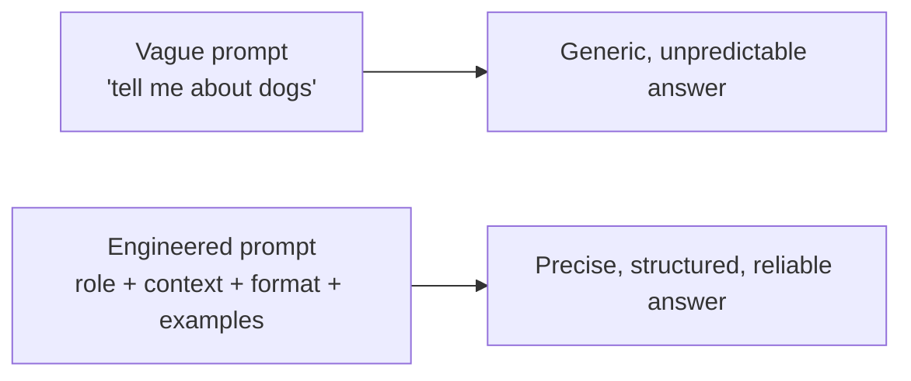
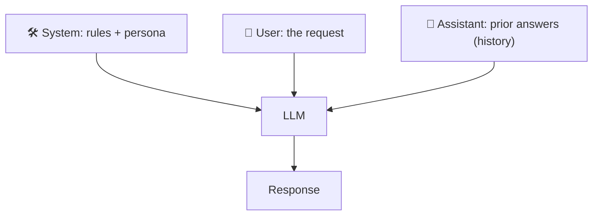
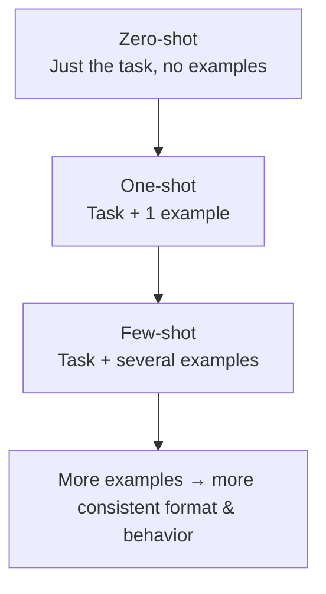
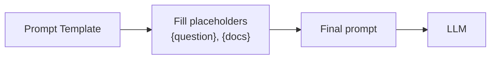

# 4. Prompt Engineering

> **In one sentence:** Prompt engineering is the craft of writing inputs that reliably get the output you want from an LLM — by giving it the right role, context, examples, and format instructions.

**Interview goal:** Design production-quality prompts.

---

## 4.1 Why prompts matter

The model has no idea what you *actually* want unless you tell it clearly. Small wording changes can dramatically change output quality. A good prompt reduces hallucination, enforces format, and saves cost (fewer retries).



---

## 4.2 The message roles: System / User / Assistant

Modern chat models take a list of messages with **roles**:

| Role | Purpose | Example |
|------|---------|---------|
| **System** | Sets behavior, persona, rules. Highest-level instructions. | "You are a senior AWS architect. Answer concisely. Never invent APIs." |
| **User** | The actual request / question. | "How do I set up a Bedrock Knowledge Base?" |
| **Assistant** | The model's previous replies (used for conversation history / examples). | "To set up a Knowledge Base, first..." |



> **Rule of thumb:** Put stable rules in the **system** prompt, the specific ask in the **user** prompt.

---

## 4.3 Context

**Context** = extra information you inject so the model can answer accurately: documents, data, user profile, or conversation history.

- This is the bridge to **RAG** — retrieved documents are added as context.
- Everything counts against the **context window** (see [LLM Fundamentals](02-llm-fundamentals.md)).
- Order matters: models pay most attention to the **start and end** of the context ("lost in the middle" effect). Put the key instruction and question near the end.

---

## 4.4 Zero-shot, one-shot, and few-shot prompting

**"Shots" = examples you give in the prompt.**



**Few-shot example (classification):**
```
Classify the sentiment as Positive, Negative, or Neutral.

Review: "The battery lasts all day." → Positive
Review: "It stopped working after a week." → Negative
Review: "It's okay, nothing special." → Neutral

Review: "Best purchase I've made this year!" →
```
The examples teach the model the exact labels and output shape.

---

## 4.5 Structured output

Force the model to answer in a machine-readable format (JSON, XML, table) so your code can parse it.

```
Return ONLY valid JSON in this exact schema, no extra text:
{
  "sentiment": "Positive | Negative | Neutral",
  "confidence": 0.0-1.0,
  "keywords": ["..."]
}
```

Tips for reliable structured output:
- Give the **exact schema** and say "ONLY JSON, no prose."
- Provide a **filled example**.
- Use **low temperature** (0–0.2).
- Many providers offer a native **"JSON mode" / tool schema** — prefer it when available.

---

## 4.6 Prompt templates

A **template** is a reusable prompt with placeholders you fill at runtime. This is how prompts work in real applications.

```
SYSTEM:
You are a support assistant for {product_name}. Be concise and cite sources.

USER:
Context:
{retrieved_documents}

Question:
{user_question}

Answer using ONLY the context above. If the answer isn't there, say "I don't know."
```



Benefits: consistency, versioning, easy A/B testing, and separation of logic from wording.

---

## 4.7 Prompting techniques that boost quality

| Technique | What it does | Example phrase |
|-----------|--------------|----------------|
| **Role / persona** | Sets expertise & tone | "You are an expert Java developer." |
| **Chain-of-thought** | Ask it to reason step by step | "Think step by step before answering." |
| **Delimiters** | Separate instructions from data | Wrap docs in triple backticks or `<context>` tags |
| **Constraints** | Bound the output | "Answer in under 100 words." |
| **Grounding** | Force use of provided context | "Use ONLY the context. If missing, say you don't know." |
| **Guardrails** | Prevent unwanted behavior | "Do not give medical advice." |

> **Security note:** Untrusted text (user input, documents) can contain **prompt injection** — instructions that hijack your prompt. Keep data clearly separated from instructions and never blindly trust it. See [14 — AI Security](14-ai-security.md).

---

## 4.8 Inference parameters recap (used with prompts)

Prompt engineering and inference parameters work together:
- **Temperature / Top-P / Top-K** — see [LLM Fundamentals](02-llm-fundamentals.md).
- For structured/factual output: low temperature.
- For creative output: higher temperature + open-ended prompt.

---

## 4.9 A production-quality prompt checklist

- [ ] Clear **role** in the system prompt.
- [ ] Explicit **task** and **success criteria**.
- [ ] **Context** provided and clearly delimited.
- [ ] **Output format** specified (ideally with an example).
- [ ] **Fallback** behavior ("if you don't know, say so").
- [ ] **Guardrails** against unsafe/off-topic answers.
- [ ] Appropriate **temperature**.
- [ ] Stored as a **versioned template**, not hardcoded strings scattered around.

---

## Practical / Interview Goal

✅ **Design a production-quality prompt.** Walk through: system role → deliver context with delimiters → give the task → specify JSON output with an example → add a "say I don't know" fallback → set temperature 0 → store as a versioned template.

---

## Resources

- Course: *AI A-Z 2026* (Udemy).
- [Anthropic prompt engineering guide](https://docs.anthropic.com/en/docs/build-with-claude/prompt-engineering/overview) *(rephrased for compliance)*
- Next: [05 — Embeddings](05-embeddings.md)
