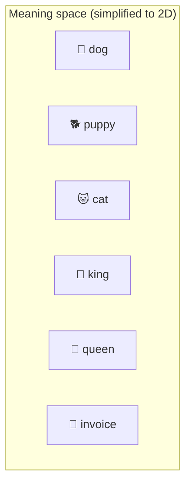
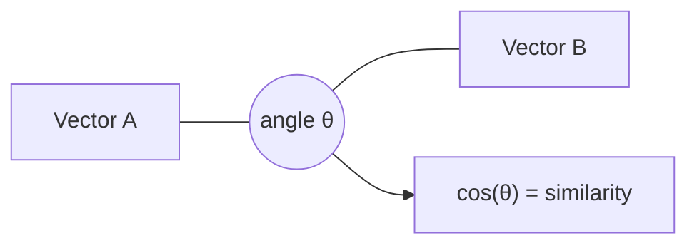
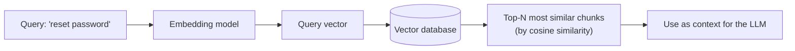
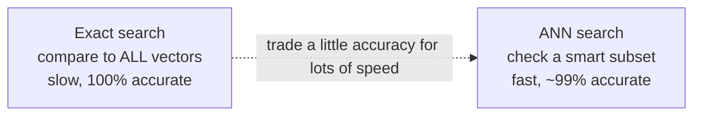

# 5. Embeddings

> **In one sentence:** An embedding turns a piece of text (or image) into a list of numbers (a vector) so that things with **similar meaning** end up **close together** in space — which is how machines can "search by meaning."

**Interview goal:** Explain how text becomes searchable by meaning.

---

## 5.1 What is an embedding?

An **embedding** is a vector — a fixed-length list of numbers — that represents the *meaning* of some content.

```
"dog"    → [0.21, -0.88, 0.05, ..., 0.42]   (e.g. 1536 numbers)
"puppy"  → [0.19, -0.85, 0.09, ..., 0.40]   (very close to "dog")
"invoice"→ [-0.71, 0.33, -0.20, ..., 0.66]  (far away)
```

An **embedding model** (e.g., Amazon Titan Embeddings, Cohere Embed) is trained so that similar meanings produce similar vectors.

Key point: computers can't compare *meaning* directly, but they *can* compare numbers. Embeddings convert meaning → numbers.

---

## 5.2 Vector space intuition

Imagine every piece of text as a point in a high-dimensional space. Related concepts cluster together.



- **dog, puppy, cat** cluster (animals/pets).
- **king, queen** cluster (royalty).
- **invoice** is far from all of them.

Famous example: `king - man + woman ≈ queen`. Embeddings capture relationships, not just similarity.

> Real embeddings have hundreds or thousands of dimensions — we just draw 2D for intuition.

---

## 5.3 Semantic similarity

**Semantic similarity** = how close in *meaning* two texts are, measured by how close their vectors are.

- "How do I reset my password?" and "I forgot my login credentials" have **different words** but **similar meaning** → their vectors are close.
- Traditional keyword search would miss this; embedding search catches it.

---

## 5.4 Cosine similarity

The most common way to measure closeness between two vectors is **cosine similarity** — the cosine of the angle between them.



| Cosine value | Angle | Meaning |
|--------------|-------|---------|
| **1.0** | 0° | Identical direction (very similar) |
| **0.0** | 90° | Unrelated |
| **-1.0** | 180° | Opposite meaning |

- It measures **direction**, not length — so it's robust to differences in text length.
- Other metrics: **dot product** and **Euclidean distance**, but cosine is the go-to for text.

---

## 5.5 Vector search

**Vector search** = find the stored vectors closest to a query vector.



Steps:
1. **Offline:** embed all your documents and store the vectors in a **vector database**.
2. **At query time:** embed the user's question into a vector.
3. Find the **nearest** stored vectors.
4. Return the matching text chunks.

This is the retrieval engine behind **RAG** ([06 — RAG Fundamentals](06-rag-fundamentals.md)).

---

## 5.6 Vector databases

Specialized databases built to store vectors and search them fast.

| Option | Notes |
|--------|-------|
| **Amazon OpenSearch (k-NN)** | Common Bedrock Knowledge Base backend |
| **Amazon Aurora / RDS PostgreSQL + pgvector** | SQL DB with vector support |
| **Pinecone, Weaviate, Milvus, Qdrant, Chroma** | Purpose-built vector DBs |
| **FAISS** | Library for local/in-memory search |

They store: `vector + original text + metadata` (source, date, tenant, tags).

---

## 5.7 ANN — Approximate Nearest Neighbor

If you have 10 million vectors, comparing the query to **every** one (exact search) is too slow. **ANN** algorithms find *almost* the closest vectors much faster by being smart about which ones to check.



- **Trade-off:** tiny accuracy loss for a huge speed gain — essential at scale.
- Common algorithms: **HNSW** (graph-based, very popular), **IVF**, **PQ** (compression).
- Tunable: higher accuracy = slower/more memory, and vice versa.

---

## 5.8 Chunking (preview)

You don't embed a whole 100-page document as one vector — you split it into **chunks** (e.g., paragraphs) and embed each. This keeps each vector focused and makes retrieval precise. Chunking strategy is a big topic in [07 — Advanced RAG](07-advanced-rag.md).

---

## Practical / Interview Goal

✅ **Explain how text becomes searchable by meaning.** Clean answer:
> "An embedding model converts each text chunk into a vector where similar meanings sit close together. We store those vectors in a vector database. At query time we embed the question, then use cosine similarity (via an ANN index like HNSW) to find the nearest chunks. That returns semantically relevant results even when the words don't match — which keyword search can't do."

---

## Resources

- Course: *AI A-Z 2026* (Udemy).
- [Amazon Titan Text Embeddings](https://docs.aws.amazon.com/bedrock/latest/userguide/titan-embedding-models.html) *(rephrased for compliance)*
- Next: [06 — RAG Fundamentals](06-rag-fundamentals.md)
