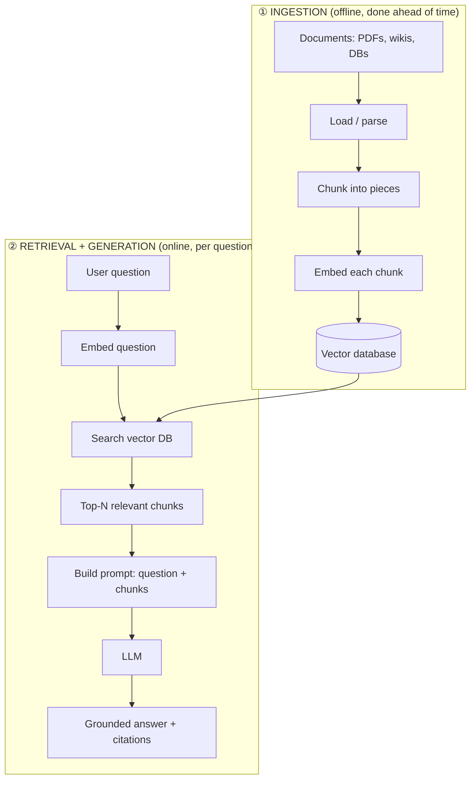
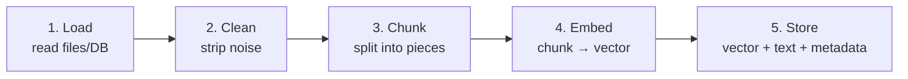
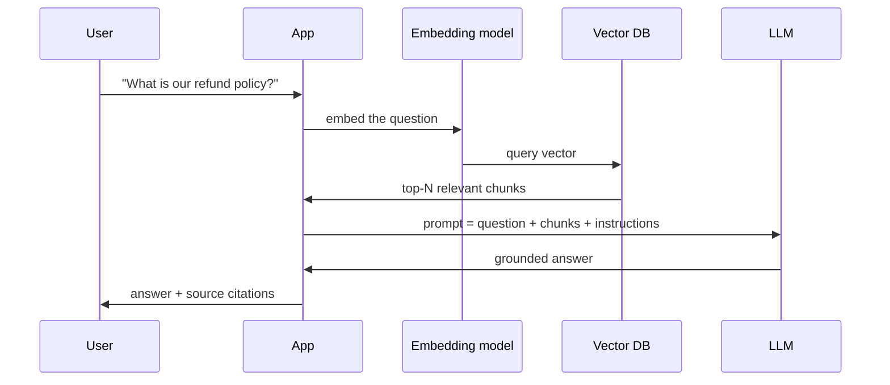
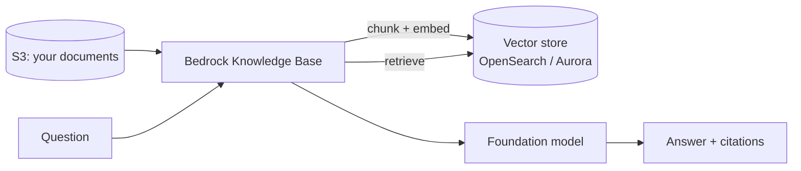

# 6. RAG Fundamentals ⭐

> **In one sentence:** RAG (Retrieval-Augmented Generation) makes an LLM answer using **your** documents by *retrieving* the most relevant chunks and *feeding* them into the prompt — so the model stays accurate, current, and grounded.

**Interview goal:** Draw the complete RAG architecture.

---

## 6.1 Why RAG exists

LLMs have three big limitations RAG solves:

| Problem | Without RAG | With RAG |
|---------|-------------|----------|
| **Knowledge cutoff** | Doesn't know recent/private data | Retrieves fresh, private docs |
| **Hallucination** | Makes up plausible answers | Grounds answers in real text |
| **No sources** | Can't prove where info came from | Can cite retrieved chunks |
| **Context limits** | Can't fit all your docs in the prompt | Retrieves only what's relevant |

> RAG = "open-book exam" for the LLM. Instead of relying on memory, it looks up the answer in your documents first.

**RAG vs Fine-tuning:**
- **RAG** injects knowledge at *query time* → great for facts that change, cited answers, large corpora.
- **Fine-tuning** bakes behavior/style into the model → great for tone, format, narrow tasks. They can be combined.

---

## 6.2 The two phases of RAG

RAG has an **offline** phase (prepare your data) and an **online** phase (answer questions).



---

## 6.3 Phase 1 — Ingestion (the pipeline)

This is how raw documents become searchable vectors.



### Step 1 — Load / ingest
Read the source content: PDFs, Word docs, HTML, Confluence, S3, databases, etc.

### Step 2 — Clean
Remove headers/footers, boilerplate, broken characters. Garbage in → garbage retrieved.

### Step 3 — Chunk
Split documents into smaller pieces (e.g., 300–800 tokens each) because:
- A whole document is too big and dilutes relevance.
- Retrieval should return the *specific* relevant passage.

Basic chunking: fixed size + **overlap** (e.g., 512 tokens with 50-token overlap so sentences aren't cut awkwardly). More strategies in [Advanced RAG](07-advanced-rag.md).

### Step 4 — Embed
Run each chunk through an embedding model → a vector. (See [05 — Embeddings](05-embeddings.md).)

### Step 5 — Store
Save `vector + original text + metadata` in a vector database. Metadata (source, date, author, tenant) enables filtering later.

---

## 6.4 Phase 2 — Retrieval + Generation



### Retrieval
Embed the question, search the vector DB, return the **top-N** most similar chunks (N is often 3–10).

### Augmentation
Insert those chunks into the prompt as context, with instructions like:
> "Answer using ONLY the context below. If the answer isn't there, say you don't know. Cite the source."

### Generation
The LLM writes an answer grounded in the retrieved text — and can include citations.

---

## 6.5 A minimal RAG prompt template

```
SYSTEM: You are a helpful assistant. Answer using ONLY the provided context.
If the answer is not in the context, reply "I don't know based on the available documents."
Always cite the source of each fact.

CONTEXT:
{retrieved_chunks_with_sources}

QUESTION:
{user_question}
```

---

## 6.6 RAG on AWS Bedrock (Knowledge Bases)

**Amazon Bedrock Knowledge Bases** is a managed RAG service — it handles ingestion, chunking, embedding, storage, and retrieval for you.



You mainly configure: data source (S3), embedding model, chunking strategy, and vector store. Bedrock offers a `RetrieveAndGenerate` API that does retrieval + generation in one call, or `Retrieve` if you want to build the prompt yourself.

---

## 6.7 Common beginner mistakes

- **Chunks too big or too small** → poor retrieval. Test different sizes.
- **No overlap** → answers split across chunk boundaries get lost.
- **Retrieving too many chunks** → noise, higher cost, "lost in the middle."
- **Not citing sources** → users can't verify, and you can't debug.
- **Forgetting metadata** → can't filter by date/tenant/permissions later.

---

## Practical / Interview Goal

✅ **Draw the complete RAG architecture.** Include both phases:
> Ingestion: documents → load → clean → chunk → embed → store in vector DB.
> Query: question → embed → search vector DB → top-N chunks → build prompt → LLM → grounded answer + citations.
> Mention Bedrock Knowledge Bases as the managed version.

---

## Resources

- [Amazon Bedrock Knowledge Bases](https://docs.aws.amazon.com/bedrock/latest/userguide/knowledge-base.html) *(rephrased for compliance)*
- Course: *AI A-Z 2026* (Udemy).
- Next: [07 — Advanced RAG](07-advanced-rag.md)
