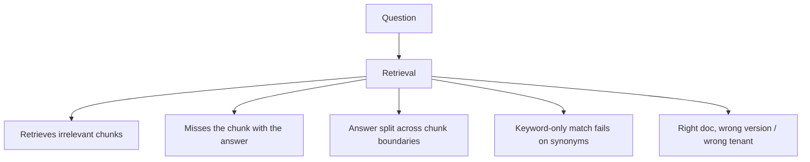
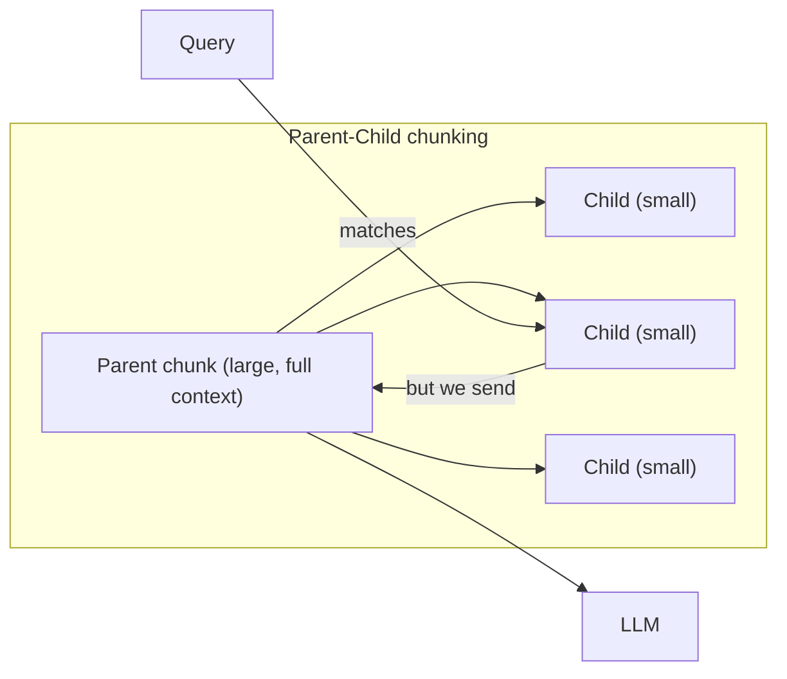
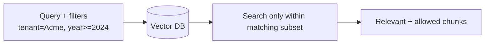
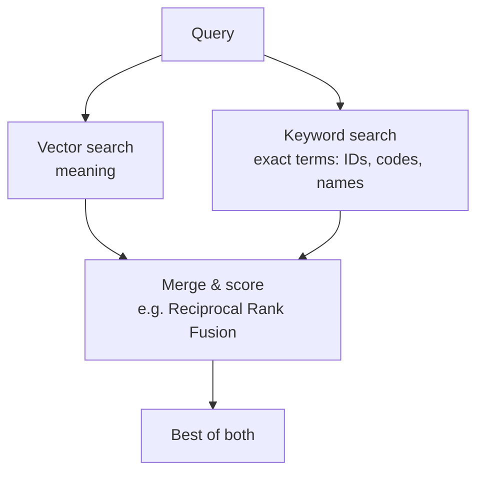
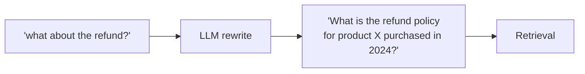
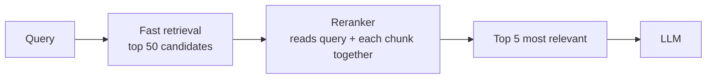
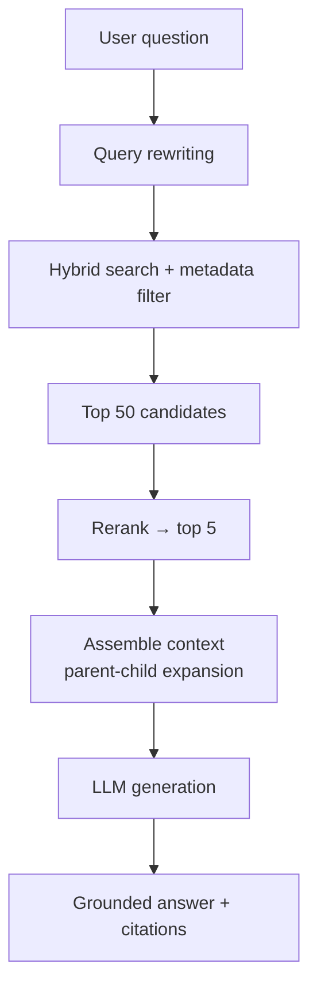
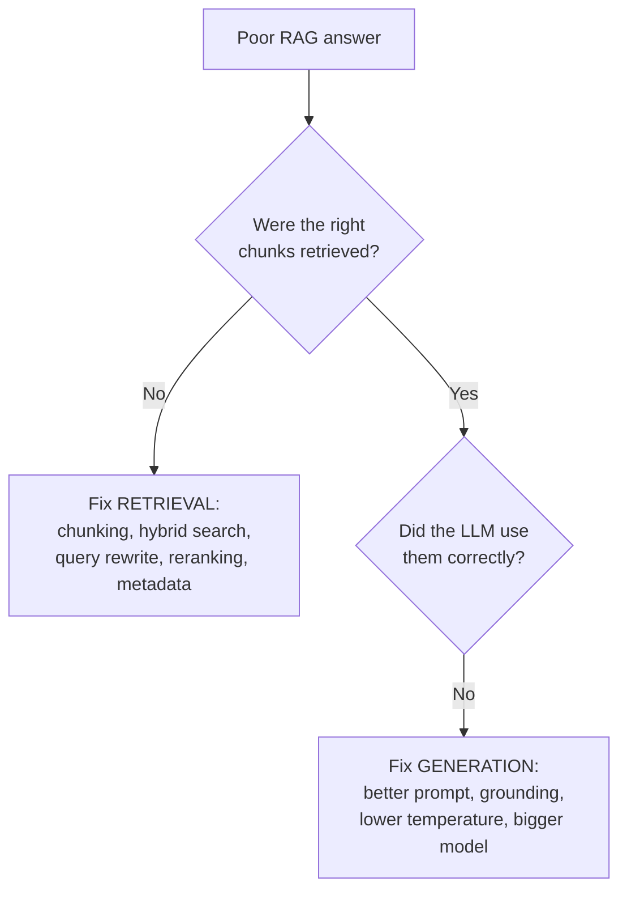

# 7. Advanced RAG ⭐

> **In one sentence:** Basic RAG often retrieves the wrong or noisy chunks; advanced RAG uses smarter **chunking, filtering, hybrid search, query rewriting, and reranking** to make retrieval far more accurate.

**Interview goal:** Answer *"How would you improve poor RAG results?"*

---

## 7.1 Where basic RAG fails

Advanced RAG techniques target each of these failure modes. Below is a toolkit — you rarely need all of them, so diagnose first (see [09 — RAG Evaluation](09-rag-evaluation.md)).

---

## 7.2 Chunking strategies

Chunking quality is the #1 driver of RAG accuracy. Options:

| Strategy | How it works | Best for |
|----------|--------------|----------|
| **Fixed-size** | Split every N tokens, with overlap | Simple, uniform text |
| **Recursive / structural** | Split on natural boundaries (paragraph → sentence) | Most documents |
| **Semantic chunking** | Split where the *meaning* changes (embedding shifts) | Dense, varied content |
| **Document-based** | Respect structure: headings, sections, tables, code blocks | Technical docs, manuals |
| **Sentence-window** | Embed single sentences, but return neighbors as context | High precision needs |
| **Parent-child (hierarchical)** | Embed small chunks, but feed the larger parent to the LLM | Best of both: precise match + full context |

**Overlap:** keep 10–20% overlap so a sentence spanning a boundary isn't lost.

**Tuning tip:** start ~300–500 tokens with overlap, then evaluate and adjust.

---

## 7.3 Metadata filtering

Store metadata with each chunk (`date`, `author`, `product`, `tenant_id`, `access_level`, `doc_version`) and **filter before or during** vector search.

Why it's essential:
- **Security / multi-tenancy** — only search a tenant's own data (see [17 — Multi-Tenant AI](17-multi-tenant-ai.md)).
- **Freshness** — restrict to recent documents.
- **Precision** — narrow to the right product/region/language.

---

## 7.4 Hybrid search

Combine **semantic (vector) search** with **keyword (lexical / BM25) search** and merge the results.

- **Vector search** wins on synonyms and paraphrases.
- **Keyword search** wins on exact matches: error codes, product SKUs, function names, acronyms.
- **Hybrid** gets both — usually the biggest single accuracy boost.

---

## 7.5 Query rewriting / transformation

The user's raw question is often a poor search query. Rewrite it first.

| Technique | What it does |
|-----------|--------------|
| **Query expansion** | Add synonyms/related terms |
| **Query decomposition** | Split a complex question into sub-questions, retrieve for each |
| **Multi-query** | Generate several rephrasings, retrieve for all, merge |
| **HyDE** (Hypothetical Document Embeddings) | Ask the LLM to draft a hypothetical answer, embed *that*, and search — often matches real docs better |
| **Conversational rewrite** | Turn "what about pricing?" into "what is the pricing of product X?" using chat history |

---

## 7.6 Reranking

Retrieve a **large** candidate set (e.g., top 50) quickly, then use a smarter, slower **reranker model** (a cross-encoder) to re-score and keep only the best (e.g., top 5).

- **Retriever** = fast but approximate (compares independent vectors).
- **Reranker** = slow but precise (reads the query and chunk *together*).
- Big precision boost; examples: Cohere Rerank, cross-encoder models.

---

## 7.7 Putting it together — an advanced RAG pipeline

---

## 7.8 Diagnosing "poor RAG results" (interview gold)

Split the problem into **retrieval** vs **generation**:

Fix checklist by symptom:
- **Missing the answer** → better chunking, hybrid search, query rewriting, retrieve more + rerank.
- **Retrieves junk** → metadata filtering, reranking, cleaner ingestion.
- **Right chunks, wrong answer** → improve the prompt, enforce grounding, lower temperature.
- **Answer cut off / lacks context** → parent-child chunking, increase overlap.
- **Can't verify** → add citations and evaluation (see [09](09-rag-evaluation.md)).

---

## Practical / Interview Goal

✅ **Answer "How would you improve poor RAG results?"**
> "First I'd measure whether the failure is in retrieval or generation. If retrieval: improve chunking (try parent-child/semantic), add hybrid search for exact terms, apply metadata filtering, rewrite the query, and add a reranker on a larger candidate set. If generation: tighten the prompt to force grounding, lower temperature, and possibly use a stronger model. Then re-run evaluation to confirm the fix."

---

## Resources

- [Amazon Bedrock — retrieval & advanced chunking](https://docs.aws.amazon.com/bedrock/latest/userguide/kb-chunking-parsing.html) *(rephrased for compliance)*
- Next: [08 — RAG Production Design](08-rag-production-design.md)
