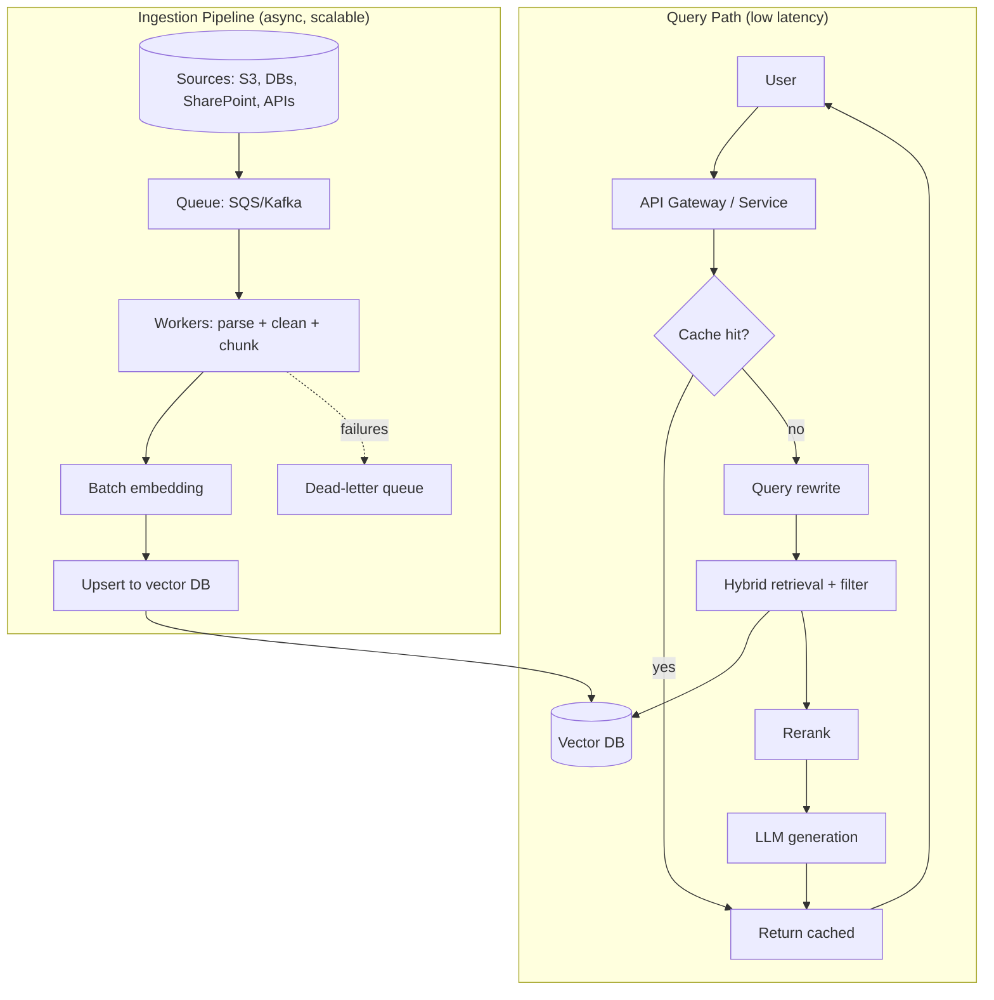
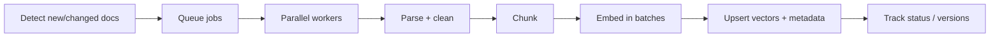
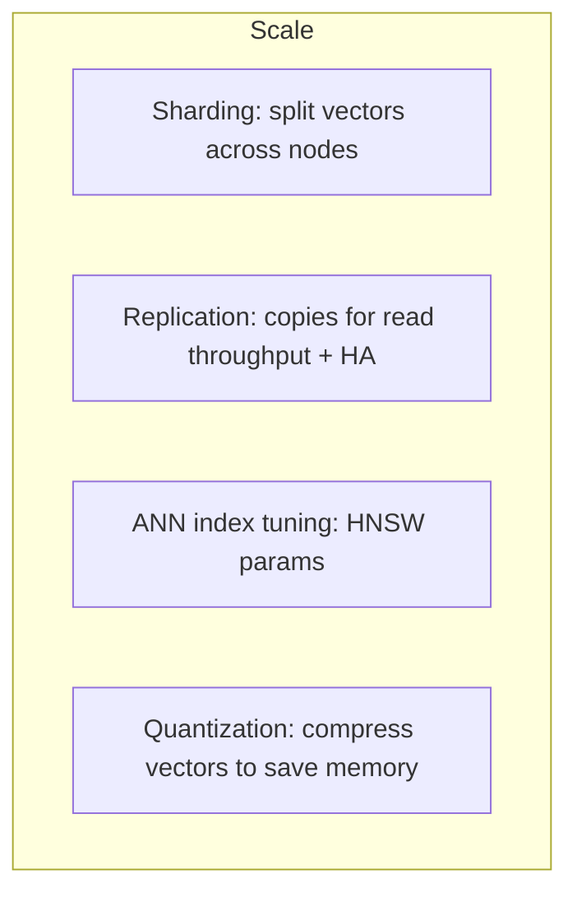
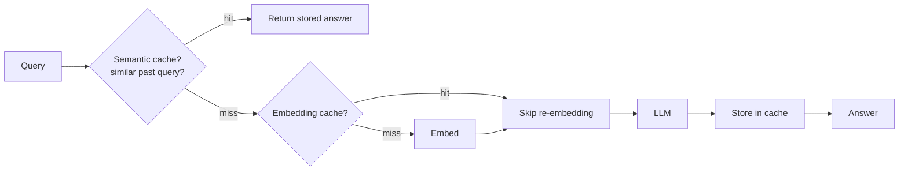
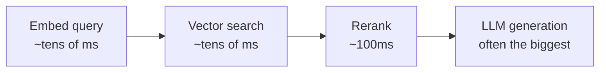

# 8. RAG Production Design ⭐⭐⭐

> **In one sentence:** Scaling RAG from a demo to millions of documents means designing a robust **ingestion pipeline**, choosing the right **vector database**, and engineering for **scale, caching, cost, and latency**.

**Interview goal:** Design an enterprise RAG system for millions (e.g., 10M) of documents.

---

## 8.1 Demo RAG vs Production RAG

| Concern | Demo (100 docs) | Production (10M docs) |
|---------|-----------------|-----------------------|
| Ingestion | Run a script once | Automated, incremental, fault-tolerant pipeline |
| Vector DB | In-memory / FAISS | Managed, sharded, replicated |
| Updates | Re-index everything | Incremental upserts + deletes |
| Latency | "Good enough" | p95 latency SLA (e.g., < 2s) |
| Cost | Negligible | Carefully optimized per query |
| Failures | Restart | Retries, dead-letter queues, monitoring |

---

## 8.2 The full production architecture

---

## 8.3 Ingestion pipeline design

The pipeline must handle continuous, large-scale, and *changing* data.

Key design points:
- **Decouple with a queue** (SQS/Kafka) so ingestion scales independently and survives spikes.
- **Parallel workers** — chunking/embedding is embarrassingly parallel.
- **Incremental updates** — use content hashes or change-data-capture; only re-embed what changed. Handle **inserts, updates, deletes**.
- **Idempotency** — a re-run shouldn't create duplicates (use stable chunk IDs).
- **Batch embedding** — send many chunks per API call to cut cost and time.
- **Error handling** — retries + **dead-letter queue** for poison documents.
- **Metadata** — attach tenant, source, timestamp, version, ACLs at ingest.

**Rough scale math (10M docs):** if each doc → ~10 chunks, that's ~100M vectors. At 1536 dims × 4 bytes ≈ 6 KB/vector → ~600 GB of raw vectors (before index overhead). This drives your vector DB and sharding choices.

---

## 8.4 Choosing a vector database

| Option | Strengths | Watch out |
|--------|-----------|-----------|
| **OpenSearch (k-NN)** | AWS-native, hybrid search, mature | Cluster ops, memory tuning |
| **Aurora/RDS + pgvector** | SQL + vectors together, transactions | Scaling beyond ~10s of millions |
| **Pinecone** | Fully managed, serverless scaling | Vendor cost |
| **Milvus / Qdrant / Weaviate** | High performance, self-host or managed | You operate it |

Selection criteria: **scale**, **hybrid search support**, **metadata filtering**, **managed vs self-hosted**, **cost**, **latency**, and **multi-tenancy** features.

---

## 8.5 Scaling techniques

- **Sharding** — partition the index (e.g., by tenant or hash) so no single node holds everything.
- **Replication** — multiple copies for high availability and higher read QPS.
- **ANN index tuning** — HNSW parameters trade recall vs speed/memory (see [Embeddings §5.7](05-embeddings.md)).
- **Quantization** — store compressed vectors (e.g., int8/PQ) to fit more in RAM, with slight accuracy loss.
- **Autoscaling** — scale ingestion workers and query nodes independently.

---

## 8.6 Caching

Caching is the biggest lever for both **latency** and **cost**.

Cache layers:
- **Embedding cache** — don't re-embed identical/near-identical text.
- **Retrieval cache** — cache results for repeated queries.
- **Semantic response cache** — if a new query is *semantically* close to a previous one, reuse the answer.
- **Prompt caching** — some providers cache static prompt prefixes to cut cost/latency.

⚠️ Invalidate caches when underlying documents change.

---

## 8.7 Latency optimization

Break down where time goes and attack the biggest piece.

Levers:
- **Streaming** — stream tokens so users see output immediately (perceived latency).
- **Smaller/faster models** for simple queries; big models only when needed (**model routing**).
- **Limit N** retrieved + rerank instead of stuffing huge context.
- **Parallelize** retrieval and any tool calls.
- **Cache** (above).
- Set and monitor a **p95/p99 latency SLA**, not just averages.

---

## 8.8 Cost optimization

- **Token discipline** — retrieve fewer, higher-quality chunks; trim context.
- **Model tiering** — cheap model for easy tasks, expensive model for hard ones.
- **Batch** embeddings during ingestion.
- **Cache** aggressively.
- **Right-size the vector DB** (quantization, tiered storage for cold data).
- Track **cost per query** and **cost per tenant** (ties into [17 — Multi-Tenant AI](17-multi-tenant-ai.md)).

---

## 8.9 Reliability & operations

- **Retries + backoff** and **dead-letter queues** in ingestion.
- **Fallbacks** — if the primary model/region is down, route to a backup.
- **Rate limiting & quotas** to protect the system.
- **Observability** — trace retrieval quality, latency, cost, errors (see [15 — Evaluation & Observability](15-ai-evaluation-observability.md)).
- **Versioning** — track embedding model version; re-embedding on model change is a migration project.

---

## 8.10 Design answer template (10M documents)

Structure your interview answer like this:
1. **Clarify requirements** — QPS, latency SLA, freshness, doc types, multi-tenant?
2. **Ingestion** — queue + parallel workers + incremental upserts + DLQ + metadata.
3. **Storage** — pick vector DB, estimate ~100M vectors, shard + replicate.
4. **Retrieval** — hybrid search + metadata filter + rerank + query rewrite.
5. **Generation** — model routing, streaming, grounded prompt.
6. **Caching** — embedding + semantic response cache.
7. **Cross-cutting** — cost per query, security/tenancy, observability, evaluation.

---

## Practical / Interview Goal

✅ **Design an enterprise RAG for millions of documents.** Lead with requirements clarification, then walk the diagram in §8.2, and always mention scale math, caching, latency SLA, and cost-per-query. That separates senior answers from junior ones.

---

## Resources

- [Amazon Bedrock Knowledge Bases](https://docs.aws.amazon.com/bedrock/latest/userguide/knowledge-base.html) *(rephrased for compliance)*
- [Amazon OpenSearch k-NN](https://docs.aws.amazon.com/opensearch-service/latest/developerguide/knn.html) *(rephrased for compliance)*
- Next: [09 — RAG Evaluation](09-rag-evaluation.md)
