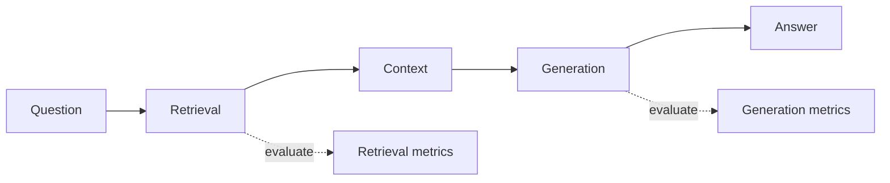
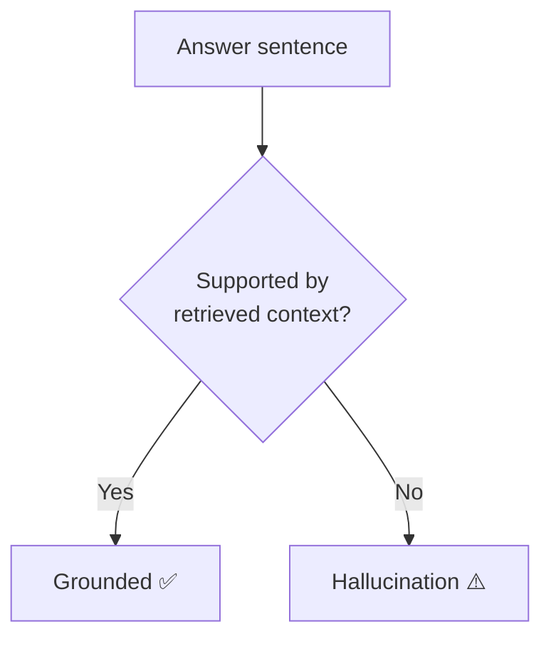
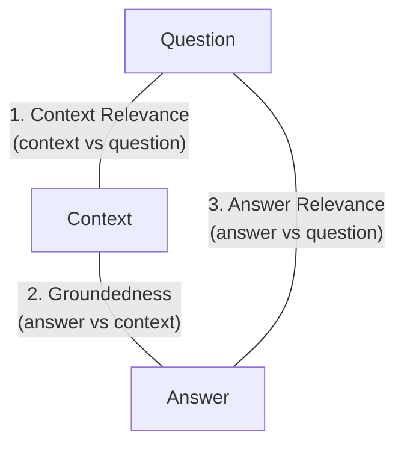
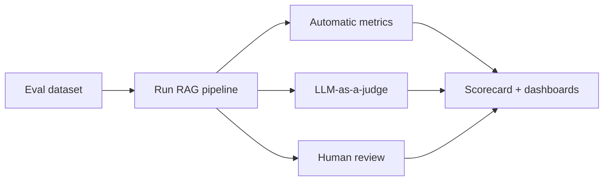

# 9. RAG Evaluation

> **In one sentence:** RAG evaluation measures whether your system **retrieves the right context** and **generates faithful, relevant answers** — because "it looks good in the demo" is not proof it works.

**Interview goal:** Explain how you *know* your RAG is actually working.

---

## 9.1 Why evaluate?

RAG can fail silently: fluent answers that are subtly wrong, outdated, or unsupported. Evaluation lets you:
- Catch **hallucinations** and unsupported claims.
- Know if a change (new chunking, new model) actually **improved** things.
- Set **quality gates** in CI/CD before deploying.
- Debug *where* the pipeline breaks (retrieval vs generation).

---

## 9.2 Two halves to evaluate

- **Retrieval quality** — did we fetch the right chunks?
- **Generation quality** — did the LLM use them correctly?

Always separate these; a bad answer might be a retrieval problem *or* a generation problem, and the fixes differ.

---

## 9.3 Retrieval metrics

| Metric | Question it answers |
|--------|--------------------|
| **Context Relevance** | Are the retrieved chunks actually about the question? |
| **Context Recall** | Did we retrieve *all* the chunks needed to answer? |
| **Context Precision** | Are the top-ranked chunks the useful ones (not buried)? |
| **Hit Rate** | Was at least one correct chunk retrieved? |
| **MRR (Mean Reciprocal Rank)** | How high up was the first correct chunk? |
| **NDCG** | Are the most relevant chunks ranked highest? |

> If **recall** is low, the answer literally isn't in the retrieved context — fix retrieval before touching the prompt.

---

## 9.4 Generation metrics

| Metric | Definition |
|--------|-----------|
| **Faithfulness / Groundedness** | Is every claim in the answer supported by the retrieved context? (anti-hallucination) |
| **Answer Relevance** | Does the answer actually address the question? |
| **Correctness** | Does it match the known correct answer (if you have one)? |
| **Completeness** | Does it cover all parts of the question? |
| **Citation accuracy** | Do the cited sources really support the claims? |

**Groundedness** is the key anti-hallucination metric: check whether each sentence can be traced back to a retrieved chunk.

---

## 9.5 The RAG Triad (easy mental model)

A popular way to remember the core three:

1. **Context Relevance** — is retrieved context relevant to the question?
2. **Groundedness** — is the answer supported by the context?
3. **Answer Relevance** — does the answer address the question?

If all three are high, your RAG is healthy.

---

## 9.6 How to actually measure it

### a) Build an evaluation dataset
A set of representative `question → ideal answer → relevant source(s)` examples ("golden set"). Sources:
- Real user questions from logs.
- SMEs (subject-matter experts) write Q&A pairs.
- LLM-generated synthetic questions from your documents (then human-reviewed).

### b) Choose evaluators

- **Automatic/statistical** — hit rate, MRR, exact match, ROUGE/BLEU (limited for open-ended text).
- **LLM-as-a-judge** — a strong model scores faithfulness/relevance against a rubric. Scalable and popular, but validate it against human labels.
- **Human evaluation** — the gold standard; expensive, so use on samples and hard cases.

### c) Automate & gate
Run evals in CI/CD. Block deploys if metrics drop below thresholds. Re-run whenever you change chunking, embeddings, prompts, or the model.

---

## 9.7 Tools

- **Ragas** — open-source RAG metrics (faithfulness, context precision/recall, answer relevance).
- **TruLens** — implements the RAG triad.
- **DeepEval**, **Arize Phoenix**, **LangSmith**.
- **Amazon Bedrock model evaluation / RAG evaluation** — managed evaluation on AWS.

---

## 9.8 Online vs offline evaluation

| | Offline | Online (production) |
|---|---------|---------------------|
| **When** | Before deploy, in CI | On live traffic |
| **How** | Golden dataset + metrics | User feedback (👍/👎), thumbs, A/B tests, monitoring |
| **Goal** | Prevent regressions | Catch real-world drift |

Feed online signals (thumbs-down, escalations) back into your offline dataset — a continuous improvement loop.

---

## Practical / Interview Goal

✅ **Explain how you know your RAG is working.**
> "I evaluate retrieval and generation separately. For retrieval I track context relevance, recall, and MRR; for generation I track groundedness, answer relevance, and citation accuracy — the RAG triad. I build a golden dataset from real logs plus SME/synthetic Q&A, score it with automatic metrics and LLM-as-a-judge validated against human labels, and gate deployments in CI. In production I add thumbs feedback and A/B tests, then feed failures back into the dataset."

---

## Resources

- [Ragas documentation](https://docs.ragas.io/) *(rephrased for compliance)*
- [Amazon Bedrock evaluation](https://docs.aws.amazon.com/bedrock/latest/userguide/evaluation.html) *(rephrased for compliance)*
- Course: *AI A-Z 2026* — evaluation section.
- Next: [10 — AI Agents](10-ai-agents.md)
