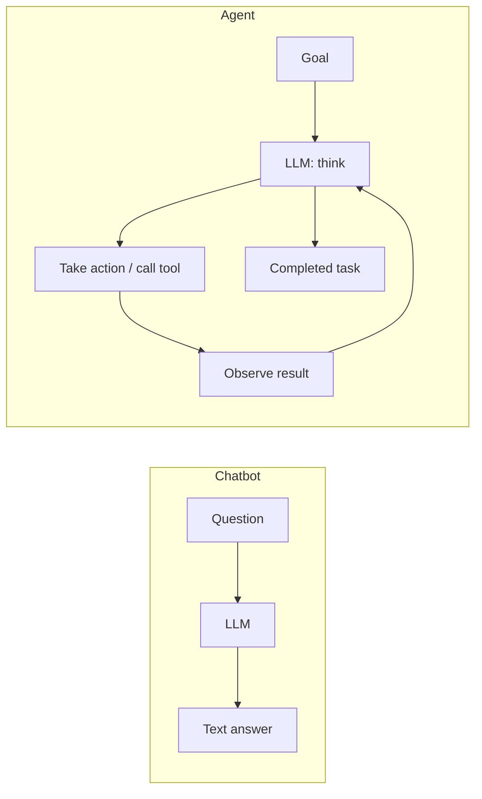
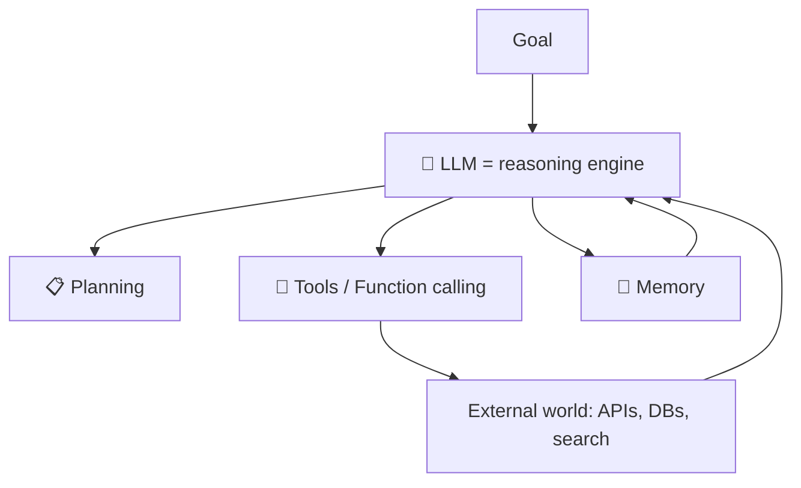
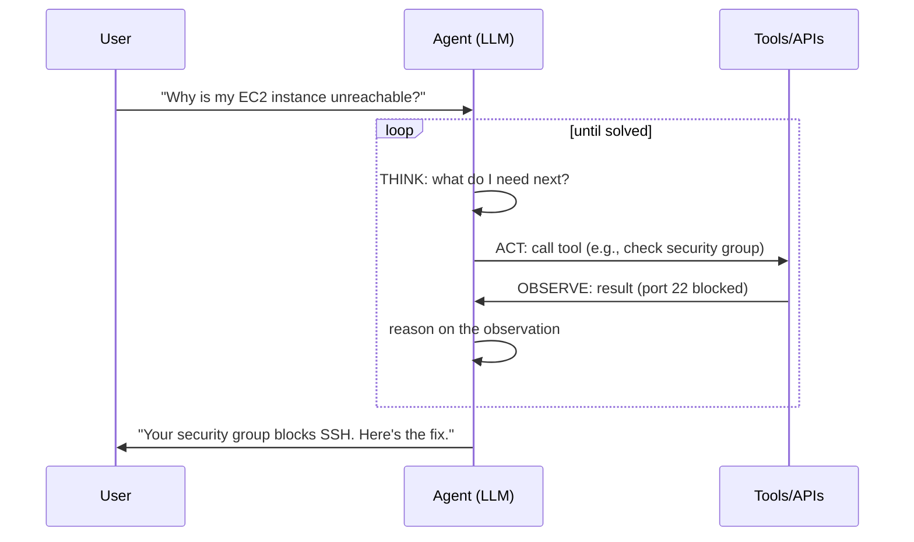
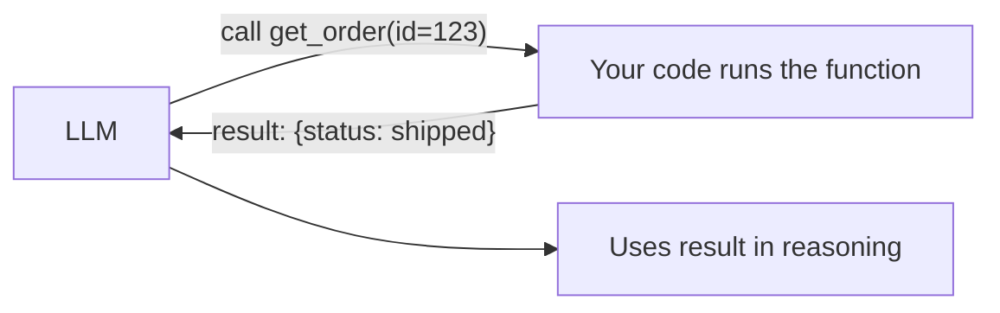
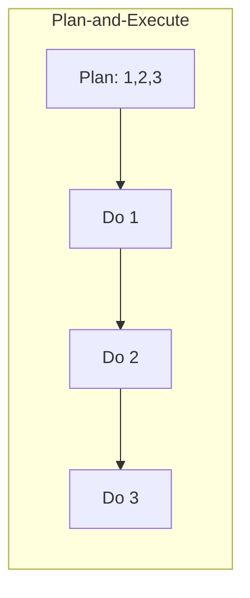
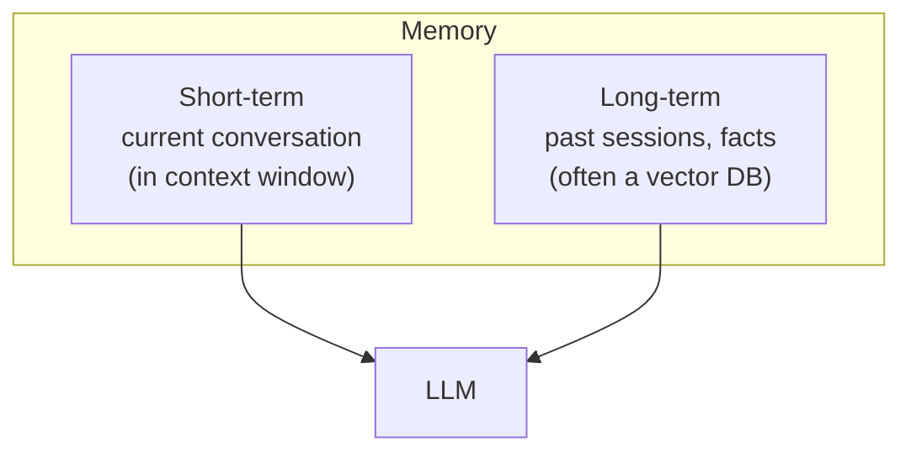
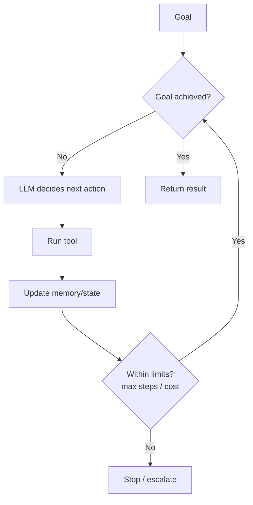
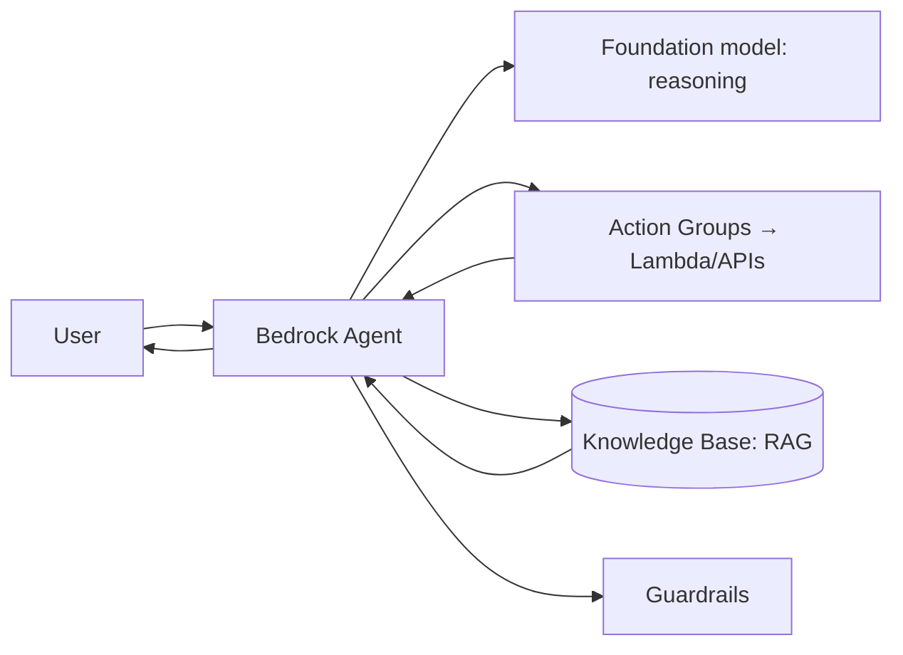

# 10. AI Agents ⭐⭐⭐

> **In one sentence:** An AI agent is an LLM that can **plan, decide, and take actions** — calling tools and APIs in a loop to achieve a goal — instead of just replying with text.

**Interview goal:** Design an enterprise AI agent.

---

## 10.1 Chatbot vs Agent



| | Chatbot | Agent |
|---|---------|-------|
| Output | Just text | Actions + text |
| Can call tools/APIs? | No | Yes |
| Multi-step? | One shot | Loops until goal met |
| Example | "Explain refunds" | "Process this refund" (looks up order, checks policy, issues refund) |

> A chatbot *tells* you what to do. An agent *does* it.

---

## 10.2 Core components of an agent



1. **LLM (brain)** — reasons and decides what to do next.
2. **Planning** — breaks the goal into steps.
3. **Tools** — functions/APIs it can call to act or fetch info.
4. **Memory** — remembers context across steps and sessions.
5. **Orchestration** — the loop that ties it all together.

---

## 10.3 Reasoning + Acting: the agent loop (ReAct)

Most agents run a **Think → Act → Observe** loop until the goal is done. This pattern is called **ReAct** (Reason + Act).



- **Thought** — the model reasons about the next step.
- **Action** — it calls a tool with arguments.
- **Observation** — the tool result is fed back in.
- Loop repeats; the model decides when it's **done**.

---

## 10.4 Tool / Function calling

**Function calling** lets the LLM output a structured request to run one of your functions. *You* run it and return the result.



You give the model a list of tools with schemas:
```json
{
  "name": "get_weather",
  "description": "Get current weather for a city",
  "parameters": {
    "type": "object",
    "properties": { "city": { "type": "string" } },
    "required": ["city"]
  }
}
```
The model, when helpful, replies with `get_weather({"city": "Paris"})`. Crucially: **the LLM never runs the function itself** — it only *requests* the call. Your application executes it (with proper auth/validation) and returns the output.

Good tool design:
- Clear names + descriptions (the model chooses based on these).
- Small, well-defined inputs/outputs.
- Validate arguments; never trust them blindly (injection risk).

---

## 10.5 Planning strategies

| Strategy | Idea |
|----------|------|
| **ReAct** | Interleave reasoning and single actions (most common) |
| **Plan-and-Execute** | Make a full plan first, then execute steps |
| **Chain-of-Thought** | Reason step by step (no tools) |
| **Tree-of-Thoughts** | Explore multiple reasoning branches |
| **Reflection / self-critique** | Review its own output and retry |



---

## 10.6 Memory



- **Short-term** — the running conversation, held in the context window.
- **Long-term** — persisted knowledge (user preferences, past interactions), often stored as embeddings and retrieved like RAG.
- **Working memory / scratchpad** — intermediate results during a task.

---

## 10.7 Orchestration

The **orchestrator** is the control loop: manage the plan, call tools, track state, enforce limits, handle errors, and decide when to stop.



Guardrails to always include:
- **Max steps / max iterations** (prevent infinite loops).
- **Cost & time budgets.**
- **Human-in-the-loop** for risky actions (e.g., issuing refunds, deleting data).
- **Error handling & retries.**

---

## 10.8 Agents on AWS Bedrock

**Amazon Bedrock Agents** provides managed orchestration: you define **action groups** (tools backed by Lambda/APIs) and connect **Knowledge Bases** for RAG; Bedrock runs the reasoning loop.



Details in [11 — Agentic Architecture](11-agentic-architecture.md).

---

## 10.9 Designing an enterprise agent (interview template)

1. **Define the goal & scope** — what tasks, what's out of bounds.
2. **Identify tools** — which APIs/DBs it needs (read vs write).
3. **Add knowledge** — connect a Knowledge Base (RAG) for docs/policies.
4. **Choose planning** — ReAct for most; add reflection for complex tasks.
5. **Memory** — short-term conversation + long-term store if needed.
6. **Guardrails** — max steps, cost caps, human approval for risky actions, input/output filtering.
7. **Security** — least-privilege IAM per tool, validate tool args (see [14](14-ai-security.md)).
8. **Observability** — trace every thought/action/observation; measure task success.

---

## Practical / Interview Goal

✅ **Design an enterprise AI agent.** Explain the components (brain, planning, tools, memory, orchestration), the ReAct loop, function calling (model requests, your code executes), and the guardrails — then map it onto Bedrock Agents with action groups + knowledge base + guardrails.

---

## Resources

- [Amazon Bedrock Agents](https://docs.aws.amazon.com/bedrock/latest/userguide/agents.html) *(rephrased for compliance)*
- Paper: *ReAct: Synergizing Reasoning and Acting in Language Models*.
- Next: [11 — Agentic Architecture](11-agentic-architecture.md)
