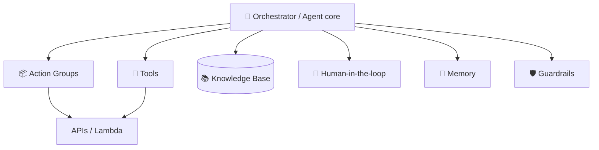
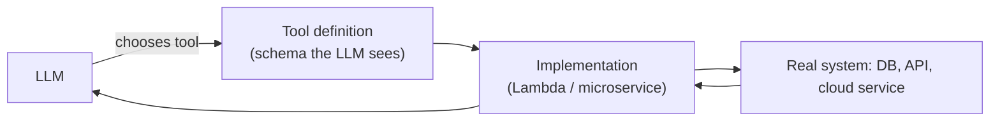
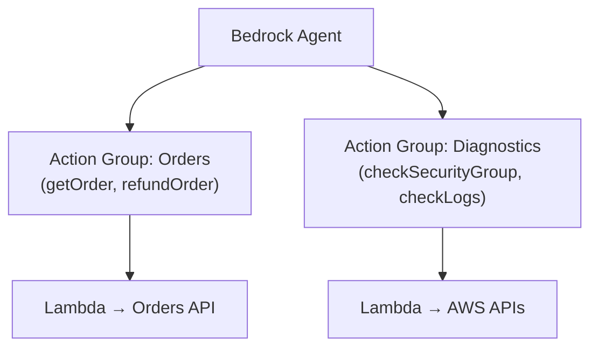
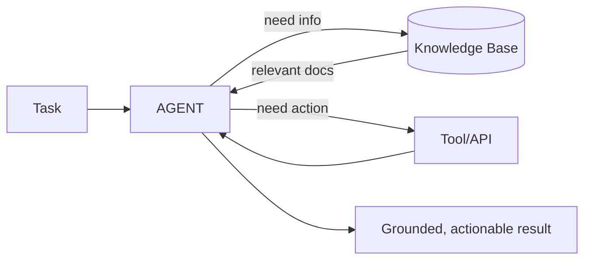
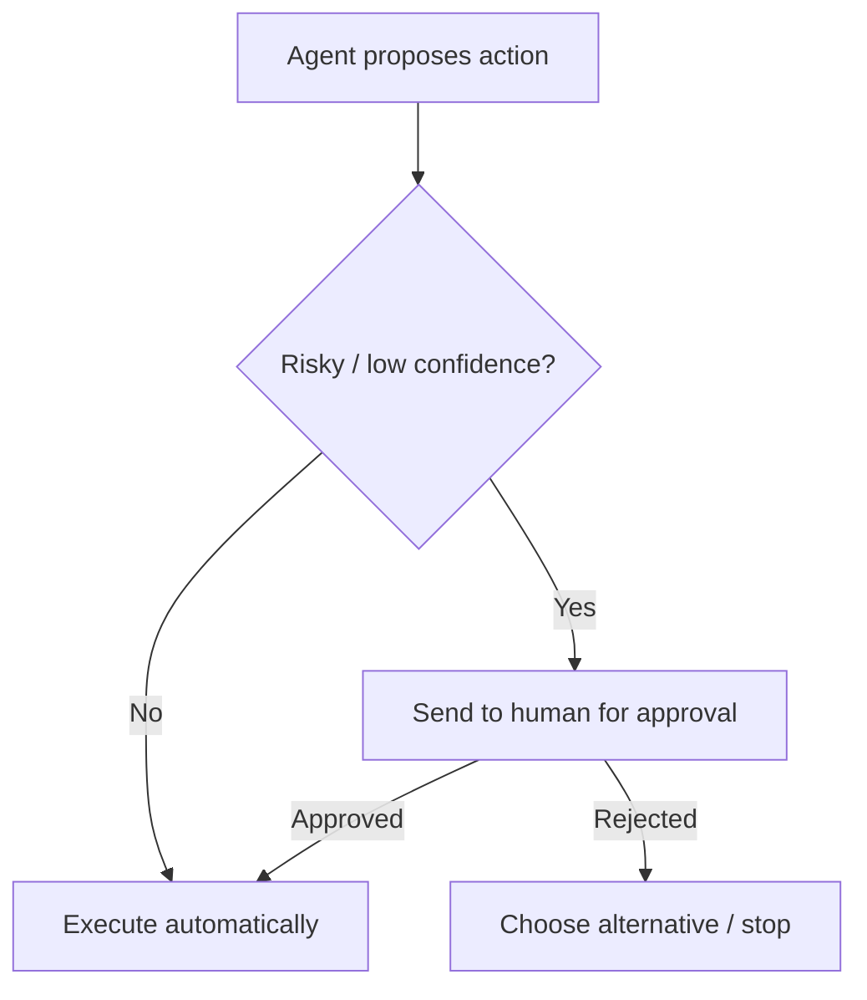
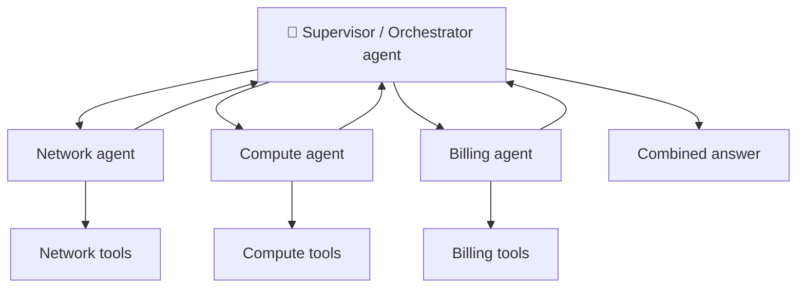
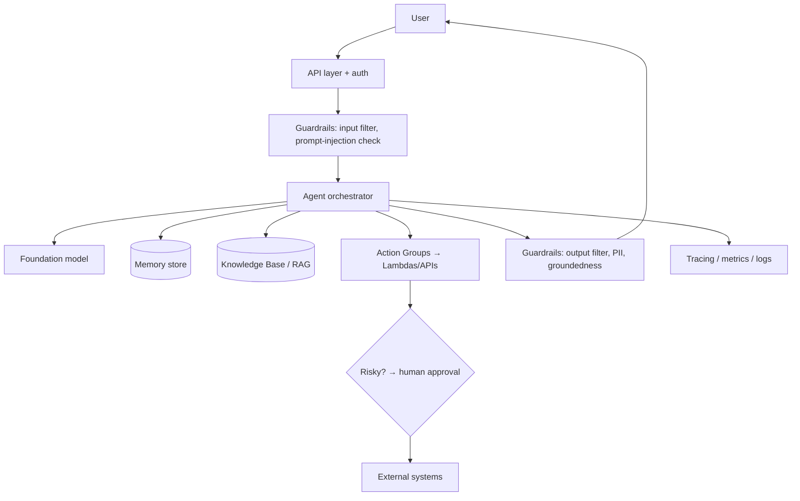
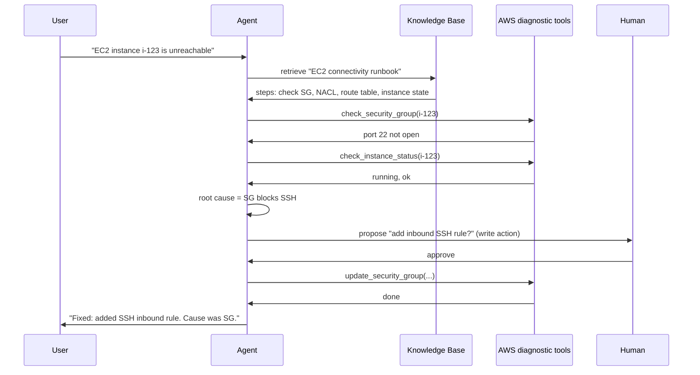

# 11. Agentic Architecture ⭐⭐⭐

> **In one sentence:** Agentic architecture is how you *assemble* an agent in production — wiring together tools, APIs, action groups, knowledge bases, human-in-the-loop checks, and (optionally) multiple cooperating agents.

**Interview goal:** Design an AWS troubleshooting agent.

---

## 11.1 The building blocks

| Block | Role |
|-------|------|
| **Tools** | Individual functions the agent can call (get data, take action) |
| **APIs** | The real systems behind tools (services, databases) |
| **Action Groups** | A *grouping* of related tools/APIs (Bedrock concept) |
| **Knowledge Bases** | RAG source for docs, policies, runbooks |
| **Human-in-the-loop** | Approval gate for risky/uncertain actions |
| **Memory** | Short- and long-term state |
| **Guardrails** | Safety filters and limits |

---

## 11.2 Tools & APIs

A **tool** is the agent-facing definition (name, description, input schema). Behind it sits a real **API** or function.

Design principles:
- **Read vs write** tools — writes need extra guardrails/approval.
- **Least privilege** — each tool gets only the permissions it needs.
- **Validate inputs** — treat LLM-generated arguments as untrusted.
- **Idempotency** for write actions where possible.
- **Clear descriptions** — the model picks tools by reading them.

---

## 11.3 Action Groups (Bedrock)

In **Amazon Bedrock Agents**, an **action group** bundles related actions the agent can perform. You define:
- An **API schema** (OpenAPI) describing the operations, and
- A **Lambda function** (or return-of-control to your app) that executes them.

The agent reads the schemas, decides which action to call, Bedrock invokes your Lambda, and the result flows back into the reasoning loop.

---

## 11.4 Knowledge Bases in agents

Agents combine **acting** (tools) with **knowing** (RAG). A Knowledge Base lets the agent look up policies, runbooks, and documentation before acting.

Example: a troubleshooting agent retrieves the "EC2 connectivity runbook" from the KB, then executes the diagnostic tools it describes.

---

## 11.5 Human-in-the-loop (HITL)

For risky, ambiguous, or high-cost actions, pause and ask a human to approve.

When to require HITL:
- Irreversible actions (delete, refund, deploy to prod).
- Low model confidence.
- High cost or compliance-sensitive operations.

---

## 11.6 Single-agent vs Multi-agent

As tasks grow, one agent with 30 tools becomes confused. **Multi-agent** systems split work among specialized agents coordinated by an orchestrator/supervisor.

| Pattern | Description |
|---------|-------------|
| **Supervisor / router** | A lead agent delegates to specialist sub-agents |
| **Sequential (pipeline)** | Agents hand off in order |
| **Collaborative** | Agents discuss/debate to reach consensus |

Trade-off: multi-agent adds capability but also **latency, cost, and complexity** — use only when a single agent can't cope.

---

## 11.7 Full agentic architecture

---

## 11.8 Worked example — AWS troubleshooting agent

**Goal:** diagnose and (optionally) fix common AWS issues, e.g., "My EC2 instance is unreachable."

Design breakdown:
- **Knowledge Base** — runbooks, best practices, past incidents (RAG).
- **Action groups** — `Diagnostics` (read-only: describe SG, logs, status) and `Remediation` (write: update SG) — writes require **HITL**.
- **Guardrails** — restrict to allowed accounts/regions; block destructive commands.
- **Security** — least-privilege IAM role per tool; read tools separate from write tools.
- **Memory** — track what's already been checked in this incident.
- **Observability** — log every thought/action for audit.

---

## Practical / Interview Goal

✅ **Design an AWS troubleshooting agent.** Cover: goal & scope → Knowledge Base of runbooks → read-only diagnostic action group → write remediation action group behind human approval → guardrails + least-privilege IAM → memory + full tracing. Show the sequence diagram.

---

## Resources

- [Amazon Bedrock Agents — action groups](https://docs.aws.amazon.com/bedrock/latest/userguide/agents-action-create.html) *(rephrased for compliance)*
- [Multi-agent collaboration on Bedrock](https://docs.aws.amazon.com/bedrock/latest/userguide/agents-multi-agent-collaboration.html) *(rephrased for compliance)*
- Next: [12 — MCP](12-mcp.md)
