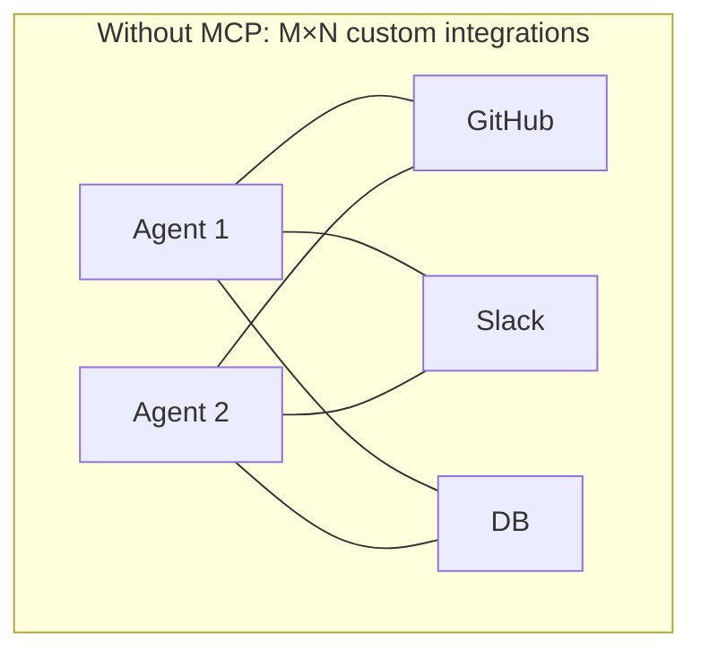
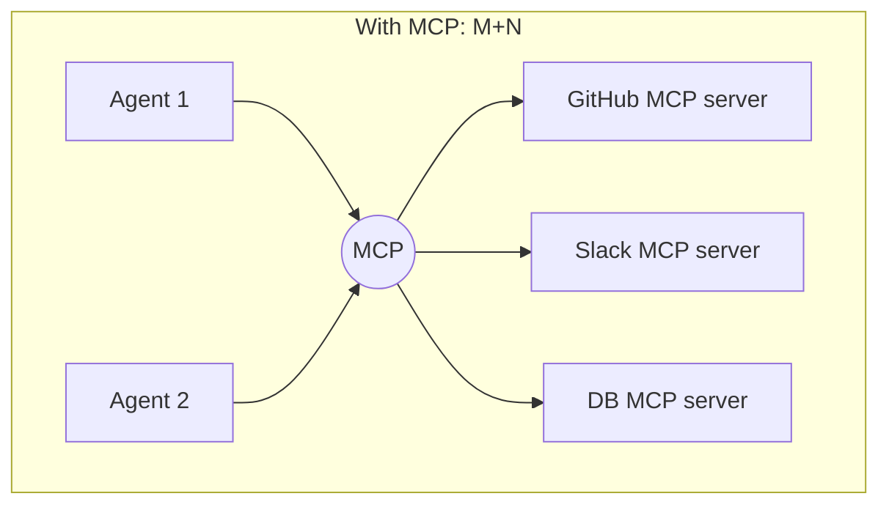
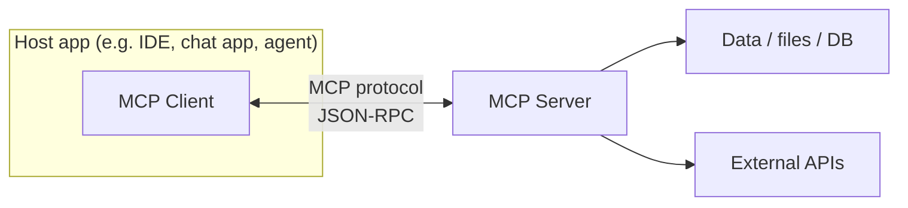
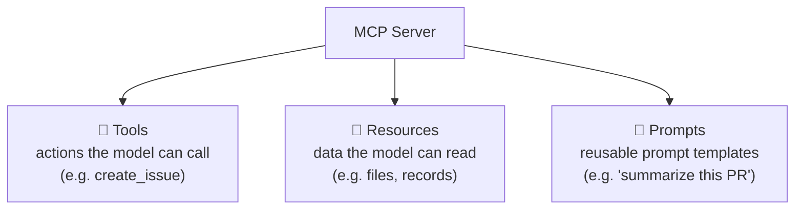
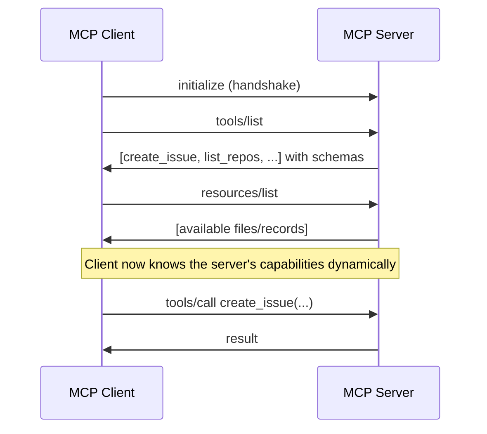
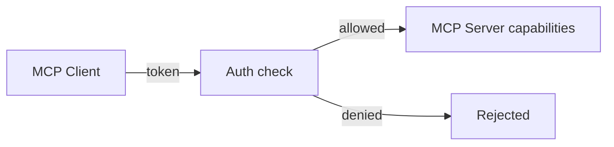
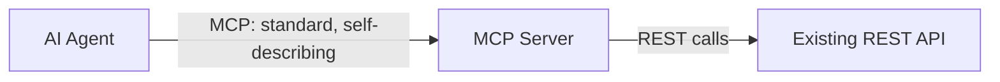
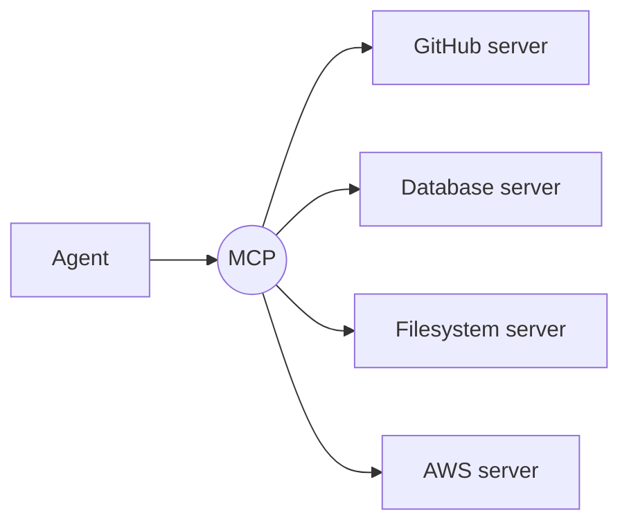

# 12. MCP — Model Context Protocol ⭐⭐⭐

> **In one sentence:** MCP is a **standard "USB-C for AI"** — an open protocol that lets any AI agent connect to any tool, data source, or app in a uniform way, so you don't hand-code a custom integration for every combination.

**Interview goal:** Explain MCP vs REST API and why agents use MCP.

---

## 12.1 The problem MCP solves

Without a standard, every AI app must build a **custom integration** for every tool. That's the "M×N problem": M apps × N tools = M×N integrations.

With MCP, each tool exposes **one MCP server**, and each agent speaks **one MCP protocol** → M+N integrations.

MCP was introduced by Anthropic as an **open standard** and is now widely adopted.

---

## 12.2 Client–Server architecture

| Term | Role |
|------|------|
| **Host** | The app the user interacts with (agent, IDE, chat client) |
| **MCP Client** | Lives inside the host; talks to servers using the protocol |
| **MCP Server** | Wraps a tool/data source and exposes its capabilities |

Communication uses **JSON-RPC**, over **stdio** (local process) or **HTTP/SSE** (remote).

---

## 12.3 What an MCP server exposes

An MCP server offers three kinds of capabilities:

| Capability | What it is | Analogy |
|------------|-----------|---------|
| **Tools** | Functions the model can invoke to *do* something | POST endpoints / actions |
| **Resources** | Read-only data the model can pull into context | GET endpoints / files |
| **Prompts** | Predefined prompt templates the server offers | Saved query templates |

---

## 12.4 Discovery

A key superpower: the client **asks the server what it can do** at runtime. No hardcoding.

Because of discovery, you can add a new tool to the server and agents can use it **without code changes** on the client side.

---

## 12.5 Authorization & security

MCP includes an **authorization** framework (OAuth 2.x-based for remote servers) so servers can control who accesses what.

Security considerations:
- **Authenticate** the client (tokens/OAuth).
- **Authorize** per tool/resource (least privilege).
- **Validate** all tool inputs (prompt-injection & confused-deputy risks).
- **Human approval** for sensitive tools.
- **Trust** — only connect to MCP servers you trust; a malicious server could try to manipulate the agent (see [14 — AI Security](14-ai-security.md)).

---

## 12.6 MCP vs REST API (the key interview comparison)

They're related but solve different problems. MCP often runs *on top of* REST APIs.

| Aspect | REST API | MCP |
|--------|----------|-----|
| **Audience** | Built for **developers** to code against | Built for **AI models** to use dynamically |
| **Discovery** | Read docs, write code manually | Model discovers tools at runtime (`tools/list`) |
| **Self-describing** | Needs external docs (OpenAPI helps) | Ships schemas + descriptions the model reads |
| **Integration effort** | Custom code per API | Uniform protocol, plug-and-play |
| **Context** | Stateless request/response | Designed to feed model context (tools/resources/prompts) |
| **Standardization** | Every API is different | One consistent protocol across all servers |

**One-line answer:** *A REST API is designed for programmers to integrate against with custom code; MCP is a standard protocol designed for AI agents to discover and use tools uniformly at runtime. MCP often wraps existing REST APIs.*

---

## 12.7 Why agents use MCP

1. **Standardization** — one protocol for all tools; no bespoke glue per integration.
2. **Dynamic discovery** — agents learn available tools at runtime and adapt.
3. **Reusability** — build an MCP server once, any MCP-compatible agent can use it.
4. **Decoupling** — tool authors and agent authors work independently.
5. **Ecosystem** — a growing library of ready-made MCP servers (GitHub, databases, filesystems, cloud).

---

## 12.8 Kiro and MCP (bonus, practical)

Kiro (this IDE) supports MCP servers configured via `mcp.json` at the workspace (`.kiro/settings/mcp.json`) or user (`~/.kiro/settings/mcp.json`) level. This is a concrete, hands-on way to see MCP in action — add a server, and its tools become available to the agent.

---

## Practical / Interview Goal

✅ **Explain MCP vs REST API and why agents use MCP.**
> "A REST API is designed for developers to write custom integration code against; each one is different. MCP is an open, standard protocol that lets AI agents *discover* and *use* tools uniformly at runtime — with tools, resources, and prompts, plus built-in auth. It turns the M×N integration problem into M+N. MCP servers usually wrap existing REST APIs, so it's a standardization layer for agents, not a replacement for REST."

---

## Resources

- [Model Context Protocol — official docs](https://modelcontextprotocol.io/) *(rephrased for compliance)*
- [MCP specification](https://spec.modelcontextprotocol.io/) *(rephrased for compliance)*
- Next: [13 — AWS Bedrock](13-aws-bedrock.md)
