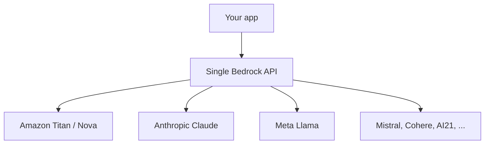
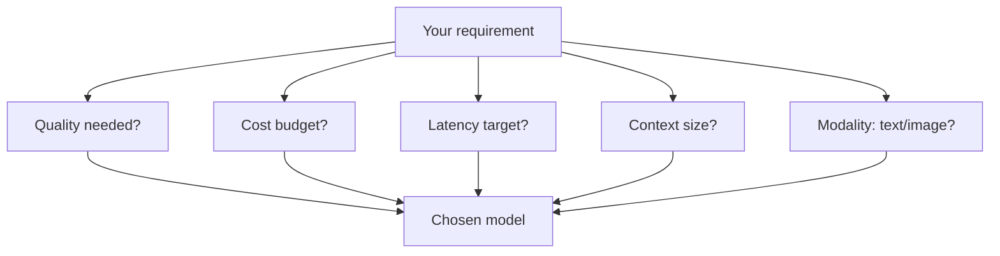
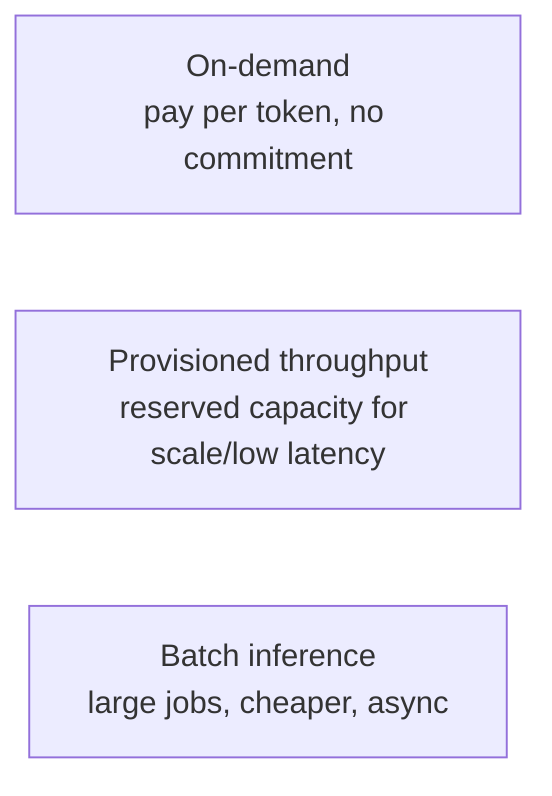
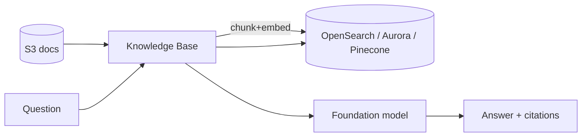
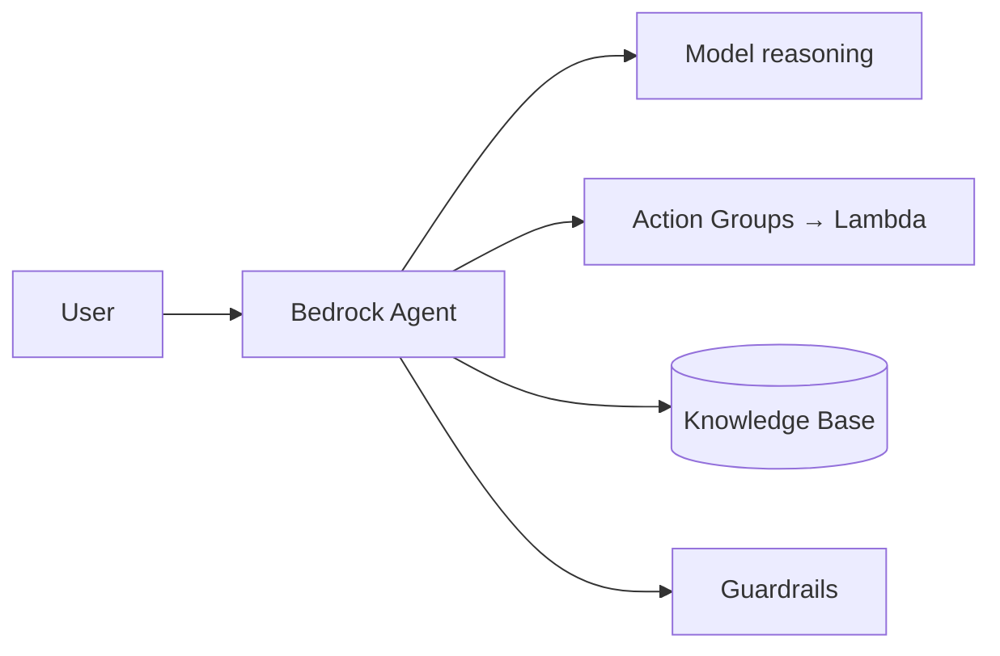
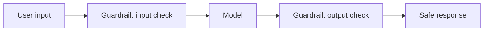
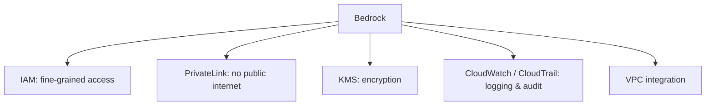
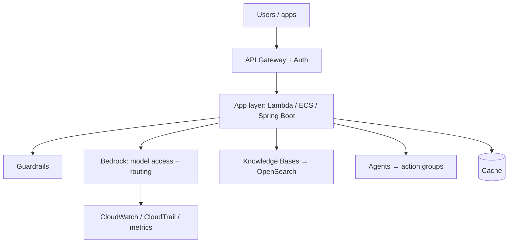

# 13. AWS Bedrock ⭐⭐⭐

> **In one sentence:** Amazon Bedrock is AWS's fully-managed service that gives you access to many foundation models through **one API**, plus built-in building blocks for RAG (Knowledge Bases), agents, and safety (Guardrails) — with no servers to manage.

**Interview goal:** Design an AWS GenAI platform.

---

## 13.1 What Bedrock is (and isn't)

- **Is:** a serverless gateway to foundation models + managed GenAI features (RAG, agents, guardrails, evaluation, fine-tuning).
- **Isn't:** a single model. It's a **marketplace + toolkit**. You pick models and compose features.

Because it's one API, switching models is often just changing a model ID.

---

## 13.2 Foundation Models on Bedrock

Bedrock hosts models from multiple providers, covering different needs:

| Type | Purpose | Examples |
|------|---------|----------|
| **Text / chat** | Q&A, reasoning, generation | Claude, Llama, Nova, Titan Text |
| **Embeddings** | Vectors for RAG/search | Titan Embeddings, Cohere Embed |
| **Image** | Generate/edit images | Titan Image, Stable Diffusion |
| **Multimodal** | Text + images | Nova, Claude (vision) |

---

## 13.3 Model selection

Choosing a model is a trade-off, not "pick the biggest."

Selection factors:
- **Capability/quality** — reasoning strength for the task.
- **Cost** — price per input/output token.
- **Latency & throughput** — response speed, tokens/sec.
- **Context window** — how much you need to fit.
- **Modality** — text-only vs vision/multimodal.
- **Region availability** & data residency.

**Model routing/tiering:** use a small cheap model for easy requests, a large model for hard ones — big cost savings.

---

## 13.4 Inference options

- **On-demand** — default; pay per token.
- **Provisioned throughput** — reserved capacity for high, steady volume and predictable latency.
- **Batch** — process large datasets offline at lower cost.
- **Streaming** — stream tokens back for responsive UX.
- **Cross-region inference** — spread load across regions for capacity/resilience.

---

## 13.5 Knowledge Bases (managed RAG)

Bedrock **Knowledge Bases** automate the entire RAG pipeline: ingest from S3, chunk, embed, store in a vector DB, and retrieve.

- APIs: **`Retrieve`** (just fetch chunks) and **`RetrieveAndGenerate`** (fetch + answer).
- You configure: data source, embedding model, chunking strategy, vector store.
- See [06 — RAG Fundamentals](06-rag-fundamentals.md) and [08 — RAG Production Design](08-rag-production-design.md).

---

## 13.6 Agents

Bedrock **Agents** run the reasoning loop and call your tools via **action groups** (Lambda/APIs), optionally using Knowledge Bases and Guardrails.

See [10 — AI Agents](10-ai-agents.md) and [11 — Agentic Architecture](11-agentic-architecture.md).

---

## 13.7 Guardrails

**Bedrock Guardrails** add a configurable safety layer around any model or agent.

Guardrails can:
- Block **denied topics** (e.g., no legal/medical advice).
- Filter **harmful content** (hate, violence, etc.).
- Detect and mask **PII** (redact emails, SSNs).
- Enforce **word filters** and profanity blocks.
- **Contextual grounding checks** — flag answers not supported by the source (anti-hallucination).

See [14 — AI Security](14-ai-security.md).

---

## 13.8 Customization & other features

- **Fine-tuning** — adapt a model to your data/style.
- **Continued pre-training** — further train on domain data.
- **Model evaluation** — built-in automatic + human evaluation.
- **Prompt management / flows** — version prompts, build visual pipelines.
- **Custom model import** — bring your own weights for supported architectures.

---

## 13.9 Security & integration (why enterprises pick Bedrock)

- **Data privacy** — your prompts/data are **not** used to train the base models.
- **IAM** for authorization, **KMS** for encryption, **PrivateLink** to keep traffic off the public internet.
- **CloudTrail/CloudWatch** for audit and monitoring.

---

## 13.10 Designing an AWS GenAI platform (interview template)

Checklist:
1. **Access layer** — API Gateway + auth (Cognito/IAM), rate limits.
2. **Model access** — Bedrock with model routing/tiering.
3. **Knowledge** — Knowledge Bases for RAG.
4. **Actions** — Agents + action groups for tasks.
5. **Safety** — Guardrails (input/output, PII, grounding).
6. **Security** — IAM least privilege, KMS, PrivateLink, VPC.
7. **Ops** — caching, CloudWatch/CloudTrail, cost tracking, evaluation.
8. **Multi-tenancy** — isolation & quotas (see [17](17-multi-tenant-ai.md)).

---

## Practical / Interview Goal

✅ **Design an AWS GenAI platform.** Anchor on Bedrock as the model gateway, then layer Knowledge Bases (RAG), Agents (actions), Guardrails (safety), and AWS-native security (IAM/KMS/PrivateLink) + observability (CloudWatch/CloudTrail). Mention model routing for cost and that base models aren't trained on your data.

---

## Resources

- [Amazon Bedrock documentation](https://docs.aws.amazon.com/bedrock/latest/userguide/what-is-bedrock.html) *(rephrased for compliance)*
- [Bedrock Guardrails](https://docs.aws.amazon.com/bedrock/latest/userguide/guardrails.html) *(rephrased for compliance)*
- Next: [14 — AI Security](14-ai-security.md)
