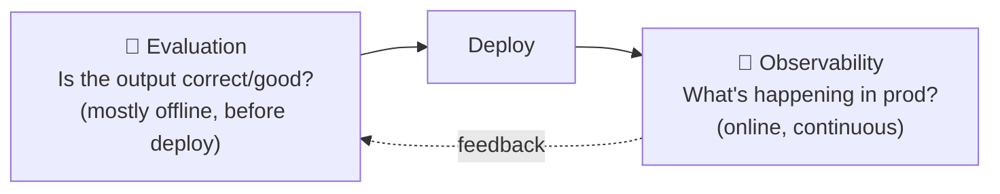
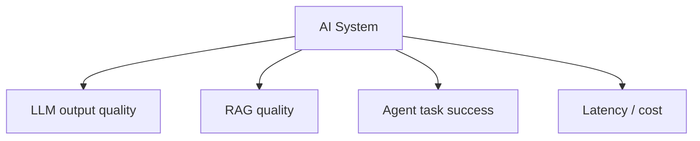
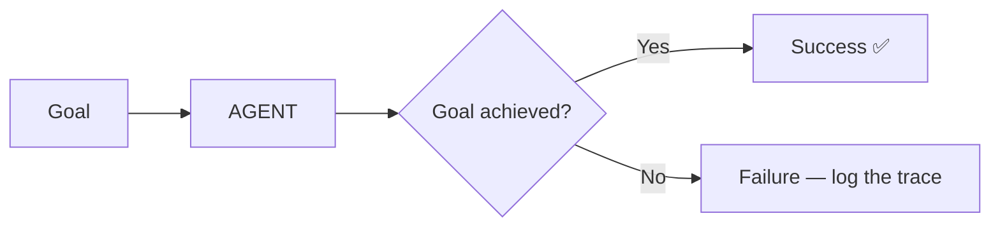
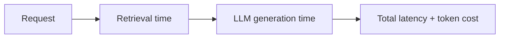
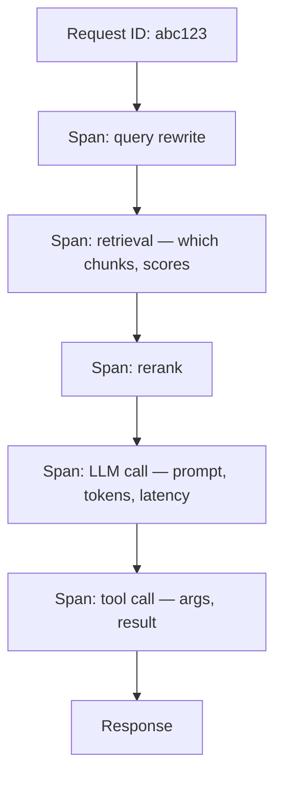
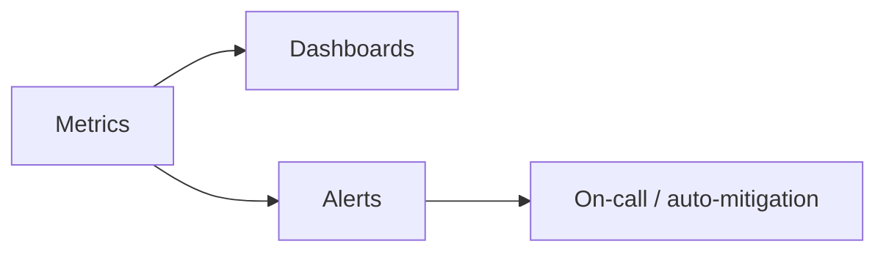
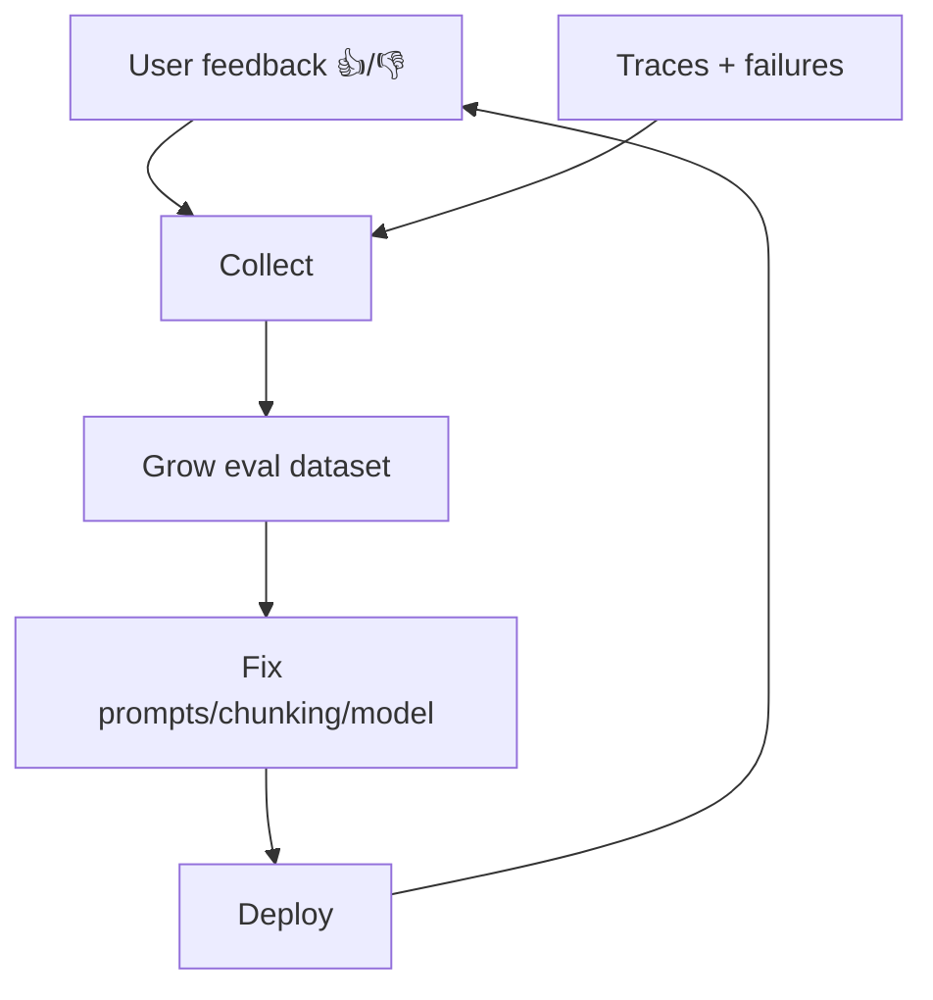
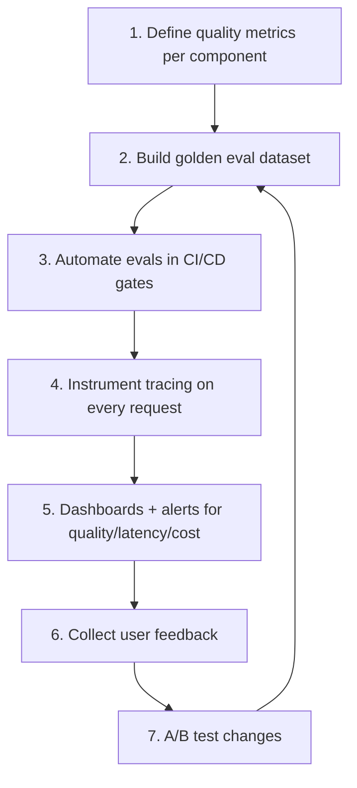

# 15. AI Evaluation & Observability

> **In one sentence:** Evaluation tells you if your AI is *good*; observability tells you what it's *doing in production* — together they let you measure quality, latency, and cost, and catch problems before users do.

**Interview goal:** Design an AI quality/observability strategy.

---

## 15.1 Evaluation vs Observability

They form a loop: evaluate → deploy → observe → feed real failures back into evaluation.

---

## 15.2 What to evaluate (by component)

### LLM evaluation
- **Correctness, relevance, coherence, safety, format compliance.**
- Methods: golden datasets, LLM-as-a-judge, human review.

### RAG evaluation
- **Context relevance, recall, groundedness, answer relevance** (the RAG triad). Full detail in [09 — RAG Evaluation](09-rag-evaluation.md).

### Agent success
- **Task completion rate** — did it achieve the goal?
- **Tool-call accuracy** — right tool, right arguments?
- **Number of steps / efficiency**, and **cost per task**.
- **Recovery** — does it handle errors gracefully?

---

## 15.3 Operational metrics: latency & cost

| Metric | Why it matters |
|--------|----------------|
| **Latency (p50/p95/p99)** | User experience; watch tails, not just averages |
| **Time-to-first-token** | Perceived speed for streaming |
| **Throughput (req/s, tokens/s)** | Capacity planning |
| **Token usage (in/out)** | Directly drives cost |
| **Cost per request / per tenant** | Budgeting & pricing |
| **Error / timeout rate** | Reliability |
| **Cache hit rate** | Efficiency |

---

## 15.4 Tracing

**Tracing** records the full journey of a single request — essential for debugging multi-step RAG and agents.

A good trace captures, per step: inputs, outputs, latency, tokens, cost, and errors. For agents, capture every **thought → action → observation**. This is what lets you answer "*why* did it give this answer?"

---

## 15.5 Monitoring & alerting

- **Dashboards** for quality, latency, cost, errors.
- **Alerts** on thresholds: latency spike, error surge, cost overrun, quality drop.
- **Drift detection** — quality degrading over time as data/usage changes.
- On AWS: **CloudWatch** (metrics/logs/alarms), **CloudTrail** (audit), plus Bedrock's model invocation logging.

---

## 15.6 Feedback loops

Turn production signals into improvements.

- Explicit: thumbs up/down, ratings, corrections.
- Implicit: user retried, abandoned, escalated to human.
- Feed failures into the golden dataset → prevents regressions.

---

## 15.7 Online experimentation

- **A/B testing** — compare prompt/model/chunking variants on live traffic.
- **Canary / shadow deploys** — try changes on a small % or in shadow before full rollout.
- **Guardrail monitoring** — track how often guardrails trigger.

---

## 15.8 Tools

- **Tracing/observability:** LangSmith, Arize Phoenix, Langfuse, OpenTelemetry (GenAI semantic conventions).
- **Evaluation:** Ragas, DeepEval, TruLens, Bedrock model evaluation.
- **AWS ops:** CloudWatch, CloudTrail, X-Ray, Bedrock invocation logging.

---

## 15.9 Designing a quality/observability strategy (template)

1. **Metrics** — pick per-component quality metrics + latency/cost.
2. **Offline eval** — golden dataset, LLM-as-judge + human samples, CI gates.
3. **Tracing** — full request/agent traces with tokens & cost.
4. **Monitoring** — dashboards + alerts + drift detection.
5. **Feedback** — capture 👍/👎 and failures, grow the dataset.
6. **Experiment** — A/B, canary, shadow.
7. **Loop** — continuous improvement.

---

## Practical / Interview Goal

✅ **Design an AI quality/observability strategy.**
> "I split it into evaluation and observability. Offline, I define per-component metrics (RAG triad, agent task success, correctness), build a golden dataset from real logs, and gate CI/CD with LLM-as-a-judge validated by human samples. Online, I instrument end-to-end tracing capturing retrieval, prompts, tokens, latency, cost, and every agent step, feed those to CloudWatch dashboards with alerts on latency p95, error rate, cost, and quality drift. I collect thumbs feedback, run A/B and canary tests, and loop failures back into the eval dataset."

---

## Resources

- [Bedrock model invocation logging](https://docs.aws.amazon.com/bedrock/latest/userguide/model-invocation-logging.html) *(rephrased for compliance)*
- [OpenTelemetry GenAI conventions](https://opentelemetry.io/docs/specs/semconv/gen-ai/) *(rephrased for compliance)*
- Course: *AI A-Z 2026* — evaluation section.
- Next: [16 — AI System Design](16-ai-system-design.md)
