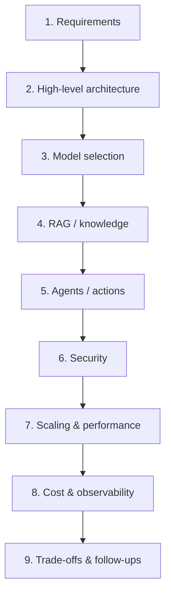
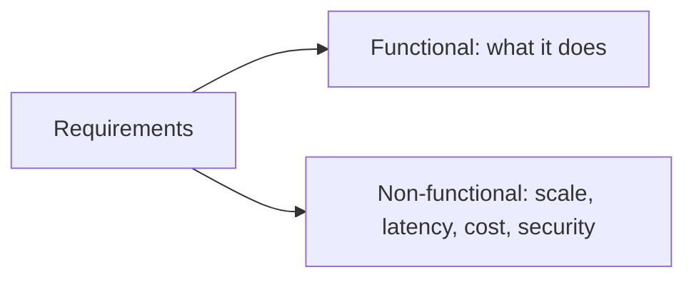
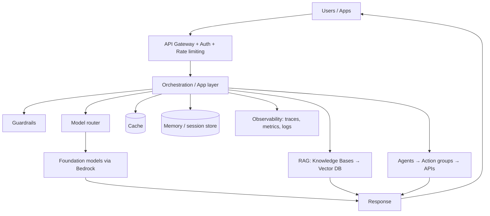
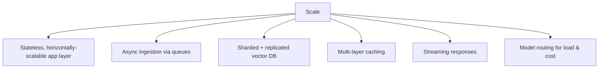
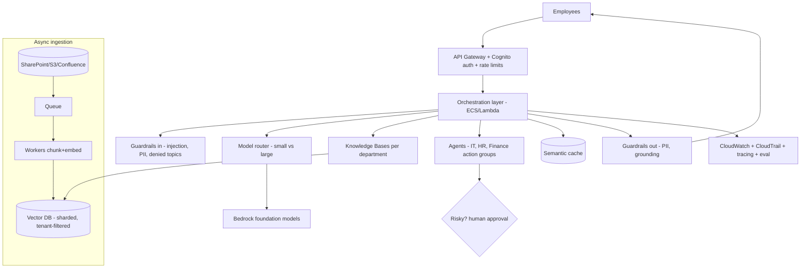

# 16. AI System Design ⭐⭐⭐

> **In one sentence:** AI system design is the skill of turning a vague requirement ("build an enterprise GenAI platform") into a complete architecture — clarifying requirements, then combining model choice, RAG, agents, security, and scaling into one coherent system.

**Interview goal:** Design an Enterprise GenAI Platform.

---

## 16.1 A repeatable framework

Use the same structure every time. It keeps you calm and thorough.

---

## 16.2 Step 1 — Requirements (don't skip this!)

Interviewers judge seniority by whether you clarify before designing.

**Functional:**
- What tasks? (Q&A, summarization, actions, workflows)
- Who are the users? Internal, external, both?
- What data sources and formats?
- Single-turn or conversational? Agentic (takes actions)?

**Non-functional:**
- **Scale** — users, QPS, document count.
- **Latency** — target p95 (e.g., < 2s, or streaming).
- **Cost** — budget / cost-per-request target.
- **Accuracy** — how critical? tolerance for errors?
- **Security & compliance** — PII, GDPR/HIPAA, multi-tenant?
- **Availability** — SLA, regions.

---

## 16.3 Step 2 — High-level architecture

Start with a simple end-to-end diagram, then deepen each box.

---

## 16.4 Step 3 — Model selection

Pick per use case (see [13 — AWS Bedrock §13.3](13-aws-bedrock.md)):
- **Model routing/tiering** — small model for easy, large for hard.
- Consider quality, cost, latency, context window, modality.
- Plan for **model version changes** (re-embedding, re-eval).

---

## 16.5 Step 4 — RAG / knowledge layer

If the system needs private/current knowledge:
- Ingestion pipeline, chunking, embeddings, vector DB.
- Advanced retrieval (hybrid, rerank, metadata filter).
- At scale, the whole of [08 — RAG Production Design](08-rag-production-design.md) applies.

---

## 16.6 Step 5 — Agents / actions

If the system must *do* things (not just answer):
- Define tools/action groups, planning (ReAct), memory, guardrails, HITL.
- See [10 — AI Agents](10-ai-agents.md) and [11 — Agentic Architecture](11-agentic-architecture.md).

---

## 16.7 Step 6 — Security

Apply defense-in-depth from [14 — AI Security](14-ai-security.md):
- IAM least privilege, KMS encryption, PrivateLink/VPC.
- Prompt-injection defenses, PII redaction, guardrails.
- Tenant isolation, tool authorization, human approval for risky actions.

---

## 16.8 Step 7 — Scaling & performance

- Stateless services behind a load balancer/autoscaling.
- Decouple heavy work (ingestion, batch) with queues.
- Cache aggressively (embeddings, semantic responses).
- Set latency SLAs; stream for perceived speed.

---

## 16.9 Step 8 — Cost & observability

- **Cost:** token discipline, model tiering, caching, batch, cost-per-request/tenant tracking.
- **Observability:** end-to-end tracing, dashboards, alerts, evaluation gates (see [15](15-ai-evaluation-observability.md)).

---

## 16.10 Step 9 — Trade-offs (senior signal)

Always name trade-offs; there's no perfect design.

| Decision | Trade-off |
|----------|-----------|
| Bigger model | Better quality ↔ higher cost + latency |
| More retrieved context | More info ↔ cost + "lost in the middle" |
| RAG vs fine-tuning | Fresh/cited ↔ style/latency |
| Multi-agent | More capable ↔ complex, slower, costlier |
| Aggressive caching | Fast/cheap ↔ staleness risk |
| Managed (Bedrock) vs self-hosted | Faster to build ↔ less control/vendor cost |

---

## 16.11 Worked example — Enterprise GenAI Platform

**Requirement:** "Build a company-wide GenAI platform for employees to query internal docs and automate tasks, multi-tenant across departments, secure, at scale."

Talking points:
- **Requirements** → internal users, multi-tenant by department, doc Q&A + task automation, secure, scalable.
- **RAG** → per-department Knowledge Bases; retrieval filtered by `tenant_id` + user permissions.
- **Agents** → department-specific action groups (IT resets, HR lookups) with HITL on writes.
- **Security** → Cognito auth, IAM least privilege, KMS, PrivateLink, guardrails, tenant isolation.
- **Scale** → async ingestion, sharded vector DB, caching, model routing, streaming.
- **Ops** → tracing, dashboards, cost-per-department, evaluation gates.
- **Multi-tenancy** → deep dive in [17](17-multi-tenant-ai.md).

---

## Practical / Interview Goal

✅ **Design an Enterprise GenAI Platform.** Always: (1) clarify requirements first, (2) draw a high-level diagram, (3) go layer by layer — model, RAG, agents, security, scaling, cost/observability, (4) end with trade-offs. Never jump straight to a solution.

---

## Resources

- [AWS Well-Architected — Generative AI Lens](https://docs.aws.amazon.com/wellarchitected/latest/generative-ai-lens/generative-ai-lens.html) *(rephrased for compliance)*
- [Amazon Bedrock architecture docs](https://docs.aws.amazon.com/bedrock/latest/userguide/what-is-bedrock.html) *(rephrased for compliance)*
- Next: [17 — Multi-Tenant AI](17-multi-tenant-ai.md)
