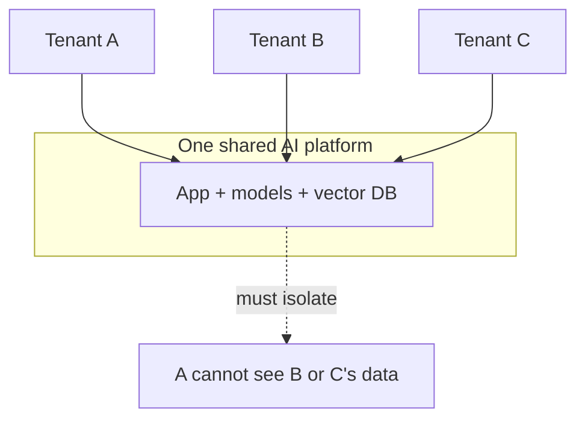
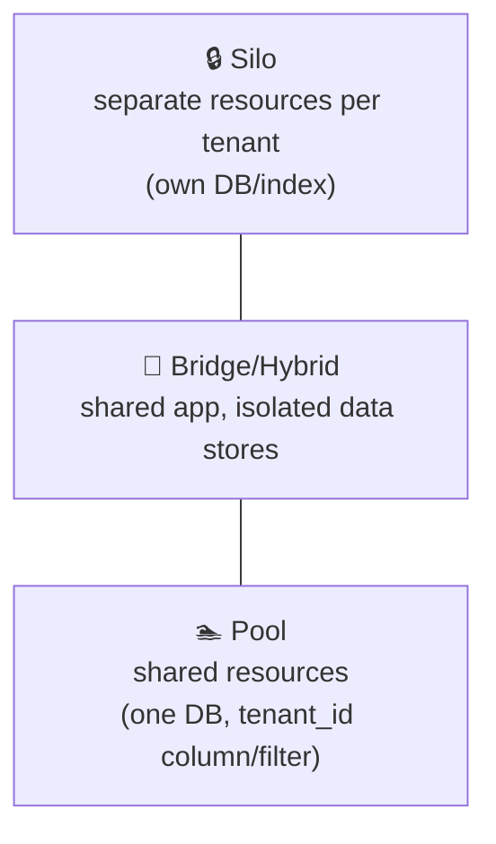
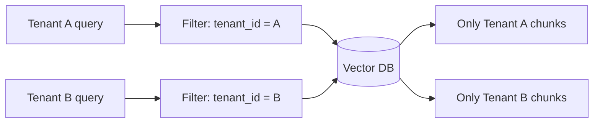
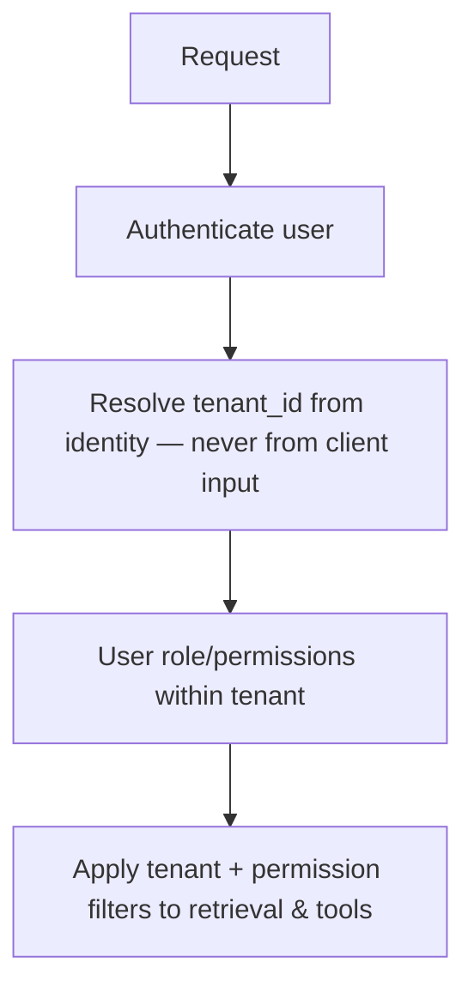
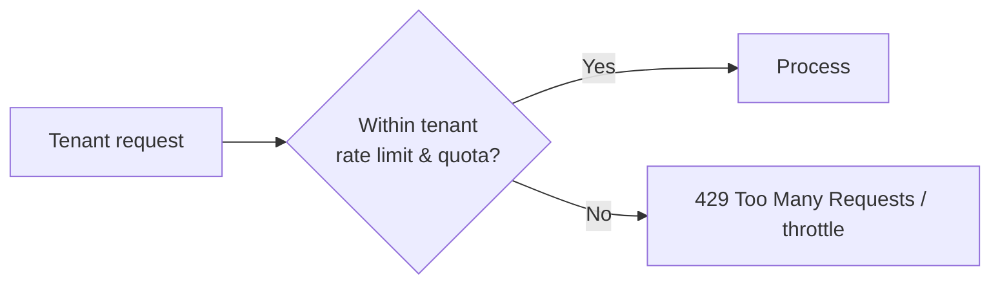
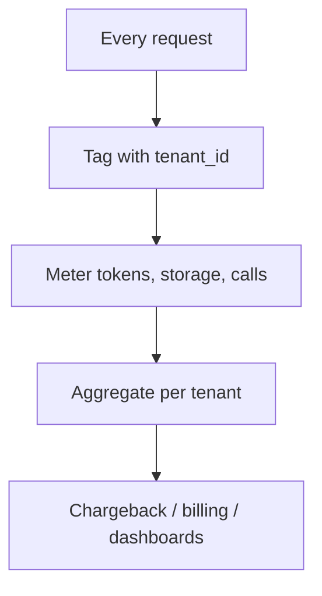
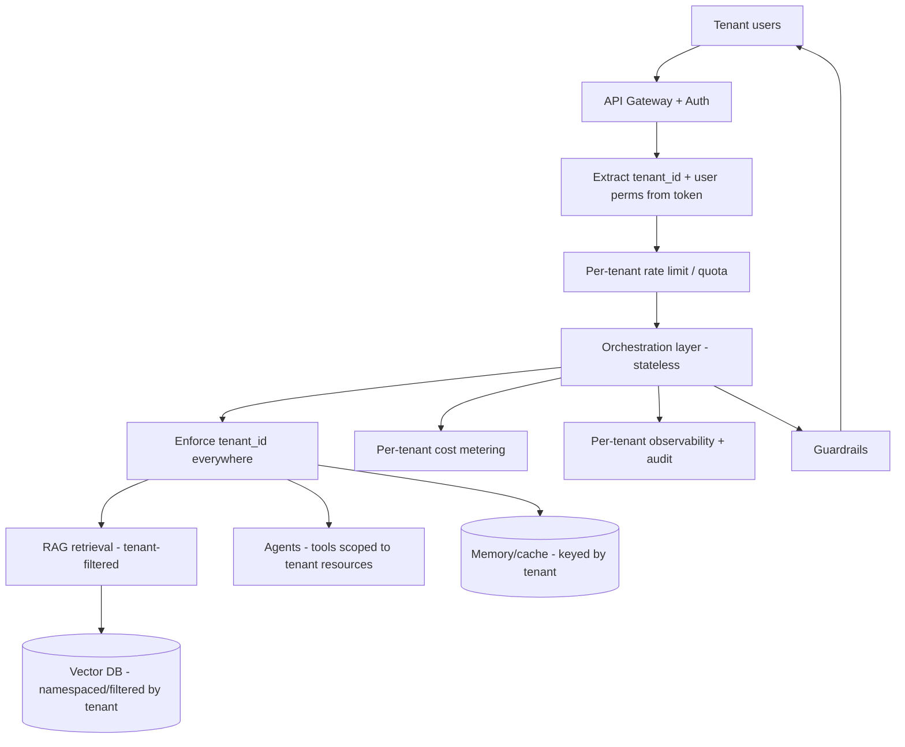

# 17. Multi-Tenant AI ⭐⭐⭐

> **In one sentence:** Multi-tenant AI serves many customers (tenants) from one shared platform while guaranteeing that each tenant's data, knowledge, and costs stay **completely isolated** — one tenant must never see or affect another.

**Interview goal:** Design a multi-tenant RAG/AI platform.

---

## 17.1 What is multi-tenancy?

A **tenant** is a customer/organization/department using your shared platform. Multi-tenancy means one deployment serves all of them efficiently, while keeping them isolated.

The core challenge: **share infrastructure to save cost, but isolate data to stay secure.**

---

## 17.2 Isolation models

| Model | Isolation | Cost | Best for |
|-------|-----------|------|----------|
| **Silo** | Strongest (separate stores) | Highest | Regulated / large enterprise tenants |
| **Pool** | Logical (shared + `tenant_id`) | Lowest | Many small tenants (SaaS) |
| **Bridge/Hybrid** | Mixed | Medium | Big tenants siloed, small ones pooled |

Choice depends on compliance needs, tenant size, and cost.

---

## 17.3 Tenant-specific Knowledge Bases (RAG isolation)

Each tenant's documents must only be retrievable by that tenant.

Options (weakest → strongest isolation):
1. **Metadata filtering (pool)** — one index, every chunk tagged `tenant_id`, every query filtered. Cheapest; the filter is critical and must be unbypassable.
2. **Namespace per tenant** — vector DB namespaces/collections separate tenants.
3. **Index/DB per tenant (silo)** — physically separate stores; strongest.

> Defense in depth: enforce `tenant_id` at the **application layer AND** the data layer, so a single bug can't leak data.

---

## 17.4 Authorization

Two levels: is this **tenant** allowed, and within the tenant, is this **user** allowed?

- **Derive `tenant_id` from the authenticated identity** (token claims), *never* trust a tenant ID sent by the client — that's an easy escalation attack.
- Enforce **user-level** permissions too (a user shouldn't see all of their tenant's docs if restricted).
- Ties into [14 — AI Security §14.7](14-ai-security.md).

---

## 17.5 Quotas & rate limits

Prevent one tenant from starving others ("noisy neighbor").

- **Rate limits** — requests/sec per tenant.
- **Quotas** — tokens/day, documents, storage per tenant (often per plan tier).
- **Fair scheduling** — isolate workloads so a heavy tenant can't degrade others.
- Protects availability and cost.

---

## 17.6 Cost allocation

Know (and often bill) what each tenant costs.

- Track **tokens (in/out), storage, and requests** per tenant.
- Enables **chargeback/showback**, tiered pricing, and spotting expensive tenants.
- On AWS: tagging + cost allocation, plus app-level token metering.

---

## 17.7 Full multi-tenant RAG/AI architecture

Every stateful thing — retrieval, memory, cache, tools, metrics — is **scoped by tenant**.

---

## 17.8 Common pitfalls

- ❌ Trusting a `tenant_id` from the request body/query → **privilege escalation**. Always derive it from auth.
- ❌ Forgetting the tenant filter on **one** query path → data leak.
- ❌ **Shared cache** keyed without tenant → serving Tenant A's answer to Tenant B.
- ❌ No per-tenant limits → one tenant degrades everyone.
- ❌ No per-tenant cost tracking → can't price or spot abuse.
- ❌ Logging another tenant's data into shared logs.

---

## 17.9 Trade-offs

| Choice | Trade-off |
|--------|-----------|
| Pool (shared) | Cheap, efficient ↔ isolation depends on flawless filtering |
| Silo (separate) | Strong isolation, easy compliance ↔ costly, harder to manage at scale |
| Hybrid | Balances both ↔ more architectural complexity |

---

## Practical / Interview Goal

✅ **Design a multi-tenant RAG/AI platform.**
> "I'd choose an isolation model based on compliance and tenant size — pool with per-chunk `tenant_id` filtering for many small tenants, silo for regulated ones, hybrid in between. The `tenant_id` always comes from the authenticated token, never the client. I enforce it at both the app and data layers on every retrieval, tool call, memory access, and cache key. I add per-tenant rate limits and quotas to stop noisy neighbors, meter tokens/storage per tenant for cost allocation, and keep per-tenant observability and audit logs. The biggest risks are a missing filter on one path and trusting a client-supplied tenant ID — so I use defense in depth."

---

## Resources

- [AWS SaaS multi-tenancy guidance](https://docs.aws.amazon.com/wellarchitected/latest/saas-lens/saas-lens.html) *(rephrased for compliance)*
- [Bedrock Knowledge Bases — metadata filtering](https://docs.aws.amazon.com/bedrock/latest/userguide/kb-test-config.html) *(rephrased for compliance)*
- Next: [18 — Hands-on, Mock Interview & Final Revision](18-handson-mock-revision.md)
