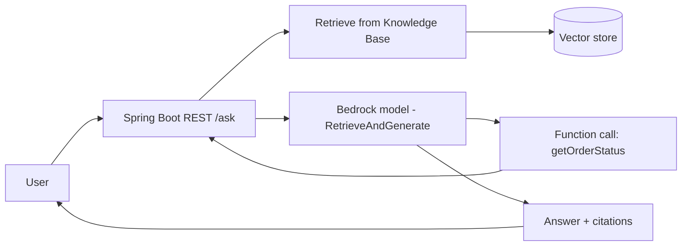
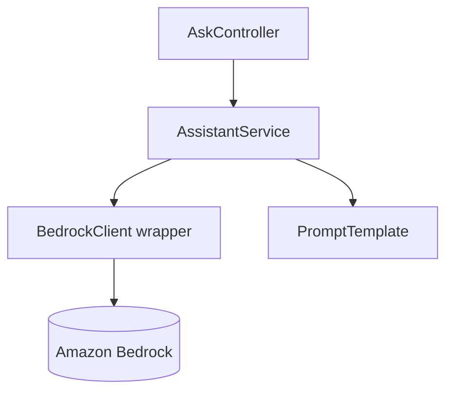
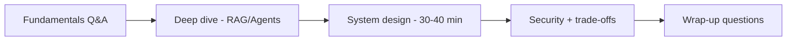
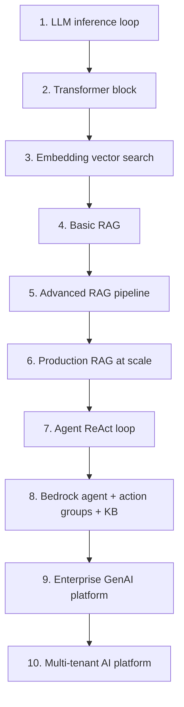

# 18. Hands-on Coding, Mock Interview & Final Revision

> **In one sentence:** This is where you turn *knowledge* into *skill* — build a small GenAI app, rehearse full mock interviews, and compress everything into a quick-recall revision sheet.

**Interview goals:** Build one small Java GenAI application · Do 2–3 full mock interviews · Be able to explain an enterprise AI system for 45 minutes.

---

## Part A — Hands-on Coding

### A.1 Goal
Build **one small Java GenAI application** that touches the core skills: calling an LLM, RAG, and tool/function calling. Small and working beats big and unfinished.

### A.2 Suggested project: "Docs Assistant" (Spring Boot + Bedrock)
A REST service that answers questions over your documents using RAG, with one tool the model can call.

### A.3 Build it in stages
1. **LLM call** — POST a prompt to Bedrock, return the completion. (Learn the SDK, auth, inference params.)
2. **RAG** — create a Bedrock Knowledge Base from docs in S3; call `RetrieveAndGenerate`; return answer + citations.
3. **Tool calling** — define one function (e.g., `getOrderStatus(id)`); let the model request it; your code runs it and returns the result.
4. **Polish** — add a system prompt, low temperature, and a guardrail.

### A.4 Java / Spring Boot essentials
- **SDK:** AWS SDK for Java v2 — `BedrockRuntimeClient` (inference) and `BedrockAgentRuntimeClient` (Knowledge Bases / agents).
- **Auth:** IAM role or credentials; least-privilege policy limited to the models/KB you use.
- **Config:** region + model ID in `application.properties`.
- **Structure:** `Controller → Service → BedrockClient`; keep prompts in a template class.

### A.5 What to be able to demo/explain
- How a prompt flows from HTTP request → Bedrock → response.
- How RAG retrieval is wired in and how citations come back.
- How function calling works (model requests, your code executes).
- Where you set inference params, guardrails, and IAM permissions.

---

## Part B — Mock Interview

### B.1 Goal
Run **2–3 full mock interviews** covering LLM + RAG + Agents + AWS + security + system design. Practice out loud, ideally with a peer or by recording yourself.

### B.2 Structure of a GenAI interview

### B.3 Question bank (rehearse each)

**Fundamentals**
- Explain AI vs ML vs DL vs GenAI. (→ [01](01-ai-genai-fundamentals.md))
- What happens when a prompt reaches an LLM? (→ [02](02-llm-fundamentals.md))
- What are temperature, top-k, top-p? (→ [02](02-llm-fundamentals.md))
- Explain attention / draw a Transformer. (→ [03](03-transformers.md))
- How does text become searchable by meaning? (→ [05](05-embeddings.md))

**RAG**
- Draw the full RAG architecture. (→ [06](06-rag-fundamentals.md))
- How would you improve poor RAG results? (→ [07](07-advanced-rag.md))
- Design RAG for 10M documents. (→ [08](08-rag-production-design.md))
- How do you know your RAG works? (→ [09](09-rag-evaluation.md))

**Agents & MCP**
- Chatbot vs agent? Design an enterprise agent. (→ [10](10-ai-agents.md))
- Design an AWS troubleshooting agent. (→ [11](11-agentic-architecture.md))
- MCP vs REST API, why agents use MCP. (→ [12](12-mcp.md))

**AWS / Security / Design**
- Design an AWS GenAI platform. (→ [13](13-aws-bedrock.md))
- How do you secure an enterprise AI platform? (→ [14](14-ai-security.md))
- Design an AI observability strategy. (→ [15](15-ai-evaluation-observability.md))
- Design an Enterprise GenAI Platform end-to-end. (→ [16](16-ai-system-design.md))
- Design a multi-tenant RAG platform. (→ [17](17-multi-tenant-ai.md))

### B.4 Interview technique
- **Clarify first** — restate the question, ask about scale/latency/cost/security.
- **Think out loud** — show reasoning, not just conclusions.
- **Draw** — diagrams beat paragraphs.
- **Name trade-offs** — this signals seniority.
- **Structure** — requirements → architecture → deep dive → security → scale → cost.
- After each mock, note the 3 weakest answers and re-study those files.

---

## Part C — Final Revision

### C.1 Goal
Compress everything into fast recall: **20 key concepts, 10 architectures, 50 questions, and the trade-offs.** Target: explain an enterprise AI system confidently for **45 minutes**.

### C.2 20 key concepts (flash-recall)
1. AI ⊃ ML ⊃ DL ⊃ GenAI
2. Token / context window
3. Parameters vs inference settings
4. Temperature / top-k / top-p
5. Transformer & attention (Q/K/V)
6. Embeddings & vector space
7. Cosine similarity
8. ANN (HNSW)
9. RAG two phases (ingest / retrieve+generate)
10. Chunking (fixed, semantic, parent-child)
11. Hybrid search
12. Reranking
13. RAG triad (context relevance, groundedness, answer relevance)
14. Hallucination & grounding
15. Agent loop (ReAct: think→act→observe)
16. Function/tool calling (model requests, app executes)
17. MCP (standard protocol; tools/resources/prompts; discovery)
18. Bedrock (models + KB + agents + guardrails)
19. Prompt injection & defense-in-depth security
20. Multi-tenancy (isolation, tenant_id from auth, quotas, cost)

### C.3 10 architectures to draw from memory

Practice drawing each in under 3 minutes without looking.

### C.4 Trade-offs to always mention
- Model size: quality ↔ cost/latency
- Context amount: coverage ↔ cost / "lost in middle"
- RAG ↔ fine-tuning
- Managed (Bedrock) ↔ self-hosted
- Pool ↔ silo multi-tenancy
- Caching: speed/cost ↔ staleness
- Single ↔ multi-agent

### C.5 The 45-minute enterprise story (spine)
> Requirements → high-level architecture → model selection/routing → RAG (ingest, retrieve, rerank) → agents (tools, HITL) → security (IAM, encryption, injection, tenant isolation, guardrails) → scaling (async ingest, sharding, caching, streaming) → evaluation & observability (RAG triad, tracing, dashboards) → cost (tiering, per-tenant metering) → trade-offs.

If you can walk this spine and expand any box on request, you're ready.

### C.6 Final checklist
- [ ] Can explain all 20 concepts in plain English.
- [ ] Can draw all 10 architectures from memory.
- [ ] Rehearsed all 50 questions out loud.
- [ ] Built and can demo the Java GenAI app.
- [ ] Completed 2–3 full mocks.
- [ ] Can talk trade-offs for every major decision.
- [ ] Can deliver the 45-minute enterprise story.

---

## Practical / Interview Goals

✅ **Build one small Java GenAI application** — Spring Boot + Bedrock doing LLM call + RAG + one tool.
✅ **Do 2–3 full mock interviews** — cover the full stack, review weak spots after each.
✅ **Explain an enterprise AI system for 45 minutes** — using the spine in C.5.

---

## Resources

- Your own notes ([01](01-ai-genai-fundamentals.md)–[17](17-multi-tenant-ai.md)) + the architecture diagrams in each.
- [AWS SDK for Java v2 — Bedrock](https://docs.aws.amazon.com/sdk-for-java/latest/developer-guide/home.html) *(rephrased for compliance)*
- [Spring AI (Bedrock support)](https://docs.spring.io/spring-ai/reference/) *(rephrased for compliance)*
- Back to [README / index](README.md)
