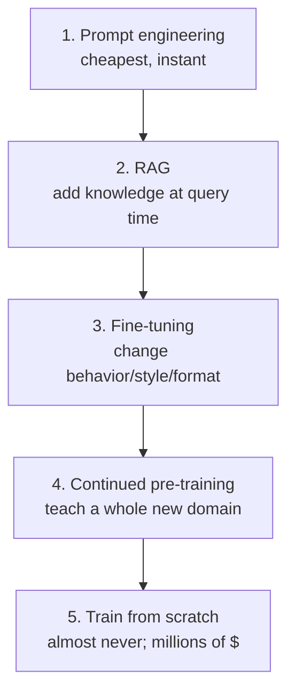
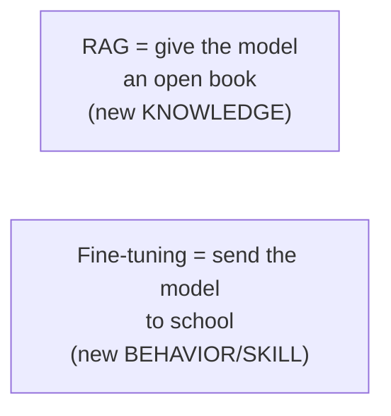
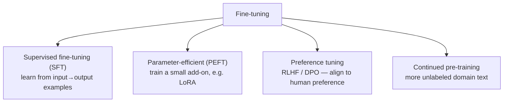
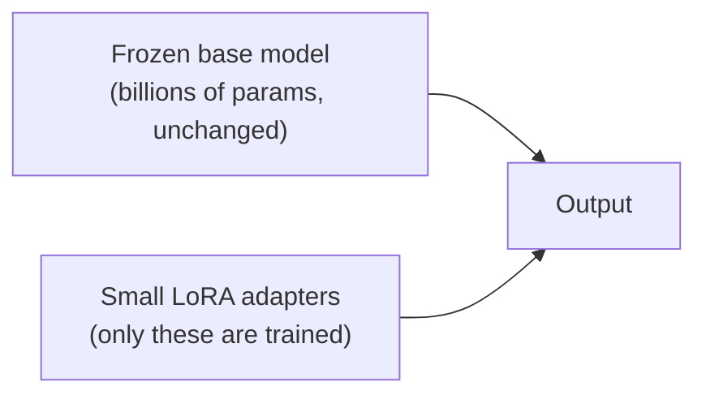
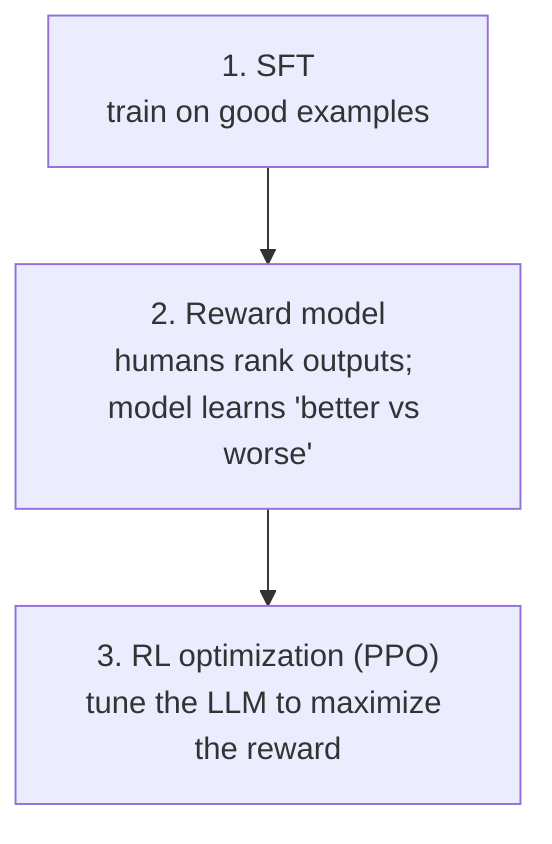
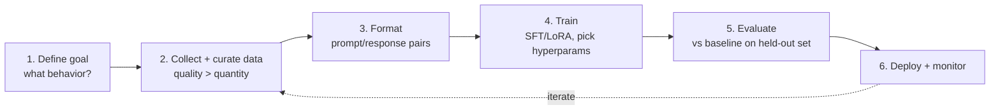
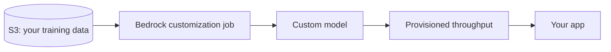

# 19. Fine-Tuning & Model Customization

> **In one sentence:** Fine-tuning takes a pretrained foundation model and trains it a bit more on *your* data so it learns your style, format, or domain — used when prompting and RAG aren't enough.

**Interview goal:** Explain when to fine-tune vs use RAG vs prompt engineering, and how techniques like LoRA make it affordable.

---

## 19.1 The ladder of customization

Always climb from cheapest/fastest to most expensive. Try the lower rungs first.

| Approach | Changes model weights? | Good for | Cost |
|----------|------------------------|----------|------|
| Prompt engineering | No | Quick behavior tweaks | 💲 |
| RAG | No | Fresh/private *knowledge*, citations | 💲💲 |
| Fine-tuning | Yes | *Behavior*: tone, format, narrow tasks | 💲💲💲 |
| Continued pre-training | Yes | New domain/language | 💲💲💲💲 |
| Train from scratch | Yes (all) | Building a new base model | 💲💲💲💲💲 |

---

## 19.2 RAG vs Fine-tuning (the classic question)

The simplest mental model:

| | **RAG** | **Fine-tuning** |
|---|---------|-----------------|
| Adds | Knowledge/facts | Behavior, style, format, skill |
| Data freshness | Live — update the docs | Frozen at training time |
| Citations | Yes | No |
| Handles changing data | Easily | Needs retraining |
| Reduces hallucination | Yes (grounding) | Not directly |
| Latency/cost per query | Higher (retrieval + big context) | Lower (knowledge is baked in) |
| Effort | Build a pipeline | Curate data + train + host |

**When to use which:**
- Facts that change or need citations → **RAG**.
- Consistent tone/format, a narrow repeated task, shorter prompts → **fine-tuning**.
- Both? **Combine them** — fine-tune for style, RAG for facts.

> Interview line: *"RAG adds knowledge; fine-tuning adds behavior. If the problem is 'the model doesn't know X,' use RAG. If it's 'the model doesn't answer the way I want,' fine-tune."*

---

## 19.3 Types of fine-tuning

- **SFT (Supervised Fine-Tuning)** — you provide labeled `prompt → ideal response` pairs; the model learns to imitate them. The most common form.
- **PEFT (Parameter-Efficient Fine-Tuning)** — see §19.4.
- **Preference tuning (RLHF / DPO)** — see §19.5.
- **Continued (domain) pre-training** — keep pretraining on large domain text (e.g., legal, medical) to build background knowledge.

---

## 19.4 LoRA & PEFT — making fine-tuning affordable

Full fine-tuning updates **all** billions of parameters → huge GPU cost and a full model copy per task. **PEFT** freezes the original model and trains only a tiny set of new parameters.

**LoRA (Low-Rank Adaptation)** is the most popular PEFT method: it inserts small "adapter" matrices and trains only those.

| | Full fine-tuning | LoRA / PEFT |
|---|------------------|-------------|
| Params trained | All (billions) | ~0.1–1% |
| GPU/memory | Very high | Much lower |
| Output size | Full model copy | Small adapter file (MBs) |
| Multiple tasks | A model each | Swap adapters on one base |
| Quality | Baseline | Usually near-equal |

- **QLoRA** = LoRA + a quantized (compressed) base model → fine-tune large models on a single GPU.
- **Adapter swapping** — host one base model, load different small adapters per customer/task.

---

## 19.5 RLHF & preference alignment (how chat models are made polite)

After SFT, models are aligned to human preferences so they're helpful, honest, and harmless.

- **RLHF (Reinforcement Learning from Human Feedback)** — the classic 3-step pipeline above.
- **DPO (Direct Preference Optimization)** — a simpler, popular alternative that skips the separate reward model and RL loop, learning directly from preference pairs.
- You usually *consume* aligned models rather than run RLHF yourself, but interviewers like to hear you know why chat models behave well.

---

## 19.6 The fine-tuning workflow

Key points:
- **Data quality is everything** — a few hundred to a few thousand *clean, representative* examples often beat huge noisy sets.
- **Hold out a test set** — measure improvement objectively (see [09](09-rag-evaluation.md), [15](15-ai-evaluation-observability.md)).
- Watch for **overfitting** (memorizing) and **catastrophic forgetting** (losing general ability).

---

## 19.7 Risks & trade-offs

| Risk | Note |
|------|------|
| **Stale knowledge** | Fine-tuned facts freeze; changing data → retrain (prefer RAG for facts) |
| **Overfitting** | Too many epochs / too little data → brittle model |
| **Catastrophic forgetting** | May lose general skills; keep some diverse data |
| **Data leakage/PII** | Model can memorize sensitive training data → scrub PII first (see [14](14-ai-security.md)) |
| **Cost & ops** | Training + hosting a custom model adds MLOps burden |
| **Versioning** | New base model = re-fine-tune + re-evaluate |

---

## 19.8 Fine-tuning on AWS Bedrock

Bedrock supports customization without managing infrastructure:
- **Fine-tuning** — supply labeled data in S3; Bedrock produces a **custom model**.
- **Continued pre-training** — train on unlabeled domain data.
- Served via **provisioned throughput** for the custom model.
- Your data stays private and isn't used to train the base models.

---

## Practical / Interview Goal

✅ **Explain fine-tuning vs RAG vs prompting.**
> "I climb the customization ladder cheapest-first: prompt engineering, then RAG, then fine-tuning. RAG adds *knowledge* and keeps facts fresh with citations; fine-tuning changes *behavior* — tone, format, a narrow skill. For fine-tuning I'd use parameter-efficient methods like LoRA (or QLoRA) to train tiny adapters on a frozen base, which is cheap and lets me swap adapters per task. I curate high-quality prompt/response pairs, hold out a test set, and watch for overfitting and catastrophic forgetting. On Bedrock I can run fine-tuning or continued pre-training and serve the custom model via provisioned throughput. For changing facts I stick with RAG, and I often combine both."

---

## Resources

- [Amazon Bedrock model customization](https://docs.aws.amazon.com/bedrock/latest/userguide/custom-models.html) *(rephrased for compliance)*
- Paper: *LoRA: Low-Rank Adaptation of Large Language Models* (Hu et al., 2021).
- Related: [01](01-ai-genai-fundamentals.md), [06](06-rag-fundamentals.md), [14](14-ai-security.md)
- Next: [20 — Responsible AI & Governance](20-responsible-ai-governance.md)
