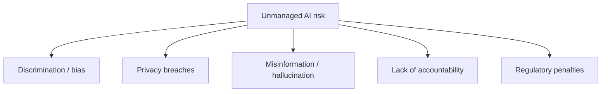
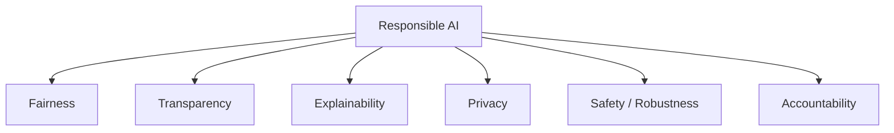
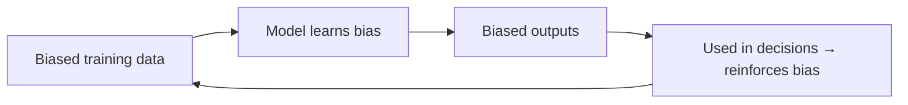
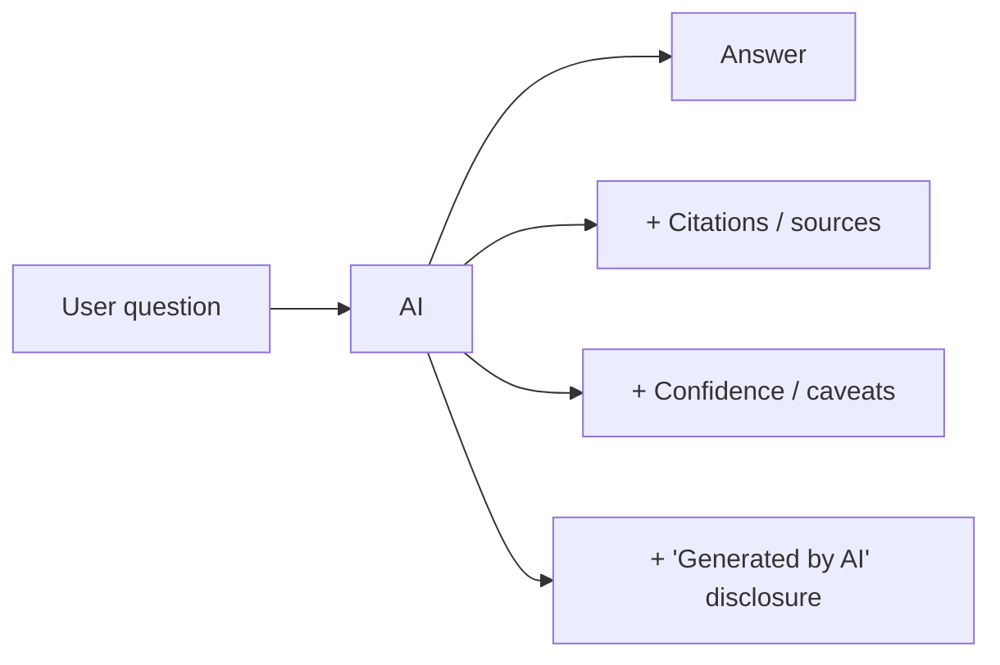
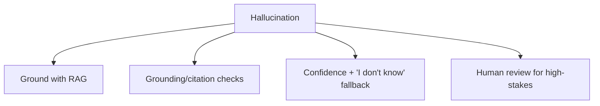
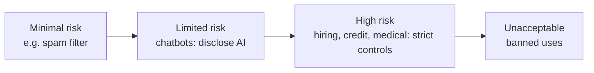
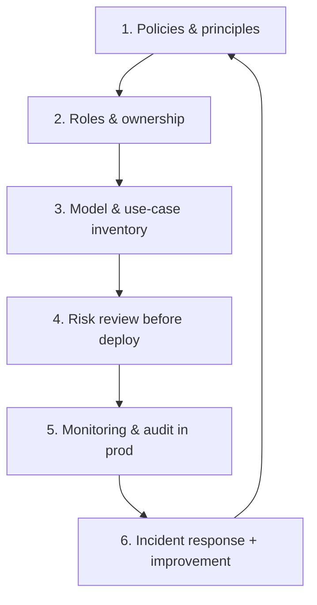

# 20. Responsible AI & Governance

> **In one sentence:** Responsible AI is about making sure your AI system is **fair, transparent, safe, private, and accountable** — and governance is the set of policies, roles, and processes that keep it that way over time.

**Interview goal:** Explain how you'd make an enterprise AI system responsible and compliant.

---

## 20.1 Why it matters

AI systems can cause real harm: biased decisions, privacy violations, confident misinformation, and unexplainable outcomes. For **enterprise** roles, interviewers increasingly expect you to speak to this — not just accuracy and latency.

---

## 20.2 The core principles

| Principle | What it means | Practical action |
|-----------|---------------|------------------|
| **Fairness** | No unjust bias against groups | Test outputs across demographics; balance training data |
| **Transparency** | Users know they're using AI and how | Disclose AI use; document data & models |
| **Explainability** | Decisions can be understood | Show sources/citations, reasoning, confidence |
| **Privacy** | Personal data is protected | PII redaction, minimization, consent (see [14](14-ai-security.md)) |
| **Safety / Robustness** | Behaves well, resists misuse | Guardrails, red-teaming, testing edge cases |
| **Accountability** | A human is responsible | Clear ownership, audit logs, human-in-the-loop |

---

## 20.3 Bias — where it comes from and how to reduce it

Sources of bias:
- **Data bias** — training data over/under-represents groups.
- **Label bias** — human labels carry prejudice.
- **Selection bias** — who/what the data was collected from.
- **Feedback loops** — biased outputs feed back into future data.

Mitigations:
- Audit datasets for representation.
- Test outputs across groups; measure fairness gaps.
- Use diverse evaluation sets and human review.
- Add guardrails to block discriminatory outputs.
- Keep a human in the loop for high-stakes decisions (hiring, lending, healthcare).

---

## 20.4 Transparency & explainability

- **Disclose** when content is AI-generated.
- **Cite sources** (RAG makes this natural — see [06](06-rag-fundamentals.md)).
- **Model/data documentation** — "model cards" and "data sheets" describe intended use, limitations, and training data.
- **Avoid overreliance** — remind users to verify high-stakes outputs.

---

## 20.5 Hallucination as a governance issue

Hallucination isn't just a quality bug — presenting false info as fact can cause harm and liability.

Policy questions to answer: *Where is a wrong answer dangerous? What's the fallback? Who reviews it?* (See [09 — RAG Evaluation](09-rag-evaluation.md) and [15 — Observability](15-ai-evaluation-observability.md).)

---

## 20.6 Regulations & standards (know the names)

You don't need legal expertise, but naming these signals maturity:

| Framework | What it is |
|-----------|-----------|
| **EU AI Act** | Risk-based AI regulation; stricter rules for "high-risk" uses |
| **NIST AI Risk Management Framework** | Voluntary US framework: Govern, Map, Measure, Manage |
| **ISO/IEC 42001** | International standard for AI management systems |
| **GDPR / HIPAA / PCI-DSS** | Data privacy/security laws that also apply to AI data |
| **OWASP Top 10 for LLMs** | Security risk checklist (see [14](14-ai-security.md)) |

*The EU AI Act's risk tiers (simplified).*

---

## 20.7 AI governance in practice

Governance = the operating model that keeps AI responsible over time.

- **Policies** — acceptable use, data handling, human oversight rules.
- **Roles** — who approves, who owns, who is accountable.
- **Inventory** — a register of AI use cases and their risk level.
- **Pre-deployment review** — risk/impact assessment for each use case.
- **Monitoring & audit** — logs, drift detection, fairness metrics (see [15](15-ai-evaluation-observability.md)).
- **Incident response** — a plan for when the AI misbehaves.

---

## 20.8 Responsible AI on AWS

- **Bedrock Guardrails** — content filters, denied topics, PII redaction, contextual grounding (anti-hallucination).
- **Model transparency** — AWS AI Service Cards describe intended use and limitations.
- **Bedrock model evaluation** — evaluate quality and safety.
- **CloudTrail / CloudWatch** — audit trails and monitoring for accountability.
- Foundation-model providers publish safety and alignment documentation.

---

## Practical / Interview Goal

✅ **Explain how you'd make an enterprise AI system responsible.**
> "I'd build responsible AI around fairness, transparency, explainability, privacy, safety, and accountability. Concretely: audit training/eval data for bias and test outputs across groups; disclose AI use and provide citations via RAG so answers are explainable; redact PII and minimize data; use guardrails plus red-teaming for safety; and keep humans accountable with audit logs and human-in-the-loop for high-stakes decisions. I'd wrap it in governance — a use-case inventory with risk levels, pre-deployment risk reviews, production monitoring for drift and fairness, and an incident-response plan — mapped to frameworks like the NIST AI RMF and the EU AI Act. On AWS I'd lean on Bedrock Guardrails, model evaluation, AI Service Cards, and CloudTrail auditing."

---

## Resources

- [NIST AI Risk Management Framework](https://www.nist.gov/itl/ai-risk-management-framework) *(rephrased for compliance)*
- [AWS Responsible AI](https://aws.amazon.com/machine-learning/responsible-ai/) *(rephrased for compliance)*
- Related: [14 — AI Security](14-ai-security.md), [09 — RAG Evaluation](09-rag-evaluation.md), [15 — Observability](15-ai-evaluation-observability.md)
- Next: [21 — Cost Optimization](21-cost-optimization.md)
