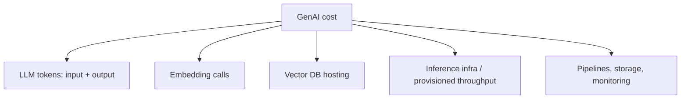
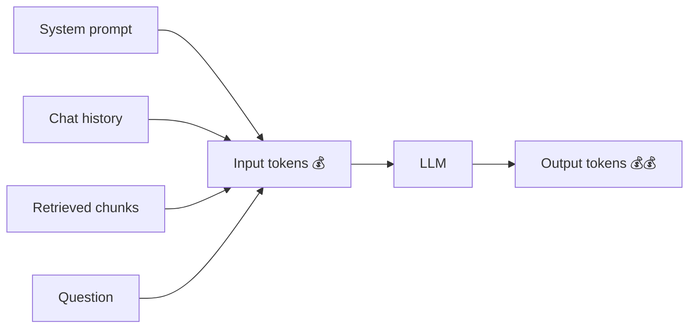
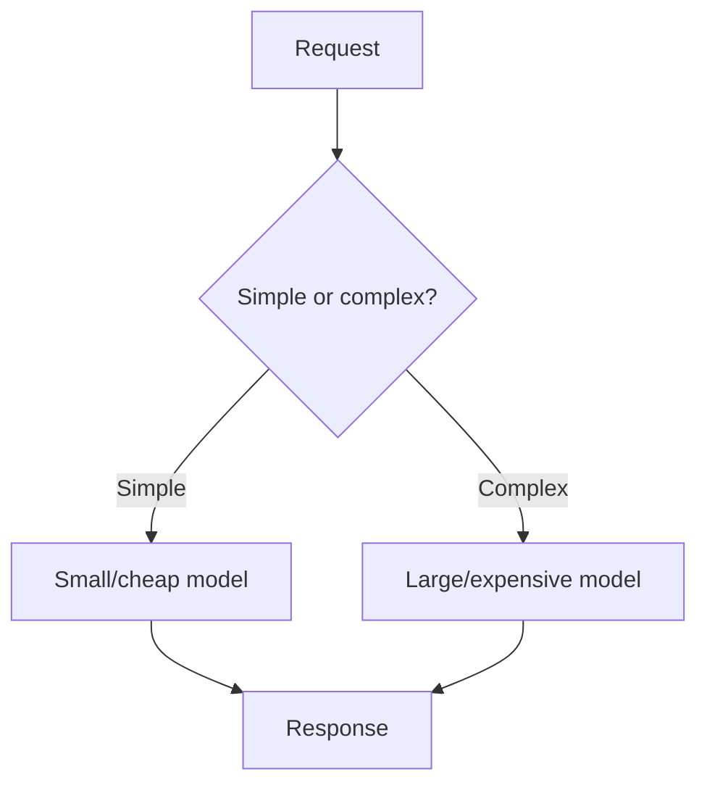
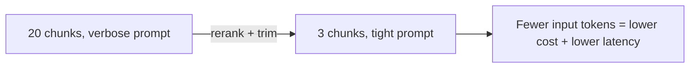
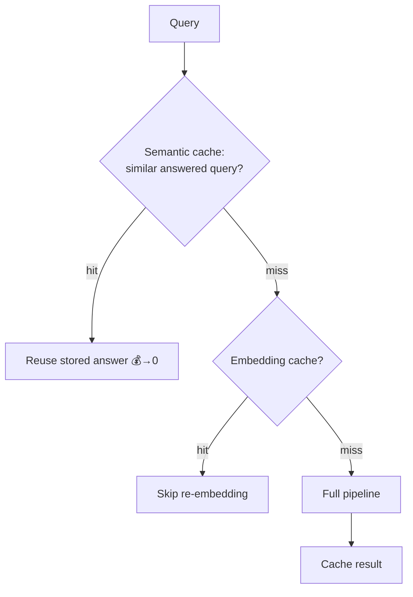
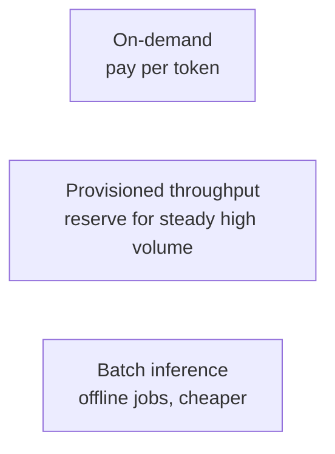
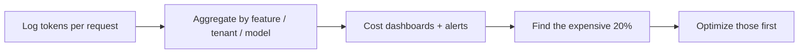
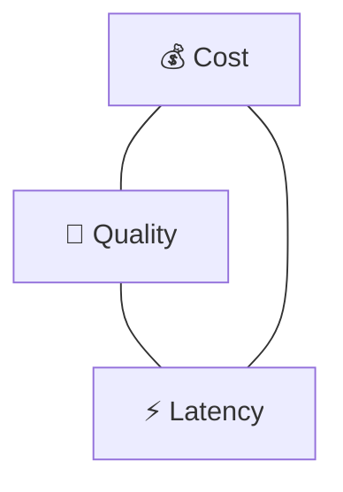

# 21. Cost Optimization & Token Economics

> **In one sentence:** GenAI costs are driven mainly by **tokens** — so you optimize by using fewer/cheaper tokens, picking the right-sized model for each request, and caching aggressively, all without hurting quality.

**Interview goal:** Explain how you'd reduce the cost of a GenAI platform while keeping it good and fast.

---

## 21.1 Where the money goes



For most apps, **LLM tokens dominate**. So token discipline is the #1 lever.

---

## 21.2 Token economics basics

You're billed per token, usually with **input** and **output** priced separately (output is often more expensive).

```
Cost ≈ (input_tokens × input_price) + (output_tokens × output_price)
```

- **1 token ≈ 4 characters ≈ ¾ of a word** (see [02 — LLM Fundamentals](02-llm-fundamentals.md)).
- **RAG inflates input tokens** — every retrieved chunk is input you pay for, on every call.
- **Long conversations grow** — chat history is resent each turn unless you manage it.



---

## 21.3 Lever 1 — Model selection & routing

Don't use a flagship model for every request. **Route** by difficulty.



- **Model tiering/routing** — small model for classification, extraction, simple Q&A; big model only for hard reasoning.
- A cheaper model at good-enough quality can cut cost by an order of magnitude.
- Consider **distilled/smaller variants** of the same family.

---

## 21.4 Lever 2 — Prompt & context discipline

Every token in the prompt costs money on every call.

- **Retrieve fewer, better chunks** — reranking lets you send top 3 instead of top 20 (see [07 — Advanced RAG](07-advanced-rag.md)).
- **Trim system prompts** — concise instructions, no bloat.
- **Summarize/compress context** — replace long history with a running summary.
- **Cap output** — set `max_tokens`; ask for concise answers.
- **Avoid resending** static content when the provider supports prompt caching.



---

## 21.5 Lever 3 — Caching

Caching cuts both **cost** and **latency** (also see [08 — RAG Production Design §8.6](08-rag-production-design.md)).



- **Semantic response cache** — reuse answers for semantically similar questions.
- **Embedding cache** — never re-embed identical text.
- **Prompt caching** — some providers cache a static prompt prefix at reduced cost.
- ⚠️ Invalidate when source docs change.

---

## 21.6 Lever 4 — Inference & batching



- **On-demand** for spiky/low volume.
- **Provisioned throughput** for high, steady traffic — predictable cost + latency.
- **Batch** for large non-urgent jobs (bulk embedding, offline analysis).
- **Batch embeddings** during ingestion to cut per-call overhead.

---

## 21.7 Lever 5 — Vector DB & storage cost

- **Quantize** vectors (int8/PQ) to fit more in memory (see [05 — Embeddings §5.7](05-embeddings.md)).
- **Tiered storage** — move cold/rarely-used vectors to cheaper storage.
- **Right-size** the cluster; don't over-provision replicas.
- **Dedupe** documents so you don't store/search redundant chunks.

---

## 21.8 Measure before you optimize

You can't optimize what you don't measure.



- Track **cost per request**, **per feature**, and **per tenant** (see [17 — Multi-Tenant AI](17-multi-tenant-ai.md)).
- Alert on cost spikes.
- Focus effort on the few endpoints/tenants that drive most spend.

---

## 21.9 The cost ↔ quality ↔ latency triangle



Every optimization trades against the others — name the trade-off:
- Smaller model → cheaper + faster, but maybe lower quality.
- Less context → cheaper + faster, but risk missing info.
- Aggressive caching → cheaper + faster, but staleness risk.
- Provisioned throughput → predictable + fast, but you pay for idle capacity.

The goal isn't *cheapest* — it's **cheapest that still meets your quality and latency SLA**.

---

## 21.10 Quick optimization checklist

- [ ] Route simple requests to a cheaper model.
- [ ] Rerank + trim retrieved context to the essential chunks.
- [ ] Cap `max_tokens`; ask for concise answers.
- [ ] Enable semantic + embedding + prompt caching.
- [ ] Summarize long conversation history.
- [ ] Batch embeddings; use batch inference for offline jobs.
- [ ] Quantize vectors; right-size the vector DB.
- [ ] Track cost per request/feature/tenant with alerts.
- [ ] Re-check quality/latency after each change.

---

## Practical / Interview Goal

✅ **Explain how you'd cut GenAI cost without hurting quality.**
> "Costs are dominated by tokens, so I start there. I route requests by difficulty — a small cheap model for simple tasks, a flagship only for hard reasoning. I keep prompts tight and use reranking to send the top 3 chunks instead of 20, cap output length, and summarize long histories. I add semantic, embedding, and prompt caching to avoid repeat work, and use batch inference for offline jobs plus provisioned throughput for steady high volume. On storage I quantize vectors and right-size the vector DB. Critically, I meter cost per request, feature, and tenant, alert on spikes, and optimize the expensive 20% first — always re-checking that I still meet the quality and latency SLA, since cost, quality, and latency trade off against each other."

---

## Resources

- [Amazon Bedrock pricing](https://aws.amazon.com/bedrock/pricing/) *(rephrased for compliance)*
- Related: [02 — LLM Fundamentals](02-llm-fundamentals.md), [08 — RAG Production Design](08-rag-production-design.md), [13 — AWS Bedrock](13-aws-bedrock.md), [17 — Multi-Tenant AI](17-multi-tenant-ai.md)
- Back to [README / index](README.md)
