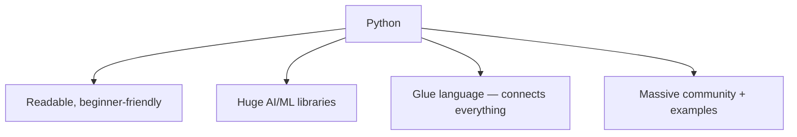
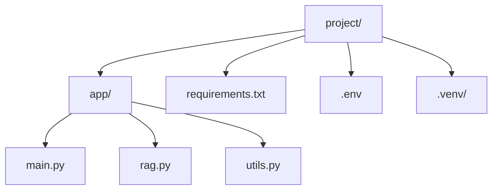
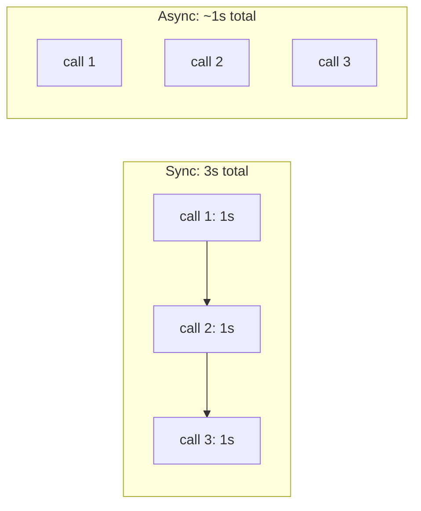

# 22. Python for AI

> **In one sentence:** Python is the default language of AI — its simple syntax, huge library ecosystem, and readable code let you go from idea to working LLM/RAG app fast.

**Interview goal:** Be comfortable reading and writing the Python you'll actually use to build GenAI apps.

---

## 22.1 Why Python for AI?



Nearly every AI SDK (OpenAI, Anthropic, AWS `boto3`, LangChain, Hugging Face) ships a Python client first. You don't need deep computer science — you need the practical subset below.

---

## 22.2 Setup essentials

```bash
python --version          # check version (use 3.10+ for modern libs)

# Virtual environment — isolate project dependencies (ALWAYS do this)
python -m venv .venv
# activate it:
#   Windows:  .venv\Scripts\activate
#   macOS/Linux: source .venv/bin/activate

pip install requests boto3      # install packages
pip freeze > requirements.txt   # save exact versions
pip install -r requirements.txt # reinstall later
```

> **Why virtual environments?** They keep each project's packages separate so versions don't clash. Think of it as a clean toolbox per project.

---

## 22.3 Variables & core data types

Python is **dynamically typed** — you don't declare types, but values still have them.

```python
name = "Ada"          # str
age = 30              # int
temperature = 0.7     # float  (LLM setting!)
is_ready = True       # bool
nothing = None        # absence of a value
```

| Type | Example | Used in AI for |
|------|---------|----------------|
| `str` | `"hello"` | prompts, responses |
| `int` / `float` | `50`, `0.7` | tokens, temperature, top-p |
| `bool` | `True` | flags |
| `list` | `[1, 2, 3]` | embeddings, chunks, messages |
| `dict` | `{"role": "user"}` | JSON payloads, config |
| `None` | `None` | "no value yet" |

---

## 22.4 Strings (you'll use these constantly for prompts)

```python
topic = "RAG"
# f-strings — the standard way to build prompts
prompt = f"Explain {topic} to a beginner in 3 bullet points."

text = "  Hello World  "
text.strip()            # "Hello World"  (remove whitespace)
text.lower()            # "  hello world  "
text.replace("World", "AI")
"a,b,c".split(",")      # ['a', 'b', 'c']
"\n".join(["x", "y"])   # "x\ny"
len(prompt)             # length (rough token proxy)

# Triple-quoted strings for multi-line prompts
system = """You are a helpful assistant.
Answer using only the provided context."""
```

---

## 22.5 Lists, dicts, sets, tuples

```python
# List — ordered, changeable
chunks = ["intro", "body", "summary"]
chunks.append("refs")
chunks[0]          # "intro"
chunks[-1]         # "refs"  (last)
chunks[0:2]        # ['intro', 'body']  (slice)

# Dict — key/value (this IS JSON in Python)
message = {"role": "user", "content": "Hi"}
message["role"]                 # "user"
message.get("missing", "default")

# Building the messages list for an LLM call
messages = [
    {"role": "system", "content": "You are helpful."},
    {"role": "user", "content": "What is RAG?"},
]

# Set — unique items
tags = {"ai", "rag", "ai"}      # {"ai", "rag"}

# Tuple — ordered, unchangeable
point = (0.12, -0.88)
```

---

## 22.6 Control flow

```python
temperature = 0.9
if temperature < 0.3:
    mode = "precise"
elif temperature < 0.8:
    mode = "balanced"
else:
    mode = "creative"

# Loops
for chunk in chunks:
    print(chunk)

for i, chunk in enumerate(chunks):      # index + value
    print(i, chunk)

for msg in messages:
    print(msg["role"], "->", msg["content"])

# while
retries = 0
while retries < 3:
    retries += 1
```

---

## 22.7 Comprehensions (very common in AI code)

Compact way to build lists/dicts.

```python
# Instead of a loop:
lengths = [len(c) for c in chunks]

# With a condition:
long_chunks = [c for c in chunks if len(c) > 4]

# Dict comprehension:
sizes = {c: len(c) for c in chunks}

# Common in RAG: embed each chunk
vectors = [embed(c) for c in chunks]
```

---

## 22.8 Functions

```python
def build_prompt(question, context, max_words=100):
    """Return a grounded prompt. (This is a docstring.)"""
    return f"""Context:
{context}

Question: {question}
Answer in under {max_words} words using only the context."""

p = build_prompt("What is RAG?", "RAG retrieves then generates.")

# Default args, keyword args, *args/**kwargs
def call_llm(prompt, *, temperature=0.7, **options):
    ...
call_llm("hi", temperature=0.2, top_p=0.9)
```

- `*args` = extra positional args (a tuple), `**kwargs` = extra keyword args (a dict).
- The `*` before `temperature` forces callers to use keywords.

---

## 22.9 Type hints (increasingly expected, and required by FastAPI)

Optional annotations that document intent and enable tooling/validation.

```python
def summarize(text: str, max_len: int = 200) -> str:
    return text[:max_len]

from typing import Optional
def get_user(user_id: str) -> Optional[dict]:
    ...   # returns a dict or None

# Modern (3.10+) syntax
def scores(items: list[str]) -> dict[str, float]:
    ...
```

> FastAPI ([23](23-fastapi-for-ai.md)) uses type hints to validate requests automatically — so this matters.

---

## 22.10 Classes & objects (OOP basics)

```python
class RAGClient:
    def __init__(self, model: str, temperature: float = 0.7):
        self.model = model            # instance attribute
        self.temperature = temperature

    def ask(self, question: str) -> str:
        return f"[{self.model}] answering: {question}"

client = RAGClient("claude", temperature=0.2)
client.ask("What is an embedding?")
```

- `__init__` = constructor. `self` = the instance (like `this`).
- You'll mostly *use* classes from SDKs more than write your own.

---

## 22.11 Modules, imports & project layout

```python
import os                        # whole module
from datetime import datetime    # one thing
import boto3                     # AWS SDK
from mypackage.utils import clean_text   # your own code
```



---

## 22.12 Error handling

```python
try:
    response = call_llm(prompt)
except TimeoutError:
    response = "The model timed out, please retry."
except Exception as e:
    print(f"Unexpected error: {e}")
    raise                     # re-raise if you can't handle it
finally:
    print("done")             # always runs

# Retry pattern (common with LLM/API calls)
for attempt in range(3):
    try:
        result = call_llm(prompt)
        break
    except Exception:
        if attempt == 2:
            raise
```

---

## 22.13 Working with files, JSON & environment variables

```python
import json, os

# Read a text file (context manager auto-closes it)
with open("notes.txt", "r", encoding="utf-8") as f:
    text = f.read()

# JSON <-> Python dict
data = json.loads('{"role": "user"}')      # string -> dict
payload = json.dumps({"role": "user"})     # dict -> string

# Secrets from environment (NEVER hardcode API keys)
api_key = os.environ.get("OPENAI_API_KEY")

# Load a .env file in dev
# pip install python-dotenv
from dotenv import load_dotenv
load_dotenv()
```

> **Security:** keep keys in environment variables or a secrets manager, never in code or git (see [14 — AI Security](14-ai-security.md)).

---

## 22.14 Calling APIs & LLMs

```python
import requests

# Generic HTTP call
resp = requests.post(
    "https://api.example.com/v1/chat",
    headers={"Authorization": f"Bearer {api_key}"},
    json={"model": "gpt-4o-mini", "messages": messages},
    timeout=30,
)
resp.raise_for_status()          # raise if not 2xx
data = resp.json()

# AWS Bedrock via boto3
import boto3, json
bedrock = boto3.client("bedrock-runtime", region_name="us-east-1")
body = json.dumps({"messages": messages, "max_tokens": 512})
out = bedrock.invoke_model(modelId="anthropic.claude-3-haiku-...", body=body)
result = json.loads(out["body"].read())
```

---

## 22.15 Async basics (important for API performance)

LLM calls are slow I/O. `async` lets your program do other work while waiting, instead of blocking. FastAPI is built on this.

```python
import asyncio

async def fetch(name: str) -> str:
    await asyncio.sleep(1)        # pretend this is a slow LLM call
    return f"done: {name}"

async def main():
    # Run several calls concurrently instead of one-by-one
    results = await asyncio.gather(fetch("a"), fetch("b"), fetch("c"))
    print(results)

asyncio.run(main())
```



- `async def` = a coroutine. `await` = "pause here until this finishes, free the thread meanwhile."
- Use async for anything network-bound (APIs, DBs, LLMs).

---

## 22.16 The AI/ML library landscape

| Library | Purpose |
|---------|---------|
| **requests / httpx** | Call HTTP APIs (httpx also does async) |
| **boto3** | AWS SDK (Bedrock, S3, etc.) |
| **pydantic** | Data validation via type hints (powers FastAPI) |
| **FastAPI** | Build APIs to serve your AI (see [23](23-fastapi-for-ai.md)) |
| **numpy** | Fast arrays/math — vectors, embeddings |
| **pandas** | Tabular data (CSVs, dataframes) |
| **langchain / llamaindex** | RAG & agent orchestration frameworks |
| **openai / anthropic** | Official LLM SDK clients |
| **sentence-transformers** | Local embeddings |

```python
# numpy: cosine similarity between two embeddings (see topic 05)
import numpy as np
def cosine(a, b):
    a, b = np.array(a), np.array(b)
    return float(a @ b / (np.linalg.norm(a) * np.linalg.norm(b)))
```

---

## 22.17 Good practices

- Use **virtual environments** and pin versions in `requirements.txt`.
- **Type hints** everywhere — clearer code, better tooling.
- Keep **secrets in env vars**, not code.
- Handle errors and **timeouts** on every external call.
- Small **functions**, clear names, docstrings.
- Use `async` for I/O-bound work in web apps.
- Format with **black**, lint with **ruff**.

---

## Practical / Interview Goal

✅ **Be fluent in practical Python.** You should be able to: build prompts with f-strings, shape `messages` as a list of dicts, write a function with type hints, call an LLM/HTTP API with error handling and timeouts, parse JSON, read secrets from env vars, and understand why `async` speeds up I/O-bound calls.

---

## Resources

- [Official Python tutorial](https://docs.python.org/3/tutorial/) *(rephrased for compliance)*
- [Real Python](https://realpython.com/) *(rephrased for compliance)*
- Next: [23 — FastAPI for AI](23-fastapi-for-ai.md)
