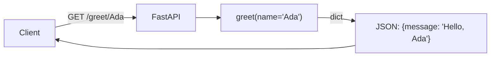
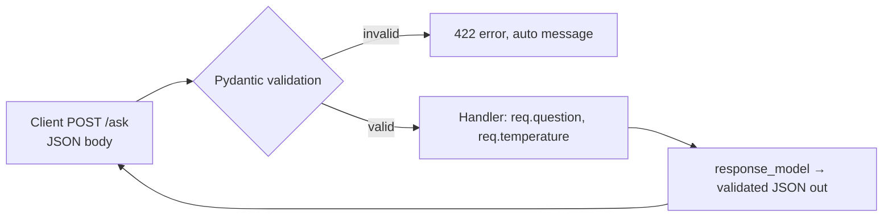
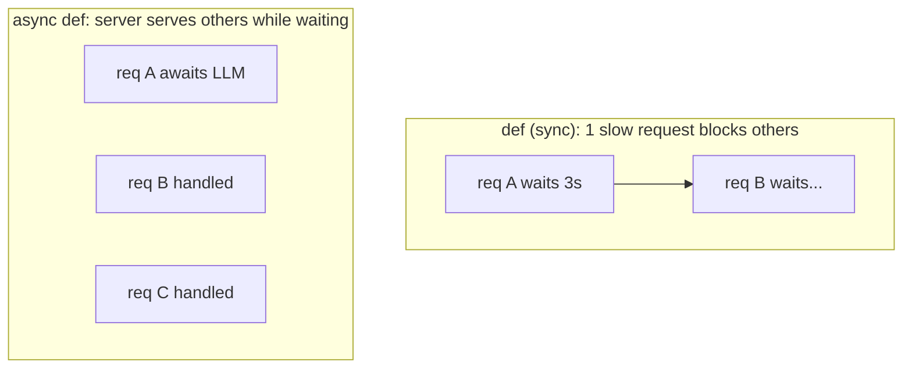
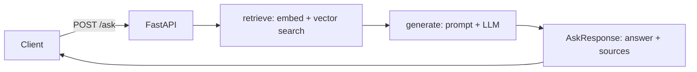
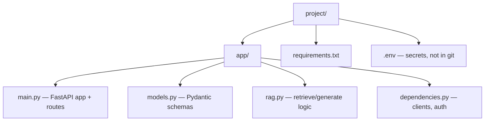
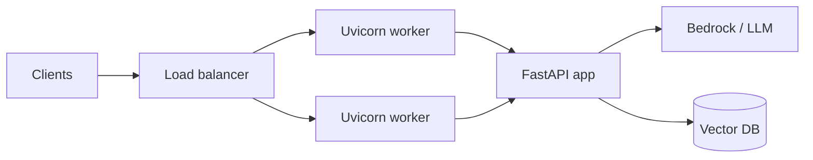

# 23. FastAPI for AI

> **In one sentence:** FastAPI is a modern Python web framework that lets you turn your AI/LLM code into a fast, validated HTTP API in just a few lines — it's the standard way to *serve* Python AI apps.

**Interview goal:** Build and explain a FastAPI service that exposes an LLM/RAG endpoint.

**Prereq:** [22 — Python for AI](22-python-for-ai.md) (type hints, async, dicts).

---

## 23.1 Why FastAPI for AI?

```mermaid
flowchart TD
    F[FastAPI] --> A[Async — great for slow LLM/API calls]
    F --> V[Auto validation via type hints + Pydantic]
    F --> D[Auto interactive docs (Swagger UI)]
    F --> S[Fast + production-ready]
    F --> ST[Streaming responses for LLM tokens]
```

Your model code is Python. FastAPI wraps it in an API so web apps, mobile apps, or other services can call it over HTTP. It's the Python equivalent of the Spring Boot service in your Java hands-on project.

---

## 23.2 Install & run

```bash
pip install "fastapi[standard]" uvicorn

# run (auto-reloads on code changes during dev)
uvicorn main:app --reload --port 8000
```

- **`main`** = the file `main.py`, **`app`** = the FastAPI object inside it.
- **uvicorn** = the ASGI server that actually runs it.
- Open **http://localhost:8000/docs** for auto-generated interactive docs.

---

## 23.3 Your first endpoint

```python
# main.py
from fastapi import FastAPI

app = FastAPI(title="AI Service")

@app.get("/")
def health():
    return {"status": "ok"}          # dict -> JSON automatically

@app.get("/greet/{name}")            # path parameter
def greet(name: str):
    return {"message": f"Hello, {name}"}
```



- `@app.get(...)` = a **decorator** that maps a URL + HTTP method to a function.
- Return a dict/list → FastAPI serializes it to JSON.

---

## 23.4 HTTP methods & parameters

| Method | Use | AI example |
|--------|-----|-----------|
| `GET` | Read data | fetch status, list models |
| `POST` | Send data / create | send a prompt, ask a question |
| `PUT`/`PATCH` | Update | update a document |
| `DELETE` | Remove | delete a document from the KB |

```python
# Path parameter: /docs/42
@app.get("/docs/{doc_id}")
def get_doc(doc_id: int): ...

# Query parameter: /search?q=rag&top_k=5
@app.get("/search")
def search(q: str, top_k: int = 5): ...
```

FastAPI reads your **type hints** to parse and validate: `doc_id: int` rejects `/docs/abc` with a clear 422 error automatically.

---

## 23.5 Request bodies with Pydantic (the key feature)

For POST requests (like sending a prompt), define the shape with a **Pydantic model**. FastAPI validates it for you.

```python
from fastapi import FastAPI
from pydantic import BaseModel, Field

app = FastAPI()

class AskRequest(BaseModel):
    question: str
    temperature: float = Field(0.7, ge=0.0, le=2.0)   # bounded
    top_k: int = 5

class AskResponse(BaseModel):
    answer: str
    sources: list[str] = []

@app.post("/ask", response_model=AskResponse)
def ask(req: AskRequest):
    # req.question is guaranteed to be a valid string here
    answer = f"Echo ({req.temperature}): {req.question}"
    return AskResponse(answer=answer, sources=["doc1", "doc2"])
```



Benefits: invalid input is rejected before your code runs, and the response shape is documented and validated.

---

## 23.6 Async endpoints (why FastAPI shines for AI)

LLM calls take seconds. `async def` lets the server handle other requests while waiting, instead of blocking one at a time.

```python
import httpx

@app.post("/ask")
async def ask(req: AskRequest):
    async with httpx.AsyncClient(timeout=30) as client:
        r = await client.post("https://llm.api/chat",
                               json={"prompt": req.question})
    return {"answer": r.json()["text"]}
```



Rule of thumb: use `async def` when the handler `await`s I/O (LLM, DB, HTTP). Use plain `def` for pure CPU/quick work.

---

## 23.7 Streaming LLM responses

Stream tokens as they're generated so users see output immediately (big UX win).

```python
from fastapi.responses import StreamingResponse

async def token_generator(prompt: str):
    for word in ["Streaming", "tokens", "one", "by", "one"]:
        yield word + " "
        # in real life: yield each chunk from the LLM stream

@app.post("/stream")
async def stream(req: AskRequest):
    return StreamingResponse(token_generator(req.question),
                             media_type="text/plain")
```

---

## 23.8 Dependency injection

Reuse shared resources (a model client, DB connection, auth check) cleanly with `Depends`.

```python
from fastapi import Depends, Header, HTTPException

def get_llm_client():
    # created once per request; could return a cached client
    return {"model": "claude", "region": "us-east-1"}

def verify_api_key(x_api_key: str = Header(...)):
    if x_api_key != "secret":
        raise HTTPException(status_code=401, detail="Invalid API key")

@app.post("/ask")
async def ask(req: AskRequest,
              client=Depends(get_llm_client),
              _=Depends(verify_api_key)):
    return {"answer": f"{client['model']} says hi"}
```

- **Dependencies** keep handlers clean and make testing/mocking easy.
- Great for auth, config, and shared clients.

---

## 23.9 Error handling

```python
from fastapi import HTTPException

@app.get("/docs/{doc_id}")
def get_doc(doc_id: int):
    doc = db.get(doc_id)
    if doc is None:
        raise HTTPException(status_code=404, detail="Document not found")
    return doc
```

| Status | Meaning |
|--------|---------|
| 200 | OK |
| 400 | Bad request |
| 401 / 403 | Unauthorized / forbidden |
| 404 | Not found |
| 422 | Validation error (FastAPI auto) |
| 429 | Too many requests (rate limit) |
| 500 | Server error |

---

## 23.10 A realistic RAG endpoint

Putting the pieces together — this mirrors the RAG flow from [06 — RAG Fundamentals](06-rag-fundamentals.md).

```python
from fastapi import FastAPI, Depends, HTTPException
from pydantic import BaseModel, Field

app = FastAPI(title="RAG Service")

class AskRequest(BaseModel):
    question: str = Field(..., min_length=3)
    top_k: int = Field(5, ge=1, le=20)

class Source(BaseModel):
    title: str
    score: float

class AskResponse(BaseModel):
    answer: str
    sources: list[Source]

async def retrieve(question: str, top_k: int) -> list[Source]:
    # 1. embed question  2. vector search  3. return top_k chunks
    return [Source(title="policy.pdf", score=0.91)]

async def generate(question: str, sources: list[Source]) -> str:
    # build grounded prompt + call the LLM
    return f"Based on {len(sources)} sources: ..."

@app.post("/ask", response_model=AskResponse)
async def ask(req: AskRequest):
    sources = await retrieve(req.question, req.top_k)
    if not sources:
        raise HTTPException(404, "No relevant documents found")
    answer = await generate(req.question, sources)
    return AskResponse(answer=answer, sources=sources)
```



---

## 23.11 Project structure & config



```python
# config with pydantic-settings (reads from env / .env)
from pydantic_settings import BaseSettings

class Settings(BaseSettings):
    aws_region: str = "us-east-1"
    model_id: str = "anthropic.claude-3-haiku"
    class Config:
        env_file = ".env"

settings = Settings()
```

---

## 23.12 Testing

```python
# pip install pytest httpx
from fastapi.testclient import TestClient
from main import app

client = TestClient(app)

def test_health():
    r = client.get("/")
    assert r.status_code == 200

def test_ask_validation():
    r = client.post("/ask", json={"question": "hi"})   # too short
    assert r.status_code == 422
```

---

## 23.13 Production notes

- **Server:** run with multiple workers, e.g. `uvicorn main:app --workers 4` (or Gunicorn + Uvicorn workers).
- **Docker:** containerize for consistent deploys.
- **CORS:** add `CORSMiddleware` if a browser frontend calls your API.
- **Rate limiting & timeouts** on LLM calls (protect cost & availability — see [21](21-cost-optimization.md)).
- **Auth:** API keys or OAuth via dependencies; never expose model keys to clients.
- **Observability:** log request IDs, latency, tokens (see [15](15-ai-evaluation-observability.md)).
- **Security:** validate all input, keep secrets in env/secrets manager (see [14](14-ai-security.md)).



---

## Practical / Interview Goal

✅ **Build and explain a FastAPI AI endpoint.**
> "FastAPI turns my Python AI code into an HTTP API. I define request/response shapes with Pydantic models so input is validated automatically and documented in Swagger UI. I use `async def` handlers because LLM and vector-DB calls are I/O-bound, so the server stays responsive under load. A `/ask` endpoint retrieves context, calls the model, and returns a validated response with sources — and I can stream tokens with StreamingResponse. Cross-cutting concerns like auth, shared clients, timeouts, and rate limits go through dependency injection, with secrets in env vars and logging for observability."

---

## Resources

- [FastAPI documentation](https://fastapi.tiangolo.com/) *(rephrased for compliance)*
- [Pydantic documentation](https://docs.pydantic.dev/) *(rephrased for compliance)*
- Related: [22 — Python for AI](22-python-for-ai.md), [06 — RAG Fundamentals](06-rag-fundamentals.md), [18 — Hands-on](18-handson-mock-revision.md)
- Back to [README / index](README.md)
