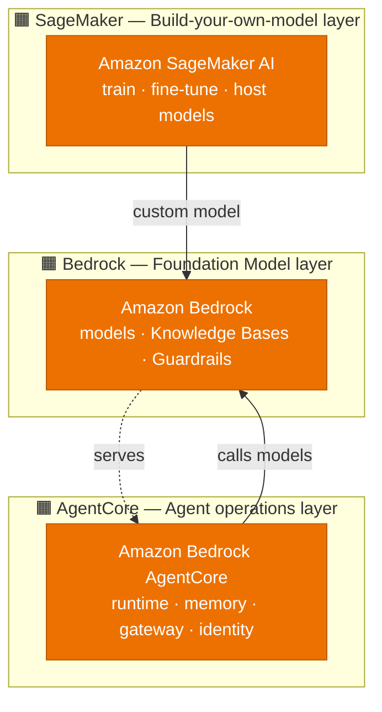
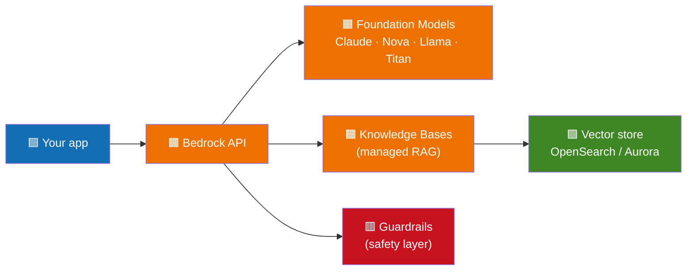
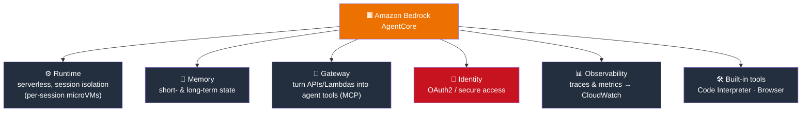
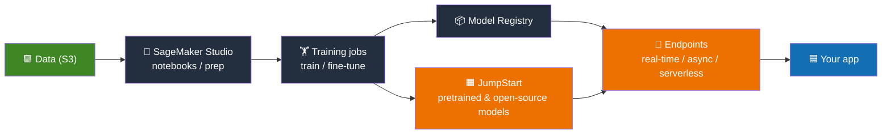
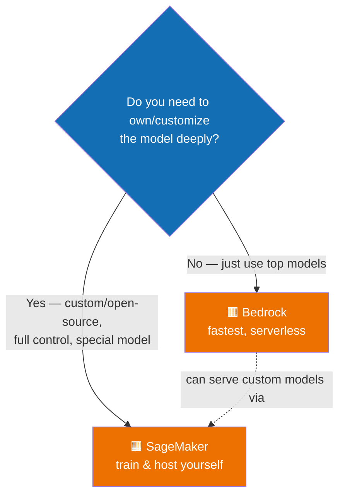
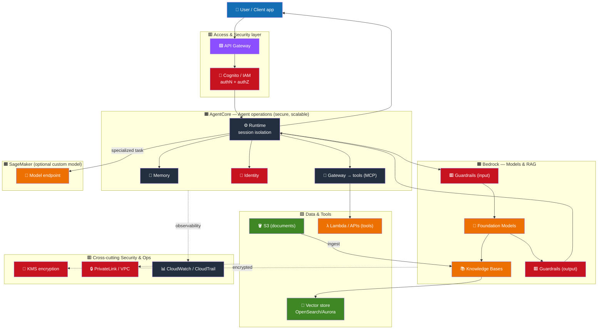
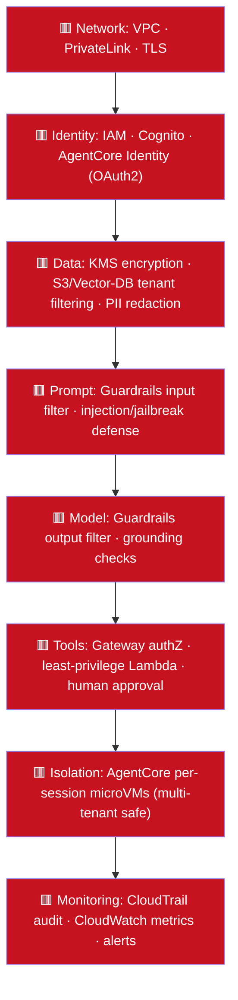
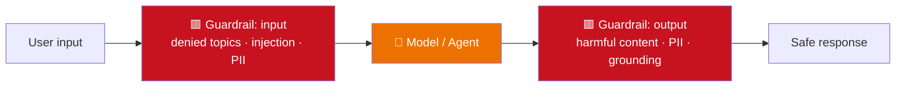
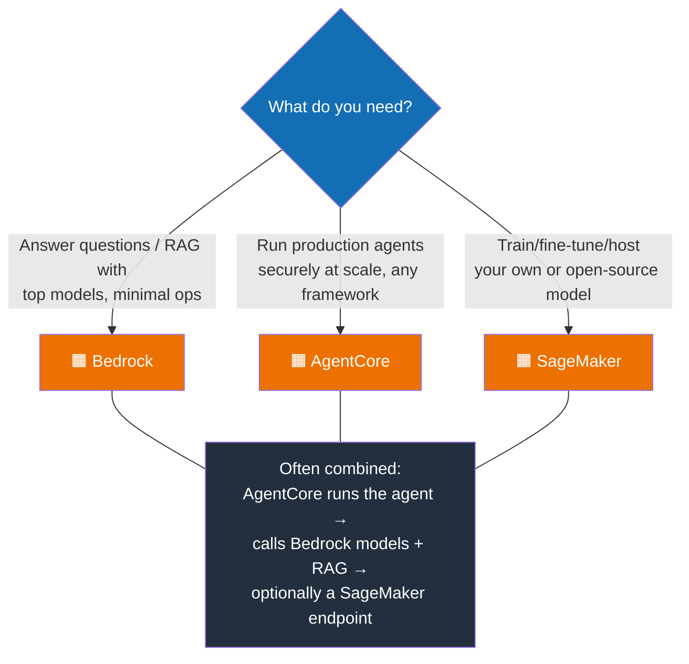

# 24. AWS GenAI Stack — Bedrock, AgentCore & SageMaker

> **In one sentence:** AWS gives you three layers for AI — **Bedrock** (use foundation models + managed GenAI features), **AgentCore** (deploy and operate AI agents securely at scale), and **SageMaker** (build, train, and host your own ML/AI models) — and they work together end to end.

**Interview goal:** Explain what each service does, when to use which, and draw a secure end-to-end AWS GenAI architecture with guardrails.

> **Diagram note:** The diagrams use AWS-style color coding and icon-emojis so they read like AWS architecture diagrams in any Mermaid viewer. Orange 🟧 = AI/ML services, blue 🟦 = compute/app, green 🟩 = storage/data, red 🟥 = security.

---

## 24.1 The three layers at a glance

| Layer | Service | Use when you want to… | Effort |
|-------|---------|------------------------|--------|
| **Consume models** | **Bedrock** | Call ready foundation models, add RAG + guardrails | Lowest |
| **Operate agents** | **AgentCore** | Run agents in production securely at scale | Medium |
| **Own the model** | **SageMaker** | Train/fine-tune/host custom or open-source models | Highest |

> **Mental model:** Bedrock = "rent a brain." SageMaker = "build your own brain." AgentCore = "give the brain hands, memory, and a secure workplace."

---

## 24.2 Amazon Bedrock (recap + focus)

Bedrock is the **serverless gateway to foundation models** plus managed GenAI building blocks. (Full detail in [13 — AWS Bedrock](13-aws-bedrock.md).)

Key concepts:
- **Foundation models** via one API (text, embeddings, image, multimodal).
- **Knowledge Bases** = managed RAG (ingest, chunk, embed, retrieve).
- **Guardrails** = configurable safety (denied topics, PII, content filters, grounding checks).
- **Model customization** = fine-tuning / continued pre-training (see [19](19-fine-tuning-customization.md)).
- **Data privacy** = your data isn't used to train the base models.

---

## 24.3 Amazon Bedrock AgentCore

**AgentCore** is a set of services to **securely deploy and operate AI agents at scale** — it removes the months of infra work (session management, identity, memory, observability) so you focus on the agent's logic. It is **framework-agnostic** (works with agents built in LangGraph, CrewAI, Strands, etc.) and **model-agnostic**.

> Content rephrased from AWS announcements for licensing compliance.

### Why it exists
Building a demo agent is easy; running one in production needs session isolation, memory, secure tool access, identity, and observability. AgentCore provides these as modular, managed building blocks.

### Core components

| Component | What it does | Maps to concept in… |
|-----------|--------------|---------------------|
| **Runtime** | Serverless agent execution with **per-session isolation** and fast cold starts | [10 Agents](10-ai-agents.md), [17 Multi-Tenant](17-multi-tenant-ai.md) |
| **Memory** | Managed short-term (session) and long-term memory | [10 Agents §10.6](10-ai-agents.md) |
| **Gateway** | Converts existing APIs/Lambdas into agent tools, often via **MCP** | [11 Agentic](11-agentic-architecture.md), [12 MCP](12-mcp.md) |
| **Identity** | Secure identity & access (OAuth2) for agents and tools | [14 Security](14-ai-security.md) |
| **Observability** | Built-in tracing/metrics to **CloudWatch** | [15 Observability](15-ai-evaluation-observability.md) |
| **Code Interpreter / Browser** | Sandboxed tools so agents can run code / browse the web | [11 Agentic](11-agentic-architecture.md) |

### Bedrock Agents vs AgentCore (common confusion)
- **Bedrock Agents** — a managed way to *build* an agent inside Bedrock (action groups + KB + guardrails). Great for simpler, Bedrock-native agents. (See [11](11-agentic-architecture.md).)
- **AgentCore** — infrastructure to *operate* agents (any framework/model) securely at scale: runtime isolation, memory, gateway, identity, observability. Use it when you need production-grade ops and portability.

---

## 24.4 Amazon SageMaker AI

**SageMaker** is the full **ML platform** for when you want to build, train, fine-tune, and host your own models (including open-source LLMs) rather than only consuming Bedrock's.

Key concepts:
- **Studio** — IDE for notebooks, data prep, experiments.
- **Training jobs** — managed, scalable training/fine-tuning on GPUs.
- **JumpStart** — deploy/fine-tune popular open-source and foundation models.
- **Model Registry** — version and govern models.
- **Endpoints** — host models for inference (real-time, async, serverless, batch).
- **Pipelines** — MLOps automation (build → train → deploy).

### When Bedrock vs SageMaker?

- **Bedrock** — you want managed, top-tier models with minimal ops.
- **SageMaker** — you need a specific/open-source model, deep customization, or to host your own weights. A SageMaker-trained model can also be imported into Bedrock.

---

## 24.5 End-to-end architecture (all three + security)

This is the diagram to be able to draw. It shows a user request flowing through security, an agent operated by AgentCore, using Bedrock models + RAG, with a custom SageMaker model available, and guardrails/observability wrapping everything.

### Reading the flow (step by step)
1. **User → API Gateway → Cognito/IAM** — request enters through a secured edge; authenticate and authorize (derive tenant/user identity here).
2. **AgentCore Runtime** — runs the agent in an isolated session; pulls **Memory** and verifies **Identity**.
3. **Gateway → Lambda/APIs** — the agent calls tools securely (often via MCP).
4. **Input Guardrails → Foundation Model** — the prompt passes safety checks, then the Bedrock model reasons.
5. **Knowledge Bases → Vector store** — RAG retrieves relevant chunks (documents ingested from **S3**).
6. **SageMaker endpoint** — for a specialized task, the agent calls a custom-hosted model.
7. **Output Guardrails** — the response is checked (PII, harmful content, grounding) before returning.
8. **KMS / PrivateLink / CloudWatch / CloudTrail** — encryption, private networking, and full observability/audit wrap the whole system.

---

## 24.6 Security & Guardrails across the stack

Security is layered (defense in depth — see [14 — AI Security](14-ai-security.md)). Here's how each AWS piece contributes.

| Layer | AWS mechanism |
|-------|---------------|
| **Network** | VPC, **PrivateLink** (traffic never touches the public internet), TLS |
| **Identity** | **IAM** least privilege, **Cognito** for users, **AgentCore Identity** (OAuth2) for agents/tools |
| **Data** | **KMS** encryption at rest, S3/vector-DB **tenant filtering**, **Guardrails PII** redaction |
| **Prompt** | **Bedrock Guardrails** input filters block denied topics, injection, jailbreaks (see [14 §14.2/§14.2.1](14-ai-security.md)) |
| **Model output** | Guardrails **content filters** + **contextual grounding checks** (anti-hallucination) |
| **Tools** | **AgentCore Gateway** authorization, least-privilege **Lambda** roles, human-in-the-loop for risky actions |
| **Isolation** | **AgentCore Runtime** per-session microVMs → strong tenant isolation |
| **Audit/Monitor** | **CloudTrail** (audit), **CloudWatch** (metrics/logs/alarms), AgentCore Observability |

### Guardrails focus (the safety net)

Bedrock Guardrails can be attached to models, Bedrock Agents, and used alongside AgentCore, giving one consistent policy layer.

---

## 24.7 Choosing the right service (decision guide)

- Start with **Bedrock** for most GenAI apps.
- Add **AgentCore** when agents go to production and need isolation, memory, secure tools, identity, and observability.
- Bring in **SageMaker** when you must own the model (custom/open-source, deep tuning, special hosting).

---

## Practical / Interview Goal

✅ **Explain and draw the AWS GenAI stack end to end.**
> "AWS gives me three layers. Bedrock is the serverless gateway to foundation models with managed RAG (Knowledge Bases) and Guardrails. AgentCore operates agents in production — Runtime with per-session isolation, Memory, Gateway to expose tools via MCP, Identity for secure access, and built-in Observability — and it's framework- and model-agnostic. SageMaker is for when I need to train, fine-tune, or host my own model. End to end: a user hits API Gateway with Cognito/IAM auth; AgentCore Runtime runs the agent, loads memory, and calls tools through Gateway; the prompt passes input Guardrails to a Bedrock model that does RAG over a vector store fed from S3, with an optional SageMaker endpoint for specialized tasks; output Guardrails check the response; and KMS, PrivateLink, CloudTrail, and CloudWatch wrap the whole thing for encryption, private networking, audit, and observability."

---

## Resources

- [Amazon Bedrock AgentCore — developer guide](https://docs.aws.amazon.com/bedrock-agentcore/latest/devguide/) *(rephrased for compliance)*
- [Introducing Amazon Bedrock AgentCore (AWS blog)](https://aws.amazon.com/blogs/aws/introducing-amazon-bedrock-agentcore-securely-deploy-and-operate-ai-agents-at-any-scale/) *(rephrased for compliance)*
- [Amazon SageMaker AI documentation](https://docs.aws.amazon.com/sagemaker/) *(rephrased for compliance)*
- [Amazon Bedrock documentation](https://docs.aws.amazon.com/bedrock/latest/userguide/what-is-bedrock.html) *(rephrased for compliance)*
- Related: [13 — AWS Bedrock](13-aws-bedrock.md), [11 — Agentic Architecture](11-agentic-architecture.md), [12 — MCP](12-mcp.md), [14 — AI Security](14-ai-security.md), [19 — Fine-Tuning](19-fine-tuning-customization.md)
- Back to [README / index](README.md)
